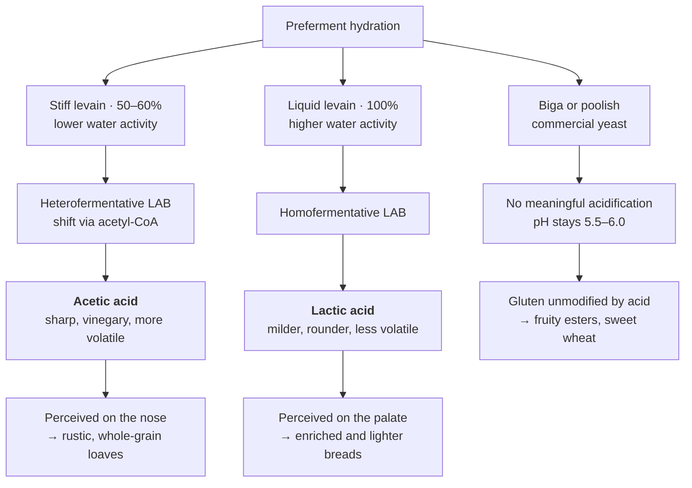

# Acidity: Lactic vs. Acetic and the Hydration Effect

The type and intensity of acid produced in a sourdough preferment is strongly influenced by hydration. This is one of the most important practical levers a baker has.

## Stiff Levain → Acetic Acid Dominance

In a stiff levain, the lower water activity favours heterofermentative LAB metabolism. These organisms shift toward acetic acid production via acetyl-CoA pathways when water is limiting. The result is a sharper, more vinegary tang. Acetic acid is more volatile than lactic acid, so it is perceived more intensely by the nose. This character works well in hearty, rustic loaves — country breads with whole grain or high-extraction flours where the sharpness reads as complexity rather than harshness.

## Liquid Levain → Lactic Acid Dominance

In a liquid levain, higher water activity promotes homofermentative LAB metabolism, which produces primarily lactic acid. Lactic acid is milder, rounder, and less volatile. It is perceived mainly on the palate rather than the nose. This gentler acidity is often preferred for enriched doughs, lighter breads, or applications where you want the acid to stay in the background and let wheat flavour, butter, or other ingredients come forward.

**The hydration choice also has a thermal consequence.** Lower water activity does not only shift LAB metabolism toward acetic acid — it makes the matrix itself protective against heat, because irreversible protein unfolding and membrane disordering are both water-mediated. A stiff levain is therefore the more heat-tolerant levain as well as the sharper one. This matters only if hot builds are in use; see chapter 11, *Water Activity: The Matrix Is a Thermal Protectant*.

## Commercial Yeast: Minimal Acidification

Neither biga nor poolish produces meaningful acidification. The dough remains near neutral pH (5.5–6.0), which means gluten behaviour is not modified by acid, and the flavour profile stays in the realm of yeast-derived aromatics: fruity esters, mild alcohols, and a sweet wheaty character from enzymatic starch breakdown (especially prominent in the wetter poolish).

---

<!-- nav -->
[← 03 Microbiology: Monoculture vs. Mixed Consortium](03-microbiology-monoculture-vs-mixed-consortium.md) · [Contents](../README.md) · [05 Gluten: Structure, Modification, and Why It Matters →](05-gluten-structure-modification-and-why-it-matters.md)
