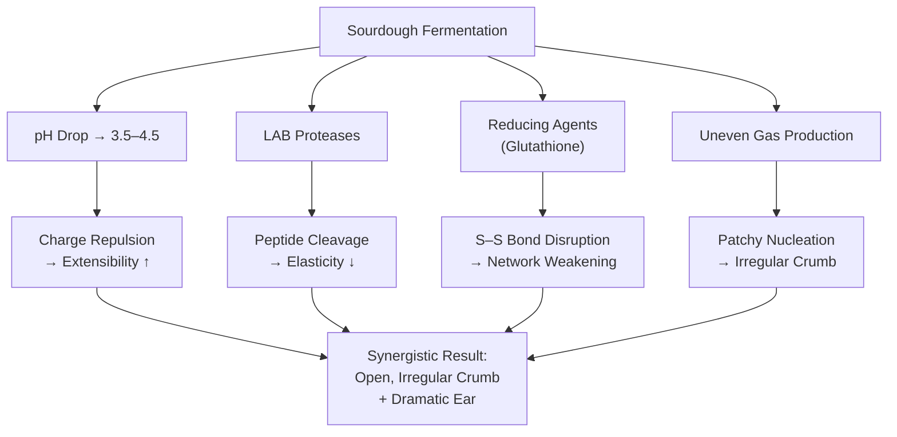

# Gluten: Structure, Modification, and Why It Matters

To understand why preferment choice affects dough handling and crumb structure so profoundly, it helps to look at what gluten actually is at a molecular level, and how acid, proteases, and fermentation kinetics each modify it through different mechanisms.

## What Gluten Is: Glutenin and Gliadin

Gluten is not a single protein. It is a viscoelastic network formed by the interaction of two families of storage proteins found in wheat endosperm: **glutenins** and **gliadins**. These proteins are insoluble in water and only begin to interact when flour is hydrated and mechanically worked.

**Glutenin** molecules are very large polymeric proteins. Individual glutenin subunits (both high-molecular-weight, HMW, and low-molecular-weight, LMW) link end-to-end via **intermolecular disulfide bonds** (covalent S–S bridges between cysteine residues) to form enormous chain-like macropolymers. These glutenin polymers are responsible for dough’s **elasticity** — its ability to resist deformation and snap back after stretching. Think of them as long, interconnected springs. When you stretch the dough, the glutenin network stores energy; when you release, it pulls back.

**Gliadin** molecules are smaller, monomeric (single-chain) proteins that do not form intermolecular disulfide bonds. Instead, they have **intramolecular** disulfide bonds (internal S–S bridges within the same molecule) that give them a compact, globular shape. Gliadins sit within the glutenin network and act as a plasticiser — they allow the network to flow and stretch without breaking. They are responsible for dough’s **extensibility** and viscous flow. Think of them as lubricant between the springs.

The balance between glutenin (elastic, spring-like) and gliadin (extensible, lubricant-like) determines the dough’s overall rheological character. A high glutenin-to-gliadin ratio gives a strong, elastic, snap-back dough (typical of high-protein bread flour). A lower ratio gives a softer, more extensible dough (typical of Tipo 00 or pastry flour). Every modification that preferments introduce — acid, proteases, hydration changes — shifts this balance.

## The Disulfide Bond Network

The structural backbone of the gluten network is the **disulfide bond** (S–S). These covalent bonds form between the thiol groups (–SH) of cysteine residues on adjacent glutenin subunits. During mixing and kneading, mechanical energy brings glutenin subunits into proximity, and oxidation drives thiol–disulfide exchange reactions that build the network progressively. This is why dough develops strength during mixing: you are physically and chemically assembling the polymer network.

The disulfide network is not static. It undergoes continuous thiol–disulfide interchange — existing S–S bonds break and reform with new partners — which allows the network to reorganise under stress. This dynamic exchange is what gives well-developed dough its ability to be stretched, folded, and reshaped without permanent damage. It is also why the network is vulnerable to chemical and enzymatic disruption: anything that attacks cysteine residues or cleaves the peptide backbone near them can weaken or fragment the network.

## How Acid Modifies Gluten: Charge State and Hydration

Gluten proteins are amphoteric — they carry both positive (amino, –NH₃⁺) and negative (carboxyl, –COO⁻) charged groups on their side chains, and the net charge depends on pH. At neutral pH (~6.0), the proteins are near their isoelectric point, where positive and negative charges roughly balance. This allows glutenin chains to pack relatively closely via hydrophobic interactions, hydrogen bonds, and electrostatic attractions, producing a tight, elastic network.

As pH drops during sourdough fermentation (toward 3.5–4.5), carboxyl groups become protonated (–COOH, losing their negative charge) while amino groups remain protonated (–NH₃⁺, retaining their positive charge). The protein carries a progressively higher **net positive charge**. This has two important effects.

First, **electrostatic repulsion** between positively charged protein chains increases. The glutenin polymers push apart, loosening the network. The dough becomes more extensible — it stretches more readily because the chains are not held together as tightly. But it also becomes less elastic, because the restoring force that snaps the dough back is weakened.

Second, the change in charge affects **water binding**. At higher net charge, the proteins interact differently with water molecules, altering hydration dynamics within the network. This contributes to the different ‘feel’ of sourdough dough — often described as silky or slack compared to the more springy texture of a commercial yeast dough at the same hydration.

These charge effects are continuous and proportional to pH. A mildly acidic dough (pH 5.0, as in a hybrid with 10–15% levain) experiences a modest shift — slightly more extensible, slightly less elastic. A fully fermented sourdough (pH 3.8) experiences a dramatic shift. This is why levain percentage in a hybrid formula directly controls the rheological outcome.

## How Proteases Degrade Gluten: Enzymatic Cleavage

**Proteases** are enzymes that hydrolyse (cleave) peptide bonds in the protein backbone. In a sourdough system, proteases come from two sources: the LAB culture itself (extracellular proteases secreted by *Lactobacillus* species), and endogenous flour proteases that are activated by the acidic environment.

These proteases do not attack randomly. They have preferences for specific peptide bond contexts — certain amino acid sequences adjacent to the cleavage site. But the net effect on the gluten network is the same regardless of specificity: each cleavage event **cuts a glutenin polymer chain**. This reduces the average molecular weight of the glutenin macropolymer, which directly reduces the network’s connectivity and elasticity.

Think of it as cutting links in a chain-mail mesh. Early cuts have minimal effect on overall integrity — the mesh still holds. But as cuts accumulate, the mesh develops weak spots and eventually loses coherence in localised areas. In dough terms, this means the cell walls between gas bubbles become thinner and weaker. During proofing and oven spring, gas pressure exploits these weak spots: thin walls rupture, adjacent bubbles coalesce, and you get the large, irregular alveoli characteristic of sourdough crumb.

Crucially, proteolytic degradation is **time-dependent**. The enzymes work continuously throughout fermentation. A 4-hour bulk ferment produces modest degradation; a 12-hour bulk followed by a 48-hour cold retard produces extensive degradation. The acid environment actually amplifies this effect because flour’s endogenous proteases (particularly aspartic proteases) have pH optima in the acidic range — they are more active at pH 3.5–4.5 than at neutral pH. So sourdough fermentation both introduces exogenous proteases (from the LAB) and activates endogenous ones (from the flour), creating a double hit on the gluten network that intensifies with time.

This is the core tension for pizza: moderate proteolysis adds extensibility and makes stretching easier, but excessive proteolysis makes the dough fragile and tear-prone. The line between these two outcomes is thin, and long fermentation pushes you past it.

## Reduction of Disulfide Bonds

Beyond peptide bond cleavage, some LAB metabolites can directly attack the disulfide bonds that hold the glutenin network together. Glutathione (GSH), a thiol-containing tripeptide present in both yeast and bacterial cells, participates in thiol–disulfide exchange with glutenin’s S–S bonds. This effectively ‘unzips’ interchain crosslinks without cutting the peptide backbone. The result is a loss of network connectivity even in regions where the protein chains themselves are intact. Extended fermentation increases the cumulative exposure to reducing agents, progressively weakening the network.

## Fermentation Kinetics and Gas Distribution

Commercial *S. cerevisiae* produces CO₂ at a relatively uniform rate, especially during proofing. The gas nucleation is even, bubble size distribution is narrow, and the crumb develops as a regular, fine-celled foam. Sourdough fermentation is inherently less uniform: multiple organisms with different growth curves, different temperature optima, and competitive dynamics produce CO₂ at variable rates. Gas nucleation is patchy, some regions of the dough inflate faster than others, and the combination of uneven gas production with an already weakened gluten network produces the characteristic irregular, wild crumb.

These modifications converge during oven spring. pH-modified charge state, proteolytic chain cleavage, disulfide reduction, and uneven gas production each push the dough toward irregular expansion through different mechanisms, and their effects are synergistic rather than additive — which is why sourdough produces dramatic ears and open, irregular crumb where commercial yeast produces controlled, even rise. The oven-spring mechanics are treated in full in a dedicated section later in this document.

---

<!-- nav -->
[← 04 Acidity: Lactic vs. Acetic and the Hydration Effect](04-acidity-lactic-vs-acetic-and-the-hydration-effect.md) · [Contents](../README.md) · [06 Time-Dependent Gluten Development: Why Folding Is a Shortcut, Not a Requirement →](06-time-dependent-gluten-development.md)
