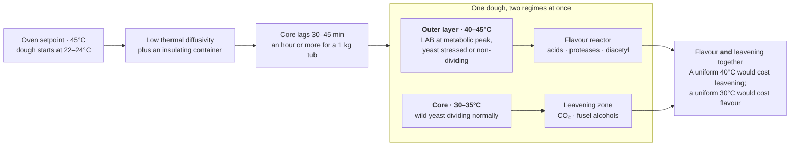

# Thermal Lag: The Oven Setpoint Is Not the Dough Temperature

A critical and frequently overlooked variable in high-temperature fermentation is the difference between the ambient temperature of the proofing environment and the **actual temperature inside the dough mass**. Dough has low thermal diffusivity — similar to water (roughly 1.4 × 10⁻⁷ m²/s) — and a plastic container adds an additional insulating layer. The result is significant **thermal lag**: the core of the dough reaches the oven setpoint much later than the surface, and the volumetric average temperature across the dough mass is lower than the setpoint for most or all of the fermentation.

## The Thermal Ramp in Practice

Consider a levain build starting at room temperature (22–24°C), placed in a proofing environment set to 45°C inside a plastic container. The surface of the dough starts warming immediately through conduction and convection from the air. But the core lags behind, heating only through slow conduction through the dough mass itself.

For a typical levain container (200–300g of dough in a jar), the **centre may not reach the oven setpoint for 30–45 minutes**, depending on container geometry, wall thickness, and dough mass. For a full dough batch of 1kg+ in a thick-walled plastic tub, the core could lag by an hour or more. A “1 hour at 40°C+” levain build is therefore actually more like: the surface at 40°C+ for most of the hour, but the core spending the first half at 25–35°C and only approaching the setpoint toward the end. The volumetric average temperature across the build is probably **30–38°C** — right in the productive stress zone where yeast is stressed but fully functional, well below the thermal kill threshold.

The same applies to a 2-hour bulk at 40°C+. A kilogram of dough in a plastic tub at an oven setting of 45°C probably has a core temperature that spends the first hour climbing through the 25–38°C range and only reaches the setpoint in the second hour. The outer layers are hotter, the core is cooler, and the **time-weighted volumetric average is significantly lower than the setpoint for the entire duration**.

## Gradient Fermentation: Two Zones, One Dough

The temperature gradient across the dough creates what is effectively a **gradient fermentation** — different zones of the dough running different fermentation regimes simultaneously.

The **outer layer**, at 40–45°C, functions as an **LAB-dominant flavour reactor**. Yeast are stressed or non-dividing, but LAB are at or near their metabolic peak. Acid production, protease secretion, and LAB-derived flavour metabolites (diacetyl, acetaldehyde, organic acids) are all running at maximum rate. This zone contributes disproportionately to the flavour complexity of the levain.

The **core**, still at 30–35°C, functions as a **yeast-friendly leavening zone**. Wild yeast are dividing normally, producing CO₂ and alcohols (including fusel alcohols via the Ehrlich pathway) with moderate LAB activity. This zone contributes the gas production that ultimately leavens the bread.

The spatial separation means the baker gets both: **intense LAB-driven flavour production and robust yeast-driven leavening** from the same dough at the same time. A uniform 40°C throughout would sacrifice leavening for flavour. A uniform 30°C throughout would sacrifice flavour intensity for leavening. The gradient gives both, and the plastic container that causes the gradient is an accidental but effective fermentation bioreactor.

## Implications for the Thermotolerance Question

Thermal lag substantially changes the interpretation of the yeast thermotolerance question raised in the preceding sections. If the core of the dough mass never actually reaches 40°C during a “40°C+” build (or reaches it only briefly at the end), then the wild yeast population may never have experienced the temperatures that the oven setpoint implies. The leavening observed in the final bread might come from perfectly ordinary mesophilic yeast that were insulated from the heat by the dough mass around them — not from exceptionally thermotolerant organisms.

This does not invalidate the domestication hypothesis entirely. The outer layers of the dough **are** experiencing temperatures above 40°C, and the organisms in those layers are under genuine thermal selection pressure. When the dough is folded, shaped, or transferred, these peripheral organisms re-mix into the bulk. Over many cycles, this edge-zone heat exposure would still drive some species-level selection. But the magnitude of the selection pressure is softer than the oven setpoint suggests, and the yeast survival question is much less paradoxical than it initially appeared.

## Verifying Actual Dough Temperature

The thermal lag can be measured directly with a probe thermometer inserted into the centre of the dough mass and logged over the duration of the build. This produces a time-temperature curve that reveals: how long the core takes to reach the oven setpoint (if it reaches it at all), what the time-weighted average temperature actually is, and how large the gradient is between surface and core. For most home-scale levain builds and dough batches in plastic containers at 40–50°C oven settings, the core temperature is likely 5–15°C below the setpoint for the majority of the fermentation.

## To Stir or Not to Stir: Homogenising the Thermal Gradient

Stirring the levain during a hot build eliminates the thermal gradient by replacing slow conduction with convective mixing. The warm outer layer mixes with the cool core, and the dough reaches a uniform temperature close to the oven setpoint much faster. A couple of stirs during a 1-hour build could halve the time required to reach target temperature. But whether this is desirable depends on what the baker is optimising for.

### The Case Against Stirring: Preserve the Gradient

The thermal gradient is, in effect, a dual-zone bioreactor. The hot shell produces flavour; the cool core produces gas. Stirring collapses these two zones into one, and every organism experiences the same temperature simultaneously. If that temperature is genuinely 40°C+, the entire yeast population is pushed into thermal stress at once rather than just the periphery. This may reduce leavening capacity — especially if the yeast population is mesophilic and relies on the cool core as a refuge.

If the current protocol (unstirred, with thermal lag) produces good results, the gradient may be an essential part of why it works. Disrupting it by stirring could shift the balance toward more LAB dominance and less yeast activity, producing a more acidic but potentially under-leavened result.

### The Case for Stirring: Uniform Control

If the baker **knows** their culture contains thermotolerant yeast (through the experiments described earlier — extending hot bulk duration, checking whether the levain doubles during a hot build), then eliminating the gradient is safe and gives more precise control. A uniform 38°C levain produces a more predictable metabolite profile than a gradient ranging from 25°C at the core to 45°C at the surface. For bakers who want to dial in a specific acid profile or ester balance, uniformity is preferable.

### The Oxygen Effect of Stirring

Each stir also incorporates air into the levain, which has metabolic consequences independent of the temperature effect. Dissolved oxygen promotes **oxidative cross-linking** of gluten (beneficial for network development), and provides a burst of oxygen to yeast metabolism. Yeast are facultative anaerobes — in the presence of oxygen, they shift partially toward respiratory metabolism, which produces more biomass (larger population) but fewer fermentation byproducts (fewer fusel alcohols, fewer esters). Stirring therefore trades some flavour precursor production for a larger yeast population. Whether this trade is worthwhile depends on whether leavening or flavour is the limiting factor in the current protocol.

### Practical Recommendation

If the current unstirred hot build produces well-risen bread with good flavour, **do not change it**. The thermal gradient is likely contributing to the result in ways that would be difficult to replicate through uniform-temperature fermentation. The gradient is an accidental feature that happens to optimise both flavour and leavening simultaneously.

If the baker wants to experiment with stirring, a single stir at the halfway point of the levain build is a reasonable starting point. This partially homogenises the temperature without fully collapsing the gradient, and the air incorporation provides a moderate oxygen boost. Compare the resulting bread to the unstirred version: if leavening is unchanged and flavour is different (more or less acid, different aromatic profile), the gradient was contributing meaningfully and stirring should be used selectively rather than routinely.

A biga is inoculated with pure *S. cerevisiae* and produces nuanced yeast-driven aromatics without significant acidification. A stiff levain is a mixed-culture system where wild yeast and LAB coexist, producing the full acid, protease, and mixed-fermentation package. You can think of a biga as what you would get if you took a stiff levain and swapped the entire consortium for a single domesticated strain — same vessel, same hydration, completely different ecology.

---

<!-- nav -->
[← 09 The Kveik Parallel: Domestication Through Selective Pressure](09-the-kveik-parallel-domestication-through-selective-pressure.md) · [Contents](../README.md) · [11 Thermal Death Kinetics and Culture Recovery →](11-thermal-death-kinetics-and-culture-recovery.md)
