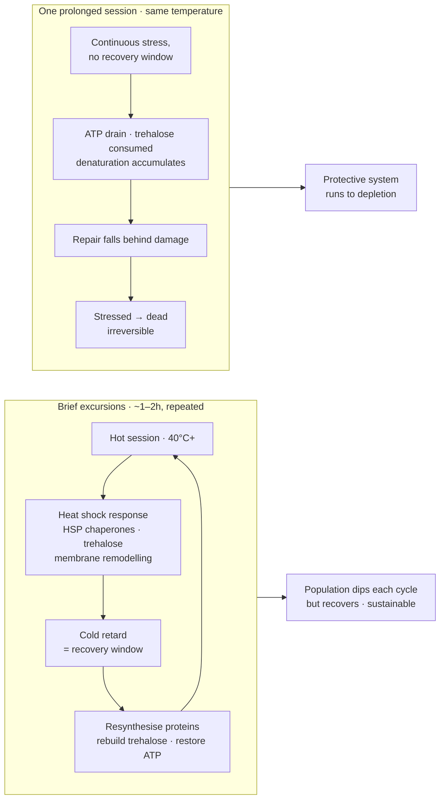

# Thermal Death Kinetics and Culture Recovery

The preceding chapters document where the thermal limits of a sourdough culture *are not* — brief excursions to 40°C+ that the literature predicts should be lethal, but which in practice produce well-leavened bread. This chapter documents where the limits actually are. The distinction between a survivable hot session and a lethal one is not temperature. It is **duration**, and the mechanism is the exhaustion of a protective response that is transient by design.

## The Observation

A working protocol of repeated brief excursions to 40°C+ — levain builds of roughly one hour, bulk fermentation of roughly two hours, each followed by a cold retard — sustained over several days without apparent harm. A single prolonged session at the same temperature then killed, or very nearly killed, the culture.

This is not a contradiction. It is the expected behaviour of a system whose thermal tolerance is time-limited.

## Thermal Death Is a Rate, Not a Threshold

Microbial thermal inactivation follows first-order kinetics. Population decline is exponential with **time at temperature**, not a step function that triggers at some critical value. The standard descriptors are:

- **D-value** — the time required at a given temperature to reduce the viable population by 90% (one log reduction).
- **z-value** — the temperature increase required to reduce the D-value tenfold.

The practical consequence is that there is no single "death temperature" for a yeast strain. There is a family of time–temperature combinations, each producing a given log reduction. Ten minutes at 45°C and two hours at 42°C may produce comparable kill. A protocol that specifies only a temperature specifies nothing useful about survival.

This alone explains the observation. Brief sessions sat at a low point on the inactivation curve; the prolonged session integrated far more lethality at the same nominal temperature.

## The Heat Shock Response Is Transient and Exhaustible

The deeper mechanism is that the protective machinery has a finite budget.

When yeast encounters heat stress it mounts a coordinated heat shock response: upregulation of HSP chaperones that refold denaturing proteins, accumulation of intracellular trehalose that stabilises both proteins and membranes, and remodelling of membrane lipid composition toward greater thermal stability. This is a genuinely effective defence — Morano et al. (2012) document that a mild pre-shock at 37°C induces tolerance to temperatures that would otherwise be immediately lethal.

But this state is **not free and not permanent**:

- Maintaining chaperone activity is **ATP-dependent**. Chaperone-mediated refolding consumes energy continuously.
- **Trehalose is consumed** as it is deployed, and resynthesis requires substrate and time.
- **Protein denaturation is cumulative**. The chaperones repair damage; they do not prevent it. Under sustained stress, damage accrues faster than repair.

Under continuous stress the repair machinery falls behind. Once cumulative denaturation crosses the point where essential enzymes and membrane integrity cannot be restored, the transition from *stressed* to *dead* is irreversible.

## Why Brief Sessions Work: The Recovery Window

The brief-excursion protocol succeeds because it alternates stress with recovery. Each hot session drives the cells into the protected state; the room-temperature mixing phase and the subsequent cold retard then provide a window in which the cells can resynthesise denatured proteins, rebuild trehalose reserves, restore ATP, and clear damaged material.

The population takes a hit each cycle, but it recovers between cycles. The net effect across several days is sustainable — and, as the Kveik chapter argues, mildly selective in favour of thermotolerant organisms.

A prolonged session removes the recovery window entirely. The protective system runs to depletion with nothing to replenish it.

## Ramp Versus Shock: An Unexpected Ally

There is a further wrinkle that works in the baker's favour, and it connects directly to the thermal lag discussed in the previous chapter.

Guyot, Ferret and Gervais found that *S. cerevisiae* is substantially **more resistant to a slow, linear temperature increase than to a sudden thermal shock** to the same final temperature. Yeast subjected to a gradual ramp survived a subsequent hour at 50°C considerably better than yeast dropped straight into it. Thermotolerance was acquired principally during the 40–50°C portion of the ramp — that is, *above* the maximum growth temperature.

Interestingly, their evidence suggests this ramp-acquired resistance is not primarily the Hsp104/trehalose route: Hsp104 was not synthesised, and blocking protein synthesis did not abolish the protective effect. Plasma membrane lipid adaptation appears to be the more likely mechanism — the cell has time to remodel its membrane composition as the temperature climbs, whereas a shock gives it none.

The practical consequence is that **the thermal lag of a dough mass in a plastic container is protective, not merely a source of imprecision**. A levain placed into a 45°C environment experiences exactly the slow ramp that confers resistance, rather than the shock that does not. Some of the apparent thermotolerance documented in the *Empirical Evidence* chapter may be attributable to this effect rather than to strain selection.

It also implies that pre-warming a container, or dropping a small levain into an already-hot water bath, is *harsher* than it looks — both reduce the ramp and push the exposure toward shock conditions.

## Water Activity: The Matrix Is a Thermal Protectant

The second protective factor is the dough itself, and it is the one most easily overlooked because it never appears in a protocol as a number.

**Microbial heat resistance rises sharply as water activity falls.** This is foundational food microbiology rather than anything specific to sourdough — it is why low-moisture foods are so much harder to pasteurise than wet ones, and why thermal processes for dry products are specified in hours where wet-process equivalents are specified in minutes. The same organism can be orders of magnitude more heat-resistant in a dry matrix than in broth.

The mechanism is that thermal death is mediated by water. Irreversible protein unfolding and the hydrolytic reactions that follow it both require water as a participant, and membrane disordering depends on the aqueous environment at the lipid interface. Reduce the free water and the same temperature does less damage per unit time.

There is a direct parallel already present in this chapter. Trehalose (Morano et al., 2012) protects yeast by acting as a compatible solute — stabilising proteins and membranes by replacing water at their surfaces. **A stiff levain does externally what trehalose does internally.** The cell is defended from both sides, and the external defence costs the baker nothing and requires no metabolic budget.

### The practical consequence

A stiff levain at 50–60% hydration is a **materially more protective matrix under heat** than a liquid levain at 100%. Chapter 04 presents the stiff/liquid choice as a flavour decision — lower water activity pushes heterofermentative LAB toward acetic acid, higher water activity toward lactic. That analysis is correct and incomplete. The same choice is also setting how much thermal abuse the culture can absorb, and the two effects point the same way: the levain that gives the sharper acid profile is also the one that survives heat better.

For a baker deliberately pushing temperature, this is a free safety margin that is currently being spent on flavour without being recognised as a margin at all. **Stiffen the levain before raising the temperature**, not after something has gone wrong.

### Limits of this claim

The *direction* is not in doubt; the *magnitude* in a sourdough matrix is unmeasured. No published work quantifies the D-value shift between a 50% and a 100% hydration levain at 40–45°C, and the reference list for this chapter carries no citation for that specific comparison because none was found. Treating the effect as a known quantity would be overreach.

Two cautions follow. First, water activity does not repeal the kinetics: **duration remains the dominant variable**, and a stiff levain held hot for six hours is still a long session. Second, the protection is not uniform across the mass — a stiff levain also conducts heat differently and holds its gradient longer, which entangles this effect with the thermal lag of the previous chapter.

The comparison is straightforward to run: the same culture, built as a stiff levain and a liquid levain, held at the same setpoint for the same duration, then fed and timed to peak. A difference in recovery vigour is the effect.

## Compounding Stressors: Why Long Sessions Are Qualitatively Harsher

A long hot session is not simply more of the same. The culture progressively creates a more hostile environment for itself, and each additional stressor lowers the thermal tolerance of the survivors.

### Falling pH

LAB continue producing acid throughout. As pH falls, thermal inactivation accelerates sharply — the D-value at a given temperature drops substantially under acid stress. The cell must simultaneously maintain internal pH homeostasis (an ATP-expensive proton-pumping activity) and fund the heat shock response from the same energy budget.

### Accumulating Ethanol

Yeast produce ethanol as a fermentation product, and ethanol destabilises membranes by the same route heat does — increasing fluidity and permeability. Heat and ethanol stress are **synergistic rather than additive**. Leão and van Uden (1982) showed that ethanol and other alkanols *exponentially* enhance thermal death rate, with the magnitude of the effect scaling with the alkanol's lipid solubility — strong evidence that the shared target is the membrane. Piper (1995) later documented extensive overlap between the heat shock and ethanol stress regulons, and both stressors induce the same plasma membrane changes. Ethanol tolerance falls as temperature rises, and thermal tolerance falls as ethanol accumulates.

### Substrate Depletion

Maltose and glucose are consumed over the session. ATP-dependent stress responses run out of fuel precisely when they are most needed, and trehalose cannot be resynthesised without carbon.

The combined picture:

> Yeast that comfortably survives 45°C at pH 5.5 with ample maltose may die at 45°C at pH 3.8 with none.

The temperature is identical. The outcome is not. This is why extrapolating from a successful short session to a longer one at the same temperature fails.

## Diagnosis: What Actually Died?

LAB are considerably more thermotolerant than sourdough yeast, and many sourdough-associated *Lactobacillus* species are outright thermophilic. In a thermal kill event, the yeast almost always dies first. The diagnostic signature is therefore straightforward:

| Observation | Interpretation |
|---|---|
| Sharp acidity, no gas production, no rise | **Yeast lost, LAB surviving.** The most common outcome. |
| No acidity, no gas, flat/neutral or "off" smell | Both populations severely damaged. Poorer prognosis. |
| Gas returns within 1–2 feeds, acidity intact | Population reduced but viable. Recovering normally. |
| Sweet or fruity-solvent smell, no gas, slimy texture | Possible spoilage colonisation. Discard rather than persist. |

The first row is the failure mode that the *Empirical Evidence* chapter identifies as the real risk of pushing temperature in a pure sourdough system: with no commercial yeast to fall back on, losing the yeast means losing all leavening capacity while the culture continues to smell — misleadingly — healthy and sour.

## Recovery Protocol

Even a 4–5 log reduction leaves survivors. A culture that appears dead is often merely severely depleted, and recovery is frequently possible.

1. **Feed at 22–25°C.** Not hot, not cold. The survivors need optimal conditions, not further selection pressure. Resist the temptation to warm the culture to "wake it up" — that is the stressor that caused the problem.
2. **Use a high feed ratio, 1:10:10 or greater.** The primary purpose is *dilution*: reducing accumulated lactic acid, acetic acid, and ethanol, all of which suppress recovery. Fresh substrate is secondary but also necessary.
3. **Include some wholemeal or high-extraction flour.** Mineral cofactors and a more diverse nutrient profile support recovery. This is one context where the higher enzymatic activity of high-ash flour is an advantage rather than a liability.
4. **Be patient — three to seven days of daily feeds** before judging the outcome. A severely reduced population needs many generations to rebuild to functional density. Judging after one or two feeds produces false negatives.
5. **Watch for spoilage.** A weakened culture has lost the competitive exclusion that normally suppresses moulds, *Bacillus*, acetic acid bacteria, and film yeasts. During the recovery window these can establish. Pink, orange, or fuzzy growth, or a genuinely putrid rather than sour smell, means discard.

If the yeast are genuinely gone, the culture can also **re-acquire them from the flour** — which is how it obtained them originally. This works, but the population that returns is drawn from whatever the flour and kitchen environment supply, and will not be the population that was selected for by the prior hot regime.

## After Recovery: Is the Culture Still Good?

A near-death event is a severe population bottleneck, and the culture that emerges is not the culture that went in. There are genuine costs and a genuine potential benefit, and they are difficult to separate without testing.

### Costs

**Diversity collapse.** The survivors are a small, non-random sample. Even within a single surviving species, allelic diversity narrows sharply — a classic founder effect. The recovered culture is genetically and ecologically simpler than the original.

**Triple selection filter.** What survived did so by being simultaneously the most thermotolerant, the most acid-tolerant, and the most ethanol-tolerant organisms present. That is a narrow filter, and it may leave one or two dominant organisms where there was previously a consortium.

**Broken mutualism.** If the original wild yeast was engaged in maltose/glucose cross-feeding with the resident LAB — the co-adapted relationship documented for *Kazachstania humilis* and *Fructilactobacillus sanfranciscensis* — and that yeast died, the surviving LAB are now paired with whatever yeast recolonises. The new pairing may lack the metabolic complementarity of the old one, which can show up as slower fermentation or altered acid balance rather than outright failure.

**Flavour flattening.** If heterofermentative mesophiles were among the casualties, the acetic contribution falls and the profile shifts lactic-dominant. This is not automatically bad — the Kveik chapter notes that a cleaner lactic profile may actually suit pizza — but a consortium reduced toward monoculture generally produces less aromatic complexity.

**Reduced resilience.** Ecological robustness comes from functional redundancy. A narrow culture that performs superbly under one set of conditions is more likely to fail when conditions change — different flour, different season, a missed feed.

### The Potential Benefit

Against all that: a near-lethal event is an extremely **efficient selection sweep**. Gentle repeated warm builds apply mild directional selection over many cycles. A single event that kills 99.99% of the population applies, in one step, selection pressure that would otherwise take months of hot builds to accumulate.

If meaningful thermotolerant organisms survived, the recovered culture may be genuinely better adapted to the hot protocols than the original was. This is the same mechanism that produced Kveik, operating at much higher intensity over a much shorter time.

The honest position is that **which of these dominates is an empirical question**, and it is testable.

### Should the Recovered Culture Be Adopted?

The recommended approach is **to keep it as a second culture rather than a replacement**. Maintain the original — or a room-temperature backup, if one was kept — in parallel, and compare them directly.

Three tests, in order of usefulness:

1. **Thermotolerance.** Build both cultures at 40°C+ under identical conditions. Does the recovered culture leaven as well or better? This is the test that determines whether a genuine selection benefit was obtained, or whether organisms were simply killed without replacement by anything more capable.
2. **Flavour.** Bake the same formula from both, side by side, same day. Assess acid character (sharp/acetic versus round/lactic) and aromatic complexity. Expect the recovered culture to be more lactic; the question is whether it is also flatter.
3. **Vigour and timing at normal temperature.** Time to peak on a standard feed at 25°C. A narrowed culture is sometimes faster — fewer organisms competing for the same substrate — but less predictable across conditions.

If the recovered culture wins on thermotolerance without an unacceptable flavour cost, it is worth adopting for the hot protocols specifically, while retaining the original for conventional work. Two cultures with different phenotypes are more useful than one compromise culture.

This episode is also the strongest practical argument for **maintaining a room-temperature backup** of any culture being used for experimental work. The backup preserves the original diversity as insurance, costs almost nothing to maintain, and makes a comparison of this kind possible at all.

## Practical Limits

Synthesising the kinetics with the empirical results elsewhere in this document:

| Regime | Assessment |
|---|---|
| Brief excursions (1–3h) at 40–45°C, with recovery between | Sustainable. Mildly selective. The documented working protocol. |
| Extended sessions (6h+) at 40–45°C, no recovery window | High risk. Protective response exhausts; compounding stressors accumulate. |
| Any duration at 50°C+ | Thermal kill territory for most sourdough yeast. |
| Hot session on an already-acidic, substrate-depleted culture | Substantially more lethal than the same session on a freshly fed one. |

The single most useful mitigation is to **feed immediately before a hot session**, not after. A freshly fed culture enters the stress with maximum substrate, minimum accumulated acid and ethanol, and a full ATP budget — which is precisely the condition in which the heat shock response performs best.

The second is to **build the levain stiff rather than liquid** when a hot session is planned. It costs nothing, changes the acid profile in a direction that suits hot protocols anyway, and buys thermal margin for free. Neither mitigation extends the duration a culture can tolerate; both raise the odds it comes through the duration already chosen.

## References for This Chapter

- Leão C, van Uden N (1982). Effects of ethanol and other alkanols on the kinetics and the activation parameters of thermal death in *Saccharomyces cerevisiae*. *Biotechnology and Bioengineering* 24:1581–1590. — Ethanol exponentially enhances thermal death rate; effect scales with lipid solubility.
- Piper PW (1995). The heat shock and ethanol stress responses of yeast exhibit extensive similarity and functional overlap. *FEMS Microbiology Letters* 134(2–3):121–127.
- Piper PW et al. (1994). Induction of major heat-shock proteins of *Saccharomyces cerevisiae*, including plasma membrane Hsp30, by ethanol levels above a critical threshold. *Microbiology* 140(11):3031–3038.
- Aguilera A, Benítez T (1989). Synergistic effects of ethanol and temperature on yeast mitochondria. *Current Microbiology* 18:179–188.
- Guyot S, Ferret E, Gervais P. Thermal death rate of *Saccharomyces cerevisiae*: dependence on the kinetics of heat perturbation. — Slow temperature ramps confer greater resistance than sudden shock; membrane adaptation rather than Hsp104/trehalose implicated.
- Guerrero S, López-Malo A, Alzamora SM (1999/2001). *Saccharomyces cerevisiae* thermal inactivation kinetics combined with ultrasound. — First-order inactivation kinetics at 45–55°C with D-values from 22.3 to 0.8 min; source for the D/z framing used here.
- Morano KA, Grant CM, Moye-Rowley WS (2012). The response to heat shock and oxidative stress in *Saccharomyces cerevisiae*. *Genetics* 190(4):1157–1195. — HSP chaperones, trehalose thermoprotection, induced thermotolerance.
- Shui W et al. A hierarchical transcriptional regulatory network required for long-term thermal stress tolerance in an industrial *Saccharomyces cerevisiae* strain. — Distinguishes short-term heat shock survival from long-term thermal stress tolerance; different regulatory requirements.

> **Caveat on precision.** Published D- and z-values for *S. cerevisiae* are measured in defined buffers or growth media, not in dough. Dough is a low-water-activity, high-viscosity, compositionally complex matrix, and its solutes are broadly protective — see *Water Activity: The Matrix Is a Thermal Protectant* above, where that protection is treated as a lever rather than only a source of error. Absolute D-values from the literature should be treated as *lower bounds* on survival time in dough, and the kinetics used qualitatively — to understand why duration matters more than temperature — rather than to predict a specific kill time.

---

<!-- nav -->
[← 10 Thermal Lag: The Oven Setpoint Is Not the Dough Temperature](10-thermal-lag-the-oven-setpoint-is-not-the-dough-temperature.md) · [Contents](../README.md) · [12 The Hybrid Approach: Commercial Yeast + Sourdough Levain →](12-the-hybrid-approach-commercial-yeast-sourdough-levain.md)
