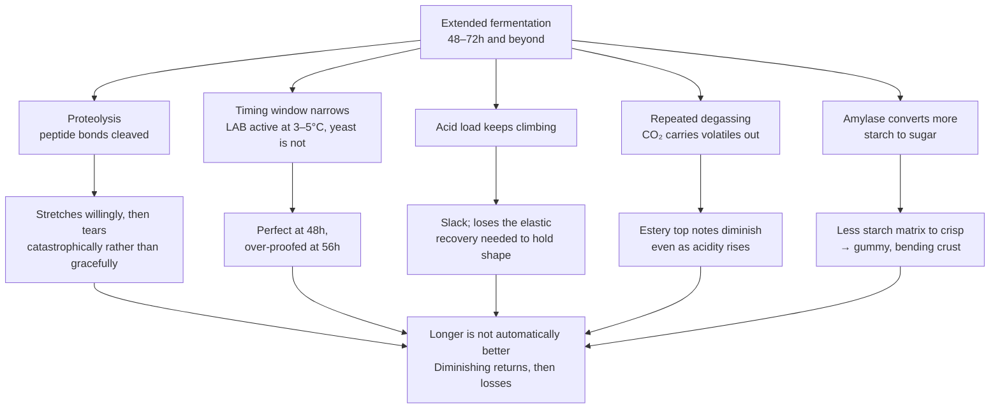

# The Long Fermentation Problem in Pizza

Long, slow fermentation is often treated as an unqualified good in bread baking — and for most loaves, it is. But pizza dough is uniquely demanding in ways that expose the downsides of extended fermentation. The dough must be stretched extremely thin by hand, hold its shape under toppings, and perform in a narrow bake window. Each of these requirements can be undermined by over-fermentation.

## Proteolytic Degradation and Structural Fragility

The central problem is proteolysis. During extended fermentation, bacterial proteases from the LAB culture (in sourdough) and, to a lesser extent, endogenous flour proteases progressively cleave peptide bonds within the gluten network. In a bread loaf, moderate proteolytic weakening is beneficial — it contributes to an open, irregular crumb. But pizza dough needs to survive hand stretching into a thin, continuous sheet. A partially degraded gluten network tears instead of stretching. The dough develops thin spots and holes during opening, particularly in the centre where it is thinnest. This is why many long-fermented sourdough pizza doughs feel extensible but fragile — they stretch willingly until they suddenly don’t, and then they fail catastrophically rather than gracefully.

## The Timing Window Narrows

A long-fermented dough has a narrower usable window than most bakers appreciate. The ideal moment for a pizza dough is when it is sufficiently aerated for oven spring but still structurally intact. With commercial yeast at low doses (the typical approach for 48–72h cold ferments), this window can be several hours wide. With sourdough, the window is less predictable because the wild yeast population varies between feeds and seasons, and LAB activity continues at refrigerator temperatures (3–5°C) even as yeast activity slows to near zero. A dough that was perfect at 48 hours may be over-proofed and structurally compromised at 56 hours. The baker loses schedule flexibility.

## Acid Accumulation and Dough Tightening

The effect of acid on pizza dough is paradoxical. Moderate acidity increases extensibility (useful for stretching), but as acid accumulates beyond a threshold, the dough can become excessively slack and lose the elastic recovery needed to hold its shape on a peel or in the oven. Acetic acid in particular can cause the dough to feel tight and resistant initially, then suddenly give way — an unforgiving combination for hand stretching. In a long sourdough ferment, the acid load keeps climbing, and the baker has limited ability to control the ratio of lactic to acetic acid once the dough is mixed.

## Volatile Precursor Loss

Extended fermentation also costs flavour, counterintuitively. During each degas, fold, or punch-down, CO₂ leaving the dough acts as a carrier gas, stripping volatile alcohols and early-formed esters from the dough matrix. A dough fermented for 72 hours has been degassed multiple times, and each event removes some of the esters and alcohols the yeast has made. The dough may taste more acidic (non-volatile acids remain), but the aromatic complexity — the fruity, estery top notes — can actually diminish.

## Crust Texture: Gummy vs. Crisp

Over-fermented pizza dough often produces a crust that is gummy or chewy rather than crisp. This is partly a starch issue: prolonged amylase activity during fermentation converts more starch to sugars, reducing the starch matrix available for crisping during baking. It is also a structural issue: a weakened gluten network does not create the rigid cell walls needed for a crisp, brittle crust. The result is a pizza base that bends and sags rather than cracking when folded.

## Implications

None of this means long fermentation is wrong for pizza — many excellent pizzas use 48–72h cold-fermented doughs with great results. But it does mean that longer is not automatically better. There is a point of diminishing returns where additional fermentation time degrades handling, narrows the timing window, and reduces rather than increases flavour complexity. For home bakers without the experience to read their dough precisely, a shorter, more controlled fermentation with deliberate flavour additions (such as a hybrid approach) can produce a more reliable and arguably more complex result.

---

<!-- nav -->
[← 15 Application: Pizza Dough](15-application-pizza-dough.md) · [Contents](../README.md) · [17 Controlled Proteolysis for Bread: Degradation as a Tool →](17-controlled-proteolysis-for-bread-degradation-as-a-tool.md)
