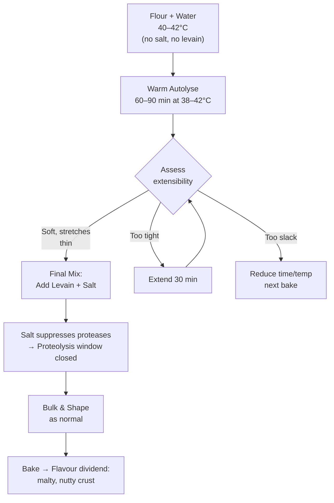

# Controlled Proteolysis for Bread: Degradation as a Tool

The preceding chapter treats proteolysis as a failure mode: the mechanism by which long fermentation ruins a pizza dough, producing a network that tears rather than stretches when opened by hand. For bread, the calculus inverts. The same enzymatic degradation that destroys a pizza dough is, within limits, exactly what produces an extensible, soft-crumbed, deeply flavoured loaf. This chapter is the counterweight to the last one — proteolysis as a tool rather than a hazard, and how to induce it quickly without waiting out a long fermentation.

## Why Bread Tolerates — and Benefits From — More Proteolysis

The failure mode is different, and the threshold is much further out. A pizza dough must survive being stretched by hand to a continuous 3–6 mm sheet; a partially degraded network develops thin spots and tears catastrophically. A bread dough is shaped with structural support — a banneton, a tin, or its own surface tension — and is never asked to hold a thin unsupported sheet. Its failure mode is not tearing but **loss of gas retention**: if the network is degraded far enough, it cannot hold the CO₂ pressure and the loaf bakes flat and dense. That threshold sits well beyond the point where a pizza dough would already have failed, which is why bread formulas routinely tolerate levain percentages of 20–30% that would wreck a pizza dough.

Within that wider window, moderate proteolysis actively improves the loaf in three ways. It increases **extensibility**, making the dough easier to shape and allowing greater oven-spring expansion before the network resists. It produces a **softer crumb**, because a partially depolymerised glutenin network yields a less chewy, more tender bite. And it liberates **free amino acids** from the flour protein — which is the underrated benefit, because those amino acids are one of the two substrates for the Maillard reaction.

This last point is where bread has a decisive advantage over pizza. The Maillard precursor pool discussed earlier in this document — reducing sugars plus free amino acids reacting at high temperature to produce melanoidins, pyrazines, furanones, and Strecker aldehydes — needs **time at temperature** to express. A 2–3 minute pizza bake compresses that chemistry into near-irrelevance. A 40–50 minute bread bake gives it full expression. Proteolysis that would be wasted on a pizza pays real flavour dividends in a loaf.

## The pH Route and Why It Is the Weakest Lever

The obvious route to faster proteolysis is to reach the protease pH optimum faster. Cereal aspartic proteases are most active around pH 3.5–4.0, and sourdough fermentation drives dough toward that range. The question is whether a heat boost can compress the acidification timeline enough to make this practical without a long fermentation. The answer is: partially, but it is the least efficient of the available levers, for two reasons.

### Buffering Capacity Is a Molar Requirement

Moving dough from roughly pH 6.0 to pH 4.0 requires producing a fixed **quantity** of acid — enough to overcome the flour’s buffering capacity, which arises from amphoteric proteins, phosphates, and mineral salts. This is a molar requirement, and it does not shrink because acid is being produced faster. Thermophilic LAB at 40–45°C acidify perhaps two to four times faster than mesophilic LAB at 25°C, so a pH drop that takes eight hours at room temperature might take two or three hours hot. That is a real compression, but it is not the order-of-magnitude acceleration that would make acidification a fast process. Heat gets you there sooner; it does not reduce the amount of acid needed.

Flour choice compounds this. Higher-ash flours buffer more strongly because of their greater mineral content — the same mineral cofactors that activate the proteases also resist the pH drop that would activate them further. A high-extraction or wholemeal flour therefore takes longer to reach protease-optimum pH than a low-ash Tipo 00, despite having more enzymatic potential overall.

### Dilution Buffers the Final Dough Back Up

This is the more serious constraint, and it is frequently overlooked. Even if a hot levain reaches pH 3.8, mixing it into the final dough at 10–15% of total flour dilutes that acid across the whole mass. The bulk flour brings its own buffering capacity, and the resulting dough typically settles somewhere around pH 5.2–5.5 — comfortably above the 3.5–4.0 optimum for the endogenous wheat proteases.

The consequence is that the levain’s own flour is heavily proteolysed, and a bolus of LAB-derived proteases is introduced into the dough, but **the bulk flour’s own protease population remains largely dormant**. Getting the levain to protease-optimum pH is easy. Getting the **final dough** there quickly is a much harder problem, and short of very high levain percentages or direct acidification, heat alone will not accomplish it.

### Heat Partially Substitutes for pH

There is, however, a compensating effect that explains why hot bulk fermentation produces noticeable softening despite the modest pH drop. Enzyme reaction rates approximately double for every 10°C rise (Q₁₀ ≈ 2) up to the denaturation threshold, and wheat proteases remain stable to roughly 50°C. A dough held at pH 5.5 and 40°C can therefore have comparable total proteolytic throughput to a dough at pH 4.5 and 25°C. The enzyme is further from its pH optimum but much closer to its thermal optimum, and the two effects partially cancel.

This is the mechanism actually doing the work in a hot bulk ferment. It is not a dramatic acidification event — it is ordinary proteases running hot. Understanding this reframes the technique: the goal is not to chase low pH, but to exploit the temperature axis of the enzyme activity curve.

## Salt: The Largest and Cheapest Lever

The single most effective control over proteolytic rate is not pH or temperature but **salt**. Sodium chloride suppresses cereal protease activity through two independent mechanisms: increased ionic strength, which interferes with enzyme–substrate interaction, and reduced water activity, which limits the hydrolysis reaction itself. This suppression operates regardless of pH, and it is substantial at normal bread salt levels of 1.8–2.2% of flour weight.

A dough mixed without salt therefore allows its endogenous proteases to run at a considerably higher rate than the same dough with salt already incorporated. Delaying the salt addition to the final mix is a larger proteolytic lever than any realistic pH manipulation, and it costs nothing in time or ingredients.

This is the underappreciated half of the classical autolyse. Calvel’s technique is usually explained as passive hydration — allowing water to fully penetrate the flour and begin gluten development before mixing. That explanation is correct but incomplete. A meaningful part of the softening and extensibility gained during an autolyse is **enzymatic**, the product of unsuppressed proteases working on an unsalted, fully hydrated substrate. The autolyse is, in part, a controlled proteolysis window.

## The Warm Autolyse: Fast Proteolysis Without Fermentation

Combining the salt and temperature levers produces the technique that most directly answers the question of how to achieve substantial proteolysis without a long fermentation: a **warm autolyse** at 38–42°C, with no salt and no levain, for 60–90 minutes.

This approach **decouples protein degradation from fermentation entirely**. There is no pH drop to wait for, no acid to accumulate, no buffering capacity to overcome, and no microbial population dynamics to manage. The flour’s own proteases work at pH ~6.0 — well off their optimum — but at two to four times their room-temperature rate by virtue of Q₁₀. Salt, the main inhibitor, is absent. The result is rapid, controlled extensibility development in about an hour.

Levain and salt are added afterward, in the final mix. By that point the desired proteolysis has already occurred, and the subsequent fermentation can be as long or as short as the flavour goal requires — the two variables are now independent. A baker who wants extensibility but not extended sourness, or who is working to a compressed schedule, gains a control axis that a conventional single-stage process does not offer.

### Temperature Ceiling

Stay below approximately 50°C. Wheat starch gelatinisation begins around 55–60°C depending on water availability and damaged starch content, and above that threshold the technique becomes something else entirely: a scald, or *Brühstück*, in the German baking tradition. A scald has the opposite goal — it deliberately gelatinises starch to increase water absorption and crumb softness, and in doing so **denatures the very proteases** the warm autolyse is designed to exploit. Both are legitimate techniques, but they are not compatible in a single step. The warm autolyse operates in the window between the protease thermal optimum and the onset of gelatinisation.

## Lever Ordering for Bread

For a baker seeking faster proteolysis in a bread dough, the available levers ranked by effectiveness per unit of effort:

**1. Remove salt from the autolyse.** The largest single effect, costs nothing, fully reversible by adding salt at the final mix.

**2. Raise autolyse or bulk temperature to 38–42°C.** Doubles to quadruples enzyme rate via Q₁₀ without requiring any pH change.

**3. Increase levain percentage.** Moves acid load and LAB-derived protease load together. Bread tolerates 20–30% where pizza does not. This is the most powerful fermentation-based lever, though it also commits to a more acidic loaf.

**4. Extend time.** Always works, but it is precisely what the question was trying to avoid.

**5. Manipulate pH directly.** The least efficient path via fermentation, for the buffering and dilution reasons above.

## Direct Acidification as a Shortcut

If protease-optimum pH is genuinely required rather than merely desirable, direct acidification offers a shortcut that fermentation cannot match. A small quantity of food-grade lactic acid drops the dough to the target pH immediately, decoupling ‘reach low pH’ from ‘wait for LAB to produce acid’. Combined with a 40°C hold, this produces rapid proteolysis with no extended fermentation whatsoever.

The caveat noted in the references — that chemical acidification *firms* dough and reduces extensibility, where biological acidification softens it — applies on short timescales, before the proteases have had time to act. The initial effect of adding acid is a tightening of the network through charge-state and hydration changes. Held warm, the enzymatic softening catches up and overtakes it. The technique therefore requires patience through an initial phase where the dough appears to be moving in the wrong direction.

This is a specialist tool rather than a routine one. For most bread applications the no-salt warm autolyse achieves sufficient proteolysis with fewer variables and no risk of overshooting into a dough that cannot hold gas.

## Suggested Protocol

**1. Warm autolyse:** Combine flour and all formula water at 40–42°C — no salt, no levain, no commercial yeast. Mix only until no dry flour remains. Hold at 38–42°C for 60–90 minutes. A proofing box, oven with the light on, or warm water bath all work. Note that thermal lag applies here as it does elsewhere: a large dough mass in a plastic container will take 30–45 minutes to reach the setpoint at its core.

**2. Assess:** The dough should feel noticeably softer, slacker, and more extensible than an equivalent room-temperature autolyse. A small piece should stretch thin without snapping back aggressively. If it still feels tight, extend by 30 minutes; if it feels slack and sticky to the point of losing all structure, reduce the time or temperature on the next attempt.

**3. Final mix:** Add levain and salt. The salt immediately begins suppressing further protease activity, which is the desired outcome — the proteolysis window is now closed and the network can begin rebuilding through the time-dependent mechanisms described earlier in this document.

**4. Bulk and shape as normal.** Because significant extensibility has already been developed, the dough may require fewer folds and shorter bulk than the same formula without a warm autolyse. Watch the dough rather than the clock.

**5. Expect a flavour dividend.** The enlarged free amino acid pool feeds Strecker degradation during the bake, producing a more complex crust aroma — malty, nutty, and roasted notes from Strecker aldehydes and pyrazines. This is the payoff that a short pizza bake cannot access.

---

<!-- nav -->
[← 16 The Long Fermentation Problem in Pizza](16-the-long-fermentation-problem-in-pizza.md) · [Contents](../README.md) · [18 High-Heat Baking: Sugar, Hydration, and the Ooni Problem →](18-high-heat-baking-sugar-hydration-and-the-ooni-problem.md)
