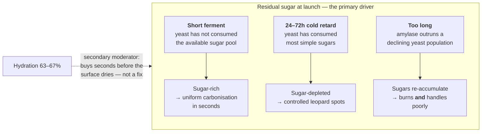

# High-Heat Baking: Sugar, Hydration, and the Ooni Problem

Portable pizza ovens like the Ooni (particularly the 12” models) operate at 400–500°C — radiant heat intensities that fundamentally change the relationship between dough composition and bake outcome. What works at 300°C in a home oven will burn in an Ooni, and the reasons are rooted in sugar chemistry, not water content.

## Why Pizza Burns: Residual Sugar, Not Hydration

The primary driver of burning at high heat is **residual sugar content** in the dough. Flour contains approximately 1.5–2% free sugars (glucose, fructose, sucrose) plus a population of damaged starch granules that are immediately accessible to amylase enzymes. During fermentation, amylases (from both flour and yeast) continuously hydrolyse damaged starch into maltose and glucose. Simultaneously, yeast consumes these sugars as its carbon source, producing CO₂ and ethanol.

With a **short fermentation**, the yeast has not had time to consume the available sugar pool. The dough retains the original free sugars plus whatever the amylases have liberated, minus only the fraction that has been metabolised. When this sugar-rich dough hits a 450°C+ stone, rapid caramelisation and Maillard browning ensue. At these temperatures, the window between beautiful leopard-spot charring and uniform carbonisation is measured in seconds. The sugar fuels the reaction, and there is too much of it.

With a **longer fermentation** (24–72h cold retard), the yeast has consumed most available simple sugars. The dough is relatively sugar-depleted by the time it enters the oven. This is precisely why traditional Neapolitan 48–72h cold-fermented doughs work so well at extreme heat — they char with controlled, attractive leopard spots rather than burning uniformly, because there is less sugar fuel available for the caramelisation and Maillard reactions.

However, there is a curve, not a straight line. If fermentation goes too long, amylase has broken down so much starch that new sugars are being liberated faster than the declining yeast population can consume them. Sugars begin to accumulate again. This is especially problematic if the dough is over-proofed and yeast activity has essentially stopped — the result is a dough that is both sugar-rich and structurally compromised. It burns easily *and* handles poorly.

## Hydration as Thermal Buffer

Hydration does play a role, but as a **buffer** rather than a solution. Higher hydration provides more thermal mass — more water that must absorb energy and evaporate before the surface temperature can rise above 100°C. While liquid water is present at the dough surface, it pins the local temperature near its boiling point. Only after the surface dries out can the temperature climb into the 150–200°C+ range where caramelisation and Maillard reactions accelerate.

At home oven temperatures (250–300°C), this buffer is large enough that hydration differences have a modest effect on browning. At Ooni temperatures (450°C+), the buffer evaporates in seconds rather than minutes. Higher hydration buys a few extra seconds before the surface dries and browning begins, which at Ooni speeds is meaningful — but it cannot compensate for a sugar-rich dough. The sugar content remains the primary driver of burn rate; hydration is a secondary moderator.

## The Practical Hydration Window for Ooni 12”

In a 12” Ooni, the working space is tight — a small turning peel, a short stone, and very little margin for error during launch. This constrains hydration from above. Above approximately 68–70% hydration, the dough becomes difficult to handle on the peel: it sticks during launch, deforms under its own weight, and if it folds on itself on the stone there is no time or space to recover before the bottom carbonises. The practical sweet spot is **63–67% hydration** — enough thermal mass to provide a useful buffer, low enough to launch cleanly and turn confidently in the cramped 12” chamber.

## Ball Size and Thickness: Two Valid Strategies

Ball size involves a genuine tradeoff between burn resistance and bake forgiveness, and there are two valid approaches depending on the style of pizza you are after.

### Larger Balls (270–280g, 10–11” pie): The Forgiving Approach

A larger ball opened to a 10–11” diameter (leaving clearance from the stone edges for the turning peel) produces a thicker crust with more thermal mass. More mass means more water that must evaporate before the surface climbs past 100°C, which buys time before browning begins. Combined with a moderate flame (40–50% of max), this gives a 2–3 minute bake with a wide margin for error at every stage: the surface browns gradually, the centre has time to cook through, and turning precision is less critical because the crust is not racing toward carbonisation. The eating experience is bread-tender with a crisp exterior — closer to a Roman or New York style than a Neapolitan. This approach also maximises thermal esterification time, giving the hybrid dough’s alcohol and acid precursors more time to react in the crust.

### Smaller Balls (220–230g, 11–12” pie): The Crisp Approach

A smaller ball stretched thinner produces a crust that cooks through faster, which means less total time on the stone and, in principle, less opportunity to burn. At moderate flame, a thin crust can be fully baked in 90 seconds to 2 minutes. The raw-centre problem essentially disappears because there is almost no centre to speak of — the entire cross-section reaches gelatinisation temperature almost immediately.

The tradeoff is that the margin for error shrinks. A very thin crust has almost no thermal mass, so the bottom transitions from done to carbonised within seconds. Turning precision and timing become more critical. Additionally, the shorter bake gives less thermal time for ester chemistry to develop in the crust, and the eating experience is cracker-crisp rather than bread-tender. If you prefer a thinner, crispier style and are confident with fast turns in the 12” chamber, this is a viable approach.

### The Choice Is Stylistic

Neither approach is objectively better. The larger ball at moderate heat maximises forgiveness, flavour development time, and produces a tender-crisp gradient. The smaller ball at moderate heat maximises speed, produces a uniformly crisp texture, and minimises raw-centre risk. Both benefit from the 48h cold retard for sugar depletion. The moderate-flame protocol (40–50% of max) is recommended for both — it is the common denominator that makes either ball size work reliably in a 12” Ooni.

## Heat Management: The Critical Lever

Many Ooni users run the burner at maximum output because they are chasing the Neapolitan 60-second bake. But a 12” Ooni does not have the thermal mass of a proper Neapolitan deck oven. The stone temperature drops significantly after each pizza and recovers unevenly, creating hot spots. More importantly, maximum flame creates a fundamental problem with thicker crusts: the exterior carbonises before the interior finishes cooking.

### The Thermal Diffusion Problem

Heat enters the pizza from two directions: conduction through the stone from below, and radiation from the flame above. This heat must then diffuse inward through the dough to cook the centre. Dough has relatively low thermal diffusivity — it conducts heat slowly. For a thin Neapolitan crust (~3mm), the diffusion path from surface to centre is so short that the entire cross-section reaches starch gelatinisation temperature (60–80°C) and protein coagulation almost instantly, well within a 60-second bake.

For a thicker crust (~6–8mm, as produced by a 275g ball opened to 10–11”), the diffusion path roughly doubles. Because diffusion time scales with the *square* of the distance (Fick’s law), doubling the crust thickness approximately quadruples the time needed for the centre to reach cooking temperature. At maximum flame, the surfaces hit browning and charring temperatures long before the centre has finished cooking. The result is a pizza that is simultaneously burnt on the outside and gummy or raw in the centre.

### The Solution: Lower Flame, Longer Bake

The fix is to trade surface heat intensity for diffusion time. By reducing the flame, the surfaces brown more slowly, giving heat time to conduct inward and cook the centre through. The goal is a bake long enough for the entire cross-section to reach full gelatinisation and protein coagulation, while the exterior develops controlled browning rather than carbonisation.

### Recommended Ooni 12” Protocol

**Preheat:** Run the burner at full flame for approximately 15 minutes. The stone needs to be heat-soaked through its entire thickness, not just on the surface — surface temperature alone is misleading. An infrared thermometer reading of 380–420°C on the stone surface indicates adequate preheat. The 12” Ooni stone is relatively thin and heats quickly; preheating beyond 15 minutes risks making the stone excessively hot, which works against the moderate-bake strategy.

**Pre-launch:** Reduce the flame to approximately 40–50% of maximum. The exact position varies by Ooni model and fuel type, but the goal is a stone surface temperature in the 350–380°C range. If using an IR thermometer, check the stone after the flame has stabilised at the reduced setting for 30–60 seconds.

**Bake:** Launch the pizza and bake for 2–3 minutes total, turning every 20–30 seconds for even exposure. At this temperature and bake time, the centre of a 6–8mm crust has sufficient time to cook through while the exterior develops a gradual, controlled browning. The cornicione will puff and blister without charring aggressively.

**Optional char boost:** In the final 15–20 seconds, briefly increase the flame to add leopard-spot charring on the cornicione. This gives you the visual and flavour character of high-heat baking without the raw-centre problem. The crust interior is already fully cooked at this point, so the brief heat spike only affects the surface.

### Why This Works With the Hybrid Approach

The moderate-heat, longer-bake protocol is synergistic with the hybrid dough in several ways. The 48h cold retard has depleted residual sugars, so the moderate heat still produces attractive browning rather than a pale underside — there is enough remaining sugar for Maillard reactions, but not so much that the crust carbonises. The 2–3 minute bake gives significantly more time for thermal esterification in the crust, allowing the alcohol and acid precursor pools from the hybrid fermentation to react and develop the complex aromatic profile that would be compressed into near-irrelevance in a 60-second bake. And the thicker crust, now properly cooked through, develops a satisfying crisp-to-tender gradient from surface to centre rather than the burnt-shell-around-raw-dough failure mode.

In practice, this means the 12” Ooni at moderate flame produces a pizza that is closer in character to a Roman-style or New York-style bake than a Neapolitan one — slightly longer bake, slightly thicker crust, more flavour development, but with the blistering and char notes that only a 350°C+ stone can provide. For a hybrid sourdough dough optimised for ester complexity, this is arguably the ideal bake profile.

### Stone Recovery Between Pizzas

After each pizza, the stone surface temperature drops by 50–100°C. At moderate flame, recovery takes 3–5 minutes. Do not launch the next pizza until the stone has recovered to target temperature — a cold stone produces a pale, soggy bottom. An IR thermometer removes the guesswork. Increase the flame to full during the recovery interval to speed reheating, then drop back to 40–50% before the next launch.

## Summary: Ooni 12” Optimisation

For a 12” Ooni with a hybrid sourdough dough, the four critical parameters are: **sugar depletion** through a 48h minimum cold retard to prevent burning; **hydration** in the 63–65% range for peel handling and moderate thermal buffering; **ball weight** of 270–280g opened to 10–11” for thermal mass and turning clearance; and **flame management** at 40–50% of maximum for a 2–3 minute bake, giving the centre time to cook through while the exterior develops controlled browning. Preheat at full flame, drop before launch, bake with regular turning, and optionally boost briefly at the end for leopard-spot char. Use an IR thermometer to target 350–380°C on the stone surface, and allow 3–5 minutes of recovery at full flame between pizzas.

---

<!-- nav -->
[← 17 Controlled Proteolysis for Bread: Degradation as a Tool](17-controlled-proteolysis-for-bread-degradation-as-a-tool.md) · [Contents](../README.md) · [19 Post-Retard Handling: CO₂ Nucleation and the Gentle Pull →](19-post-retard-handling-co2-nucleation-and-the-gentle-pull.md)
