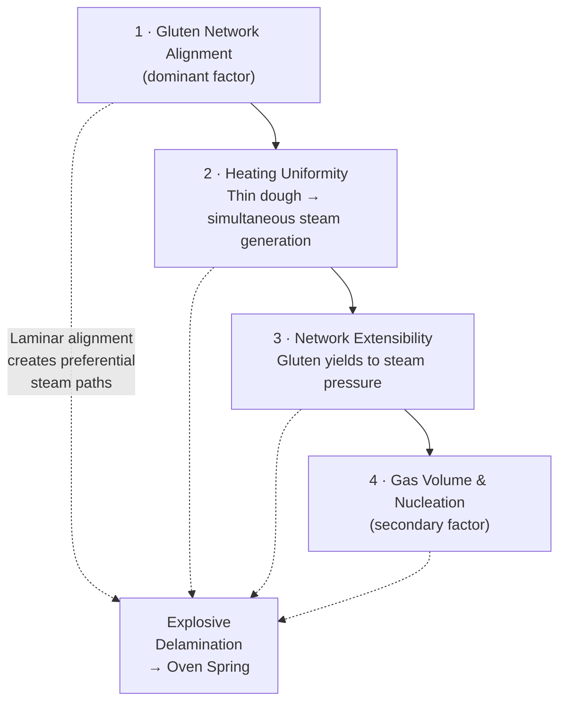

# Oven Spring Mechanics: What Actually Determines Rise

Conventional wisdom attributes oven spring primarily to gas volume — how much CO₂ the yeast produced, how well the dough was proofed, how much residual fermentation activity remains. But a series of experiments with identical dough reveals that the dominant factor is not gas volume at all. It is the **geometric state of the gluten network** at the moment the dough enters the oven.

## Three Experiments, One Dough

The following experiments use the same dough — identical formula, identical cold retard, identical yeast activity. The only variable is how the dough is handled after the retard.

**Experiment 1: Wide container.** Dough is cold-retarded overnight in a wide, flat container. After the retard, it is turned onto the table and cut into rolls. **Result: good rise.**

**Experiment 2: Bowl.** Same dough, cold-retarded in a bowl. Turned out and cut into rolls. **Result: less rise.**

**Experiment 3: Flattened and slapped.** Dough from Experiment 1, but instead of cutting into rolls, it is flattened like the centre of a pizza and slapped to extend. Baked flat — not reshaped into rolls. **Result: great rise, significant expansion, open crumb structure.**

Same dough, same fermentation, same yeast activity. The only variable is the mechanical state of the gluten network. It completely dominates the outcome.

## Why the Container Shape Matters

In a **wide container**, the dough spreads under gravity during the retard, imposing a gentle, sustained horizontal stretch on the gluten network. The strands gradually align into a more **laminar** — horizontally-oriented — configuration. Not perfectly aligned, but biased. When cut into rolls, this partially-aligned structure is preserved. During oven spring, gas expansion encounters less resistance in the vertical direction because it can push between the laminar planes rather than fighting through a tangled mesh.

In a **bowl**, the dough is constrained. It cannot spread, so the gluten network relaxes into a random, isotropic configuration — strands oriented in every direction with no preferential alignment. The bottom is compressed under the weight of the dough above. When cut into rolls, the internal structure is a tangled, relaxed mesh. During oven spring, gas expansion has to push against this disordered network in all directions simultaneously. There is no preferential path for expansion, so the network resists uniformly and rise is modest.

## The Flat Dough Revelation: Laminar Alignment and Steam Delamination

Experiment 3 is the most revealing. The dough is flattened and slapped to extend — creating extreme laminar alignment of the gluten network, with strands forced into parallel horizontal planes like pages in a book. It is then baked flat, with no vertical pre-structure to guide the rise. And yet it produces the best rise of all three experiments, with significant vertical expansion and open crumb.

This result demonstrates that **alignment combined with rapid uniform heating can create dramatic oven spring from essentially zero pre-existing vertical gas structure**. The flat disc has been largely degassed by the slapping. There are no large pre-formed bubbles providing lift. The rise comes almost entirely from **steam generation within an aligned gluten matrix**.

## The Steam Delamination Mechanism

When the flat disc enters the oven, three things happen in rapid succession. First, because the dough is thin, the **entire cross-section reaches steam-generation temperature almost simultaneously**. In a roll, heat conducts inward slowly — the outside reaches 100°C while the centre is still at 40°C, so oven spring happens as a gradual wave from surface to core. In the flat disc, the whole thing heats through within seconds.

Second, water throughout the dough converts to steam, expanding roughly 1,600-fold in volume. This steam needs somewhere to go. In a random, isotropic gluten network, it pushes in all directions and the rise is modest and uniform. In the laminar-aligned network, the steam finds **preferential paths between the aligned gluten planes** — the interfaces between layers are weaker than the layers themselves. The steam exploits these weak interfaces and **delaminates** the structure — pushing adjacent gluten planes apart.

Third, because all layers are firing at the same time (uniform heating of a thin cross-section), the delamination happens as a **single explosive event** rather than a gradual process. The entire disc lifts as a unit. This is exactly the physics of pita bread: a thin disc with aligned gluten that, under intense heat, steams uniformly and separates into a puffed structure. The only difference is that pita typically forms one clean pocket (two layers separating), while a multi-layered dough produces multiple irregular separations — which is the open crumb structure observed in the experiment.

The large alveoli in the open crumb are literally the spaces between delaminated gluten layers. Each hole is a gap where two adjacent planes of aligned gluten separated under steam pressure. This is structurally different from the open crumb of a long-fermented sourdough boule, where the holes form through gas bubble coalescence during fermentation. The flat-disc holes are formed mechanically in seconds during the bake — steam-driven delamination of an aligned network.

## The Oven Spring Hierarchy

These experiments establish a clear hierarchy of factors controlling oven spring:

**1. Gluten network alignment** — laminar alignment creates preferential paths for steam expansion. This is the dominant factor, as demonstrated by the flat disc outperforming the rolls despite having less pre-existing gas structure.

**2. Heating uniformity** — thin dough heats through simultaneously, producing explosive single-event delamination rather than gradual wave-like expansion. Thinner cross-sections produce more dramatic oven spring per unit of dough.

**3. Network extensibility** — the gluten must yield to steam pressure rather than resist it. Relaxed, extensible gluten delaminates cleanly; tight, elastic gluten resists and may even contract initially.

**4. Gas volume and nucleation** — pre-existing gas cells and dissolved CO₂ contribute to oven spring but are secondary to alignment. A well-aligned, largely degassed dough outperforms a gassy dough with random gluten orientation.

## Fold Multiplication: Amplifying the Laminar Effect

If laminar alignment is the dominant factor in oven spring, it follows that **multiplying the number of aligned layers** should amplify the effect. This is achieved through folding.

Take the flattened, slapped-out disc and fold it in thirds like a letter. Rotate 90°, flatten and extend again, fold in thirds again. Two fold cycles produce approximately 9 aligned layers. A third cycle produces 27. Each fold multiplies the number of gluten planes with delamination interfaces between them.

This is the same principle as puff pastry, without the fat. In puff pastry, butter layers physically separate the gluten planes and create steam barriers that force clean delamination into distinct flaky layers. In plain dough without fat barriers, the layers are in contact, but the alignment at each interface still creates a preferential path for steam. The delamination is less clean (irregular open crumb rather than crisp flaky layers), but the underlying mechanism is identical: steam finds the weakest paths between aligned planes and pushes them apart.

There is a practical ceiling. If the individual layers become too thin through excessive folding, they lose the structural integrity to hold steam pressure and the layers merge back into a homogeneous mass. In puff pastry with fat barriers this ceiling is around 700–900 layers. In plain dough without fat separation, the ceiling is much lower — roughly 20–40 effective layers before the interfaces blur together through overworking. Two or three letter-fold cycles (9–27 layers) sit in the practical sweet spot: enough laminar multiplication to dramatically increase delamination potential, few enough that each layer retains structural integrity.

## The Essential Rest: Why Timing Matters

The fold-and-flatten cycles must be followed by a **short rest of 15–30 minutes** before baking. This rest is mechanically essential, not optional.

Immediately after folding, the gluten network is **stressed and elastic**. The mechanical work has tensioned the network, and it wants to snap back. If baked in this state, the elastic contraction competes with steam expansion in the first seconds of the bake. Tight gluten resists delamination — or worse, contracts and shrinks before the steam pressure can overcome it.

During the 15–30 minute rest, two processes occur. First, **gluten relaxation**: the stressed network dissipates stored elastic energy through thiol–disulfide interchange, as the glutenin chains slide past each other and find a new equilibrium. The network transitions from elastic and resistant to extensible and compliant. When steam pressure arrives, the gluten yields to it rather than fighting it — clean delamination rather than forced rupture.

Second, **CO₂ nucleation into the new interfaces**. The folding created fresh layer boundaries. During the rest, dissolved CO₂ (still supersaturated from the cold retard) nucleates into these interfaces, gently pre-separating the layers with small gas lenses. When the dough enters the oven, steam does not have to crack apart layers that are pressed flush against each other — the layers are already slightly separated by nucleated gas. Steam finds these pre-opened paths and blows them wide open. The delamination is faster, more uniform, and more dramatic.

The rest cannot be too long. Beyond 30–40 minutes, the distinct layer boundaries begin to **merge** as relaxed gluten at the interfaces re-bonds through hydrogen bonding and hydrophobic interactions. The laminar structure homogenises back toward an isotropic state. The dough spreads laterally, losing height. The window is finite: long enough for relaxation and nucleation, short enough to preserve the laminar geometry.

## Implications for Pizza

These findings feed directly into pizza technique. The cornicione puffs not primarily because of yeast gas trapped during proofing — it puffs because hand-stretching and shaping align the gluten laminarly in the rim, and intense oven heat generates steam that delaminates those aligned layers. A well-aligned cornicione on a slightly under-proofed dough will out-puff a poorly-handled cornicione on a perfectly proofed dough. **The shaping technique matters more than the fermentation state for the actual puff.**

The traditional Neapolitan slapping technique is not just about shaping the disc — it is creating the laminar alignment in the cornicione that produces dramatic oven spring. The centre of the pizza, pressed thin, does not puff because it has minimal cross-section for delamination. The rim, left thick and aligned by the hand-shaping motions, has both the laminar structure and the thermal mass for steam to do its work.

For the hybrid dough in an Ooni, this means the post-retard handling sequence is: gentle pull to trigger CO₂ nucleation (as described in the previous section), temper for 1.5–2 hours, then open and shape with deliberate attention to cornicione alignment. The better the laminar structure in the rim, the more dramatic the puff — regardless of how much the dough expanded during tempering.

## Recommended Lamination Protocol for Rolls and Flatbreads

For applying these principles to rolls or flatbreads (rather than pizza, where the shaping provides its own alignment):

**1.** After cold retard, turn the dough onto the bench from a wide, flat container (not a bowl).

**2.** Flatten and extend by hand or with gentle slapping — create a thin, even sheet.

**3.** Letter fold: fold in thirds. Rotate 90°. Flatten gently and fold in thirds again. This gives approximately 9 laminar layers.

**4.** Portion and shape loosely into rolls or leave as flat pieces, depending on the desired outcome.

**5.** Rest 15–20 minutes at room temperature. The dough should look slightly puffed and relaxed — not tight and flat, not fully proofed and spreading.

**6.** Bake at high heat. The laminar structure will delaminate under steam, producing dramatic rise and open crumb regardless of how modest the visible proofing appeared during the rest.

---

<!-- nav -->
[← 19 Post-Retard Handling: CO₂ Nucleation and the Gentle Pull](19-post-retard-handling-co2-nucleation-and-the-gentle-pull.md) · [Contents](../README.md) · [21 Flour Selection: Why Protein Percentage Is Not Enough →](21-flour-selection-why-protein-percentage-is-not-enough.md)
