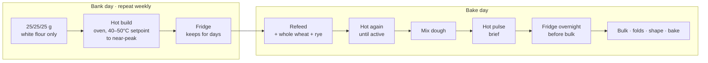

# The Heat-Driven Levain Bank: Hot Pulses, Cold Storage, and the Overnight Enzymatic Rest

> **Context.** Chapters 07, 08 and 11 document a working protocol of *one* hot levain build,
> a hot bulk, and a cold retard. This note records the protocol as it is actually run now,
> which has drifted from that in three ways: the levain is built hot and then **banked in the
> fridge for days**; it is **refed hot on bake day** with wholegrain added only at that point;
> and the freshly mixed dough goes **hot, then straight into the fridge overnight before
> bulk** rather than after it. The temperatures involved are also at or above what the
> literature chapters treat as the ceiling. This is an empirical note. The mechanisms
> proposed below are hypotheses, flagged as such.

---

## The protocol as run

**Bank day** (any convenient day)

1. Feed 25 g starter with 25 g plain white flour and 25 g water. Several jars at once.
2. Develop each jar **almost fully under aggressive heat**: the oven, set well above the
   35–40°C that chapter 07 calls the sweet spot. The working notes give 40–50°C as the oven
   setpoint. See the caveat on setpoint versus core temperature below.
3. Refrigerate. The jars keep for days.

**Bake day**

4. Take one jar out. Feed it again, this time **including whole wheat and rye**, and return
   it to the hot oven until it is active.
5. Mix the dough with this levain. **Back into the hot oven** for the initial period.
6. Then, ideally, **into the fridge overnight before bulk fermentation begins**. When the
   dough comes out the next day it is, in the baker's words, truly enzymatically activated.
7. Bulk with folds, shape, proof, bake as normal.

The short form: **hot → cold (days) → hot → hot → cold (overnight) → bulk**.

## What is different from chapter 08

| | Chapter 08 protocol | This protocol |
|---|---|---|
| Levain | Built hot, used at once | Built hot, banked cold for days, refed hot |
| Wholegrain | In the build | Withheld until the bake-day refeed |
| Hot dough phase | 2 h bulk at 40°C+ | Brief pulse straight after mixing |
| Cold phase | After bulk (retard) | Before bulk (enzymatic rest), optionally also after |
| Bulk | Hot | Room temperature, after the cold rest |

The cold-before-bulk step is the one that changes the character of the result. It is the
same idea as the early cold rest in the *Double Enzymatic Activation* notes: give amylase a
night to work while the microbes are dormant, so the dough arrives at bulk pre-sweetened and
extensible. Here it is stacked on top of a hot front end rather than replacing it.

## Why it might work

### 1. Every hot session is preceded by a fresh feed

Chapter 11 concluded that the single most useful mitigation for thermal stress is to **feed
immediately before a hot session**: maximum substrate, minimum accumulated acid and ethanol, a
full ATP budget. This protocol does that at every heated step without having been designed
to. The bank build is a fresh feed. The bake-day refeed is a fresh feed. The dough mix is,
from the levain's point of view, the largest feed of all. Each hot pulse hits a culture in
the best possible condition to survive it.

### 2. The fridge days are the recovery window

Chapter 11's framing is brief excursions with recovery between. Days at 3–5°C between the
bank build and the refeed is a long recovery window. The culture goes into the second hot
session rested, not depleted.

### 3. White flour at storage, wholegrain at activation *(hypothesis)*

This is the detail that looks like a preference and may be doing real work.

- **In storage**, the enemy is over-acidification. A levain that sits for days accumulates
  acid and ethanol, and chapter 11 shows that both make the *next* heat exposure more lethal.
  White flour has less amylase, fewer minerals and less LAB fuel than wholegrain, so the
  banked levain acidifies more slowly and arrives at bake day less stressed.
- **At activation**, the goal flips: maximum enzymatic fuel and maximum microbial kick. That
  is exactly what whole wheat and rye supply: amylase, protease, minerals, lysine-rich
  protein for the crust. Adding them at the refeed puts the fuel in the tank just before
  the two hot pulses and the overnight enzymatic rest, when it can be used, rather than
  letting it burn off in the fridge.

If this is right, the split is a small but genuine optimisation: **inert during storage,
loaded during activation.** It is testable by banking one jar with 10% rye included and
comparing its smell, rise, and heat tolerance at refeed against a white-only jar.

### 4. The hot mix is a Q₁₀ boost, then the fridge locks the microbes and frees the enzymes

The proteolysis note makes the point that enzyme rate roughly doubles per 10°C, so a dough
at pH 5.5 and 40°C has proteolytic throughput comparable to pH 4.5 at 25°C. The same applies
to amylase. A brief hot pulse right after mixing therefore does three things at once:

- wakes yeast and LAB into a sugar-rich, still-neutral dough (the metabolic bloom of chapter 07);
- runs amylase and protease hot for the duration of the pulse;
- starts the pH moving.

Then the fridge intervenes. Microbial activity drops to near zero, but amylase keeps working
all night. The dough that comes out has had the enzymatic head start of the hot pulse *and*
a night of cold amylase, with very little of the fermentation that would normally have
consumed the sugar. That is a plausible mechanism for the "truly enzymatically activated"
feel: an unusually large maltose and free amino acid pool, and a gluten network that has been
loosened but not degraded.

### 5. The pH question, and where the risk is

The early cold rest in the *Double Enzymatic Activation* notes relies on the pH still being
high when the dough goes cold, so that protease stays quiet and only amylase works. **A hot
pulse before the fridge erodes that protection.** Chapter 07 warns that a hot front end loads
proteolytic damage onto the network before it reaches the fridge, and the proteolysis note
shows that heat partly substitutes for pH in driving protease.

So the risk in this protocol is over-softening: a dough that comes out of the overnight rest
slack rather than extensible. The mitigations are the ones already on record:

- keep the hot pulse **brief** (chapter 07 suggests no more than 30–60 minutes for the dough itself);
- keep the levain percentage **low** (10–15%);
- use a **strong flour** (W 350+);
- put the **salt in at the mix**, since salt is the largest single inhibitor of cereal protease.

The observation that the overnight rest is *better* than going straight to bulk suggests the
balance is currently on the right side of the line, at least with the flour in use.

## The temperature caveat

"Lots of heat" is an oven setpoint, and chapter 10 is explicit that the setpoint is not the
dough temperature. A 75 g levain in a glass jar in 45°C oven air ramps slowly, because air is
a poor conductor, and its core very likely sits well below the setpoint for most of the
session. Chapter 11 adds that a slow ramp is *protective* compared with a sudden shock. So
the protocol may be running the culture at a lower effective temperature than the setpoint
suggests, and for a shorter time than the session length suggests. That would reconcile it
with the 40–45°C viability-decline range in chapter 07 without either being wrong.

Until a probe reading exists, the honest statement is: **the setpoint is above conventional
guidance, the core temperature is unknown, and the bread rises.**

## Open tests

1. **Log core temperature** with a probe in a banked levain jar and in the dough during the
   hot pulse. This is the single measurement that would settle the caveat above.
2. **Bank life.** How many days in the fridge before the refeed noticeably lags? Mark jars by
   date and note the first slow one.
3. **Does the hot build double?** Chapter 08's test. If the bank jars double in volume during
   the hot build, the yeast are reproducing at that temperature.
4. **White versus wholegrain at storage.** One jar banked with 10% rye, one white-only, refed
   and heated side by side.
5. **With and without the overnight rest.** Same levain, same formula, one dough straight to
   bulk after the hot pulse, one after a night in the fridge. Compare extensibility by hand,
   crumb, and crust colour. This is the test that would show whether the cold rest is
   adding sugar and extensibility or merely convenience.
6. **Hot pulse duration.** 30, 60 and 90 minutes before the fridge, same formula. Find where
   the overnight dough turns from extensible to slack.

## Related

- Chapter 07 for the flavour rationale of heat-stressed fermentation and its proteolysis risk.
- Chapter 08 for the original hot protocol and the thermotolerance versus temporal escape question.
- Chapter 11 for why feeding before heat and resting between sessions matters.
- [Accelerating Proteolysis: pH, Heat, and Salt](proteolysis-ph-heat.md) for the Q₁₀ argument and the salt lever.
- The *Double Enzymatic Activation Sourdough* notes for the early cold rest on its own, without heat.

---

<!-- nav -->
[Contents](../README.md)
