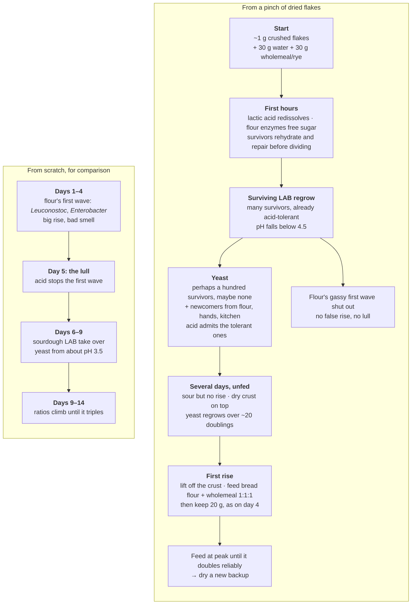

# Starting a Starter From Scratch: The 14-Day Method and What Each Stage Is

> **Context.** Every chapter in this document assumes a working culture already exists. This
> note covers the step before that: making one from flour and water. The method is the one
> actually used here, Kristen of Full Proof Baking's 14-day tutorial, and it is recorded at
> the level of grams and hours so it can be followed at the bench. Alongside it is what the
> literature says is happening in the jar at each stage. Most of the steps that put people
> off, such as the early rise that dies and the smell, turn out to be an ordinary and
> well-documented succession of microbes. *The finished culture* describes where the
> succession ends: who lives in a settled starter, how its yeast and bacteria get along, and
> when it is settled, ready and at its best. *Keeping it strong* covers how to measure a
> starter's strength and build it. A later section covers the other way to get a working
> culture: drying a backup and reviving it.
>
> The method below is taken from the title card she puts up at every feed, which gives the
> day's observations and the feed in grams, and checked against her narration on
> 2026-10-18. Her free companion PDF of day-by-day notes was not read.

---

## The source

- **Video:** [How To Make A Sourdough Starter From Scratch](https://www.youtube.com/watch?v=m6pGkOuZnrk),
  Full Proof Baking, 7 February 2019, 26 minutes.
- **Notes PDF:** free from [her Gumroad page](https://fullproofbaking.gumroad.com/l/hdAXB),
  with timestamps and her answers to common questions.
- **After day 14:** [her maintenance video](https://www.youtube.com/watch?v=beKzcOe6w_o).
- **To print:** the schedule on one A4 page, [starter-cheatsheet.pdf](starter-cheatsheet.pdf)
  ([markdown](starter-cheatsheet.md)).

---

## The method as run in the video

### Setup

- **Flour mix, 30% rye:** 350 g bread flour plus 150 g dark rye, whisked together, 500 g in
  total. Every feed until day 12 uses this mix. In the video these are King Arthur
  unbleached bread flour and Bob's Red Mill whole grain dark rye. She picks rye for its
  nutrients and enzymes, and bread flour for strength. Plain flour also works for the base.
- **Water:** purified or bottled in the video. See *Adjusting it for this kitchen* below.
- **Temperature:** "warm room temperature", 24°C (75°F), for all 14 days. Her target and
  her time-lapse are at 27°C (80°F); see below.
- **Cover:** cheesecloth and a rubber band until day 8, then a loosely fitted lid.
- **Gauge:** a rubber band around the jar at the level of each fresh feed.
- **A fresh jar** on day 2 to keep mould away, and again whenever the jar gets messy.
- **A scale reading to 0.1 g**, tared before each ingredient. The feeds go down to 5 g.

Ratios are **starter : water : flour by weight**, so every feed is at 100% hydration.

### Day by day

"Her notes" is the text of her title card for that feed. Rises are measured against the
rubber band from the previous feed.

| Day | Feed, starter / water / flour | Ratio | Her notes | Video |
|---|---|---|---|---|
| 1 | — / 30 g / 30 g, rest 24 h | — | Prep flour mix, stir together flour and water | 1:50 |
| 2 | Stir and move to a fresh jar, 24 h | — | (Narration: a dried, darker skin on top) | 3:45 |
| 3 | 20 / 20 / 20, the only feed today | 1:1:1 | "Caught some wild yeast" | 4:50 |
| 4 am | 20 / 20 / 20. **Two feeds a day from here** | 1:1:1 | Lots of activity (~3–4×), unpleasant smells | 6:35 |
| 4 pm | 16 / 16 / 16 | 1:1:1 | Again lots of activity, unpleasant smells | 7:45 |
| 5 am | 15 / 15 / 15 | 1:1:1 | **No significant growth!** Very unpleasant smells, very runny | 8:40 |
| 5 pm | 16 / 16 / 16, fresh jar | 1:1:1 | Minimal growth, smelly | 9:45 |
| 6 am | 15 / 15 / 15 | 1:1:1 | 1.2×, less smelly, more mild | 10:35 |
| 6 pm | 15 / 15 / 15 | 1:1:1 | 1.3×, less smelly, more mild | 11:20 |
| 7 am | 15 / 15 / 15 | 1:1:1 | 2×, smells nice, mild, **bit of sour** | 11:50 |
| 7 pm | 15 / 15 / 15 | 1:1:1 | 1.5×, nice mild sour smell | 13:35 |
| 8 am | 15 / 15 / 15. Start collecting (and freezing) discard; loose lid replaces cloth | 1:1:1 | 1.9×, very nice, sweet and sour | 14:05 |
| 8 pm | 15 / 15 / 15 | 1:1:1 | 2× | 14:55 |
| 9 am | 15 / 15 / 15 | 1:1:1 | 2.5× | 15:20 |
| 9 pm | 8 / 16 / 16 | **1:2:2** | Steady 2.5×, increase feed ratio | 15:50 |
| 10 am | 8 / 16 / 16 | 1:2:2 | Steady 2.5×, stick with 1:2:2. (Narration: it had peaked and fallen) | 16:40 |
| 10 pm | 5 / 15 / 15 | **1:3:3** | 2.5×, peaked and fell. "Best to feed at peak!" | 17:20 |
| 11 am | 5 / 20 / 20 | **1:4:4** | 2.5× (narration: at peak, not fallen) | 18:00 |
| 11 pm | 5 / 25 / 25 | **1:5:5** | 2.5× | 18:25 |
| 12 am | 5 / 25 / 25, then **make the 10% rye mix** | 1:5:5 | 2.5×, smells so sweet, with sour notes | 18:55 |
| 12 pm | 5 / 20 / 20, 10% rye mix from here | 1:4:4 | 2.5×, getting more active | 20:25 |
| 13 am | 5 / 25 / 25 | 1:5:5 | 2.5× | 21:00 |
| 13 pm | 5 / 25 / 25 | 1:5:5 | 2.5× | 21:40 |
| 14 am | 8 / 16 / 16. **Three feeds a day from here** | 1:2:2 | 2.5× | 22:15 |
| 14 afternoon | 8 / 16 / 16, about 7 h later | 1:2:2 | 2.5× | 23:10 |
| 14 pm | 10 / 50 / 50, overnight | 1:5:5 | 2.5× | 23:35 |

**The 10% rye mix** (day 12, at 19:20): what is left of the 30% mix weighs 155.5 g and holds
46.5 g rye. Bring the total up to 465 g with bread flour, about 310 g. Her card gives the
reason: more strength, "higher peak, hold peak longer". Her narration expects less rye to cost
some activity, but the first 10% feed still peaked and fell before morning, so she kept the
ratio at 1:5:5.

**Day 14 time-lapse** (24:20), in an oven with the light on at 27°C (80°F), in a jar marked
for 2× and 3×:

| Feed | 2× | Peak |
|---|---|---|
| 1:5:5 | 5 h | 2.9× at 7.5 h |
| 1:2:2 | 4 h | 3× at 7 h |

### Her rules

- **The target:** "more than triple in 4–6 hrs when fed 1:2:2, kept at 80°F", so at
  **27°C, not room temperature**. Her 3.5-year-old starter, Ozzy, is shown against it at 12:40.
  By that measure **the day-14 starter is not there yet**: 3× at 7 h. She calls it "still
  pretty young" and expects it to keep strengthening if it is fed at peak.
- **Week 1** is "catching wild yeast" and "waiting for microbes to balance out". **Week 2**
  is "building starter activity" and "increasing starter strength". A 1-week starter can be
  practised with, but for a proper loaf she wants the second week.
- **Feed at peak.** Feeding a starter that has already peaked and fallen weakens it over time.
  When it peaks well before the next feed is due, raise the ratio. That is the whole of days
  9–13.
- **Fewer than three feeds a day** is fine, but use higher ratios to compensate, up to
  1:10:10 if the starter can take it.
- **Write down** volume increase, consistency and smell at every feed.
- **Storage:** the fridge covers 2–4 weeks with no feed at all. Dehydrated, it keeps for
  years as a backup. See *Drying a backup and reviving it* below.
- Her closing card sums it up: **"Feed at peak! Monitor your starter! Keep it warm!"**

---

## What is happening in the jar

Her schedule follows the laboratory literature closely. Two studies anchor this section.
Van der Meulen et al. (2007) held their doughs at 30°C. Ercolini et al. (2013) fermented
theirs for 5 hours a day at 25°C and held them at 10°C in between. Both refreshed daily.

### Days 1–4: the early rise is bacteria, not yeast

Flour carries a mixed population, mostly *Proteobacteria* such as *Pantoea*, *Pseudomonas*
and *Enterobacter*. Within a day of mixing almost all of it is suppressed except the
*Enterobacteriaceae*, and lactic acid bacteria take over (Ercolini et al. 2013). The first
LAB to dominate are not typical sourdough organisms at all. They are genera such as
*Leuconostoc*, *Lactococcus* and *Enterococcus*, and they fall below detection within the
first day or two at 30°C (Van der Meulen et al. 2007). Rye flour is the exception,
arriving with *Weissella* already dominant (Ercolini et al. 2013).

The gas behind her 3–4× rise on day 4 comes from this first wave. Debra Wink had a day-two
starter analysed by two labs. Both found the gas producer was *Leuconostoc citreum*, with a
little *Enterobacter cloacae*, and neither found any lactobacilli or yeast. She also links
*Enterobacter*, *Aerococcus* and *Leuconostoc* to the bad smell (Wink 2008b).

### Day 5: the lull

As acid builds up, the first wave stops growing. Before the right organisms have built up
numbers, the jar goes quiet. That is her day-5 morning card, "no significant
growth!", with the worst smell of the run.

Wink tracked this with pH paper (Wink 2008a). The gassy bacteria grew at or above pH 5 and
not at or below 4.5. Yeast did not start to grow until the pH fell to around 3.5 (Wink
2008b), and she never saw it before a jar turned sour. She also
suggests that *L. citreum* leaves behind bacteriocins that hold back the lactobacilli after
it stops growing, so that a bigger early rise means a longer lull (Wink 2008b). Treat all of
this as careful amateur work. The pH paper read to the nearest 0.5, no replicate counts are
given, and the bacteriocin account is her hypothesis.

The lab data is consistent with it. At 30°C the pH falls below 4.0 after day 2. Yeasts lag
behind the LAB, reaching high numbers (10⁷ CFU/g) after 4–5 days of backslopping, and in
one of four doughs only after 8 days (Van der Meulen et al. 2007).

### Days 6–9: the sourdough consortium takes over

Sourdough-specific LAB such as *Lactobacillus*, *Pediococcus* and *Weissella* replace the
first wave. From about day 5 at 30°C, well-adapted strains dominate and little changes
after that (Van der Meulen et al. 2007). In the 25°C study, maturity arrives in 5–7 days of
propagation, with lactobacilli prominent by day 10 (Ercolini et al. 2013). Her "bit of sour"
on day 7 and her narration's "definite sour notes" on day 9 are this transition, running
about a day behind the 30°C timeline.

### Why the yeast comes last

Nothing is caught on day 6. The yeast came in on day 1, with the flour and the baker's
hands (Reese et al. 2020; *Where the video and the literature differ*). What day 6 marks
is the point where there are enough of them to lift the jar. Four things set that date.

1. **It starts rare.** Flour carries mostly bacteria (Ercolini et al. 2013), and a ripe
   starter holds about 10⁷ yeast cells per gram (Van der Meulen et al. 2007). Each tenfold
   is about 3.3 doublings, so from a few cells per gram that is around 20 doublings.
2. **It loses the first races.** Fresh flour is close to neutral, which suits the first
   wave. It dominates within a day, takes the sugar first and makes the early rise
   (*Days 1–4*), while the yeast is still a small minority. Every feed also discards most
   of the jar: at 1:1:1 the kept starter is a third of the new mix, so the yeast has to
   manage about 1.6 doublings per feed just to hold its ground.
3. **Acid clears the field.** The first wave's own acid ends it: the gas producers grew at
   pH 5 and above and not at 4.5 and below (Wink 2008a), while the classic sourdough yeast
   grew unaffected from pH 3.5 to 7 (Gänzle et al. 1998). The pH falls through a range
   that stops the competition but not the yeast. The lull is the changeover, with the
   first wave stopped and the yeast still too few to show (*Day 5*).
4. **Then it climbs.** Wink saw no yeast growth until the pH fell to around 3.5, and it
   usually followed soon after (Wink 2008a, b). At 30°C the yeast reached 10⁷ per gram after 4–5 days of backslopping, and in
   one dough in four only after 8 (Van der Meulen et al. 2007). The video, at 24°C, runs
   about a day behind that.

**The test of the account is Wink's acidified starts.** With ascorbic acid (vitamin C) in
the day-1 mix, her jars and a colleague's had no gassy bacteria and showed yeast on or
before day 4, where it had been taking about seven days. The one jar she acidified straight
to pH 3.5, with citric acid, had yeast on day 2 (Wink 2008a). Pineapple juice, the version
her group settled on, did the same with water controls alongside, but she gives no day
counts for it, only a "more timely and predictable result" (Wink 2008b). Start acidic, and
the yeast comes sooner. *(Hypothesis:)* acid is the gate. That reading fits her pH-paper series and
the lab counts, but her work is careful amateur work, and no study found here isolates
acid as the cause. The flakes in a revival work the same way (*What it skips*), and *Flakes
in a new start* tries them in a fresh mix (open test 12).

### Days 9–14: ratio escalation is about timing, not species

By day 9 the community has largely settled. What remains is matching food to appetite. A
1:2:2 feed that peaks and collapses within 12 hours has run out of food well before the
next feed, and sits in its own acid until then. A higher ratio dilutes the starter further,
so it takes longer to reach peak, and dilutes the acid it carried over. This is the same
dilution lever chapter 11's recovery protocol uses at 1:10:10.

**"Feed at peak" is a practitioner's rule, not a measured result.** The plausible
mechanism is chapter 11's compounding stressors. Past peak, the substrate is spent and acid
and ethanol are at their highest, so a starter that is always fed after collapse is always
fed in its most stressed state.

**What it looks like when the ratio stays put** *(own run, October 2026)*. A starter here
was held at 1:2:2 to 1:3:3, twice a day, through its second week, and was sometimes fed
after it had fallen, though not long after. After the lull it gave several strong rises,
then slowed markedly within days. The reading above gives the shape: as the culture strengthened, its peak came
earlier, so more of each twelve-hour cycle was spent collapsed in acid and ethanol, and
the yeast lost a little ground at every feed. Held to the clock, the better it got, the
harder each feed punished it. Nothing was caught or killed: the species were settled and
only the yeast's share fell. *Setting the ratio by the interval* gives the rule that
prevents it, and open test 9 records the recovery.

---

## The finished culture

The succession above ends in a culture that stays put. This section describes what that
culture is, how its yeast and bacteria get along, and three timelines: when it has settled,
when it is ready, and when in each feed it is at its best.

### Who lives there

Most starters are simpler than the word "consortium" suggests. In 500 home starters from
four continents, the median held one yeast and three LAB or acetic acid bacteria, and many
were dominated by a single yeast and a single bacterium (Landis et al. 2021):

- **The yeast** was usually *Saccharomyces cerevisiae*, the same species as baker's yeast
  but wild strains. It made up more than half the fungal DNA in 77% of starters.
- **The bacteria** were most often *L. plantarum* and *L. brevis*, found together in 177 of
  the 500.
- ***Fructilactobacillus sanfranciscensis***, the bacterium of San Francisco sourdough,
  dominated wherever it occurred, but it was the exception. It turned up mainly in older
  starters and ones bought from a business.

Bakery sourdoughs are where the classic pairing lives: *F. sanfranciscensis* with the yeast
*Kazachstania humilis* (earlier *Candida milleri* or *C. humilis*). Two Italian bakeries
kept that pair, alongside *S. cerevisiae*, stable for three years (Venturi et al. 2012).

### How they share the food

The main sugar is maltose. The flour's own enzymes keep releasing it from starch, and the
heterofermentative LAB of wheat and rye sourdoughs prefer it (Gänzle 2014).
*F. sanfranciscensis* splits maltose with a maltose phosphorylase (Ehrmann and Vogel 1998),
and *K. humilis* cannot use maltose at all, so the classic pair does not compete for the
main sugar. Together they use more of it. Paired with LAB of the obligately
heterofermentative group *F. sanfranciscensis* belongs to, *K. humilis* leavened dough as
well as *S. cerevisiae* did with the same partners, though on its own it never matched
*S. cerevisiae* (Carbonetto et al. 2020).

Two common claims need care:

- **That the bacterium leaks glucose to feed the yeast.** It is not universal: in Greek
  sourdough LAB, no glucose built up outside the cells (De Vuyst et al. 2002).
- **That they divide the food neatly.** In the three-year bakery study, all three species
  grew at about the same rate and none of the main sugars ran out. The authors credit that,
  not a division of labour, for the stable association (Venturi et al. 2012).

The yeast can also feed the bacteria. In co-culture with sourdough yeasts, two sourdough
lactobacilli grew faster and to higher numbers, and when their medium lacked valine or
leucine, amino acids they need, the yeasts supplied them (Gobbetti et al. 1994).

Both partners tolerate the acid the bacteria make. *C. milleri* grew unaffected from pH 3.5
to 7, and *F. sanfranciscensis* grew between pH 3.9 and 6.7. Undissociated acetic acid sets
the limit: the yeast stopped at 150 mmol/L, while the bacterium tolerated more than 160
(Gänzle et al. 1998).

### Is it a symbiosis?

Loosely, yes: the partners live together and stay together. Strictly, the evidence is
mixed. In the most direct test, the yeasts' numbers fell when LAB were present, the LAB
were rarely affected by the yeasts, and no pairing benefited in numbers. The authors call
for rethinking the idea that the partners coexist by helping each other (Carbonetto et al.
2020). Yet in a synthetic sourdough, *F. sanfranciscensis* grew poorly alone and persisted
only when paired with *K. humilis* (Landis et al. 2021), and the amino acid supply above is
a real benefit to the bacteria. The fairest summary: the bacteria gain from the yeast, the
yeast mostly tolerates the bacteria, and the pair ferments better than either does alone.

### Heat changes who wins

The classic pair held its ground against every competitor tried at 20–30°C, with 12–24 h
between feeds and 5–20% of the old dough carried over. At 35–40°C a different association
won: *L. reuteri* and *L. johnsonii* with the yeast *Issatchenkia orientalis*, which could
only grow with enough oxygen (Vogelmann and Hertel 2011). Chapter 09 describes the same
kind of shift for repeated hot builds.

*Issatchenkia orientalis* is the yeast chapters 08 and 09 call *Pichia kudriavzevii*, earlier
*Candida krusei*: one species under three names, so the two parts of this document describe
the same organism. The two associations also map onto the two kinds of sourdough the
literature distinguishes (De Vuyst and Neysens 2005). Type I is the traditional starter,
backslopped daily at 20–30°C, and it leavens the bread itself. Type II is the industrial
acidifier: liquid, held above 30°C for days, dominated by *L. reuteri*, *L. pontis*,
*L. johnsonii* and their relatives with little or no yeast, and used for acid and flavour
while baker's yeast does the lifting. Repeated hot builds push a home culture from the first
toward the second.

**What each team gives the bread.** The cool team is the one the literature was written
about; the hot team is sketched from Type II sourdoughs, which are not a home jar.

| | Cool team, 20–30°C | Hot team, 35–40°C |
| --- | --- | --- |
| Who | *F. sanfranciscensis* with *K. humilis*; at home, *S. cerevisiae* with *L. plantarum* and *L. brevis* | *L. reuteri* and *L. johnsonii*, with *I. orientalis* or no yeast |
| Leavening | Self-sufficient. *S. cerevisiae* is baker's yeast; *K. humilis* leavened as well in co-culture (*How they share the food*) | Weak. *I. orientalis* grew only with oxygen (Vogelmann and Hertel 2011), and Type II sourdoughs are leavened with added baker's yeast. The gas comes from whatever cool-team yeast survives |
| Acid | Heterofermentative: lactic and acetic; chapter 04 has the lever. Acetate production falls off at 35°C (Brandt et al. 2004) | Fast and deep, pH toward 3.5 in a day. *L. johnsonii* makes lactic only; *L. reuteri* adds some acetic and ethanol. Lactic-dominant, as chapter 09 says |
| Dough | Heterofermenters with glutathione reductase accumulate thiols and depolymerise the gluten macropolymer, so the dough softens and extends (Vermeulen et al. 2006) | Exopolysaccharides: *L. reuteri* strains make reuteran and levan from sucrose, which soften the crumb and add volume (Tieking and Gänzle 2005). Some *F. sanfranciscensis* strains make levan too |
| Aroma | Yeast esters and higher alcohols on top of the acid | Little from the yeast. *L. reuteri* accumulates glutamate, which reads as umami in the bread (Zhao et al. 2015) |

What is solid: the species, the Type I and II split, the oxygen dependence of *I. orientalis*,
acetate falling at 35°C, and the homo- against heterofermentative acid split. What is weaker:
the exopolysaccharide and glutamate effects are strain-dependent and were measured in
industrial or laboratory sourdoughs; Vermeulen et al. found the thiol effect in
heterofermenters with glutathione reductase and not in the homofermenters they tested, and
whether this kitchen's *L. reuteri*, if it has any, carries the enzyme was not checked; and
the hot team's aroma is thin in the literature. No study found here measured *I. orientalis*
leavening a dough on its own.

The practical reading is chapter 08's rule with its reason attached. The hot team is good at
what a hot build is for, fast and deep acidification with a lactic profile that suits pizza
(chapter 09), and bad at what the mother is for, which is rising on time. A culture built hot
for months drifts toward a Type II acidifier, and chapter 11's diagnosis table already
describes the end state: sharp sour and no rise is the hot team on its own. Keep the mother
cool to keep the leavening team; the fridge-banked levains of the
[levain bank](heat-driven-levain-bank.md) are a hedge, not a cure.

### Three timelines: settled, ready, at its best

| Timeline | What happens | When |
| --- | --- | --- |
| **Settled** (days) | The species stop changing | About day 5–7 at 25–30°C (*Days 6–9*). Yeast reaches 10⁷ per gram after 4–5 days of feeding, in one dough only after 8 (Van der Meulen et al. 2007) |
| **Ready** (days) | It triples in 4–6 h on 1:2:2 at 27°C | Day 14 in the video. The second week builds numbers and timing, not new species |
| **At its best** (hours) | Both partners growing, sugar still there | From mid-rise to peak *(hypothesis)* |
| **Past peak** (hours) | Acid and ethanol at their highest; the balance tips toward the bacteria | From the peak until the next feed |
| **Long term** (months to years) | The species hold, the strains turn over | Strains replaced within 6–12 months; LAB counts swing ten- to a hundredfold (Minervini et al. 2018) |

**When it is ready.** A starter is microbially settled in about a week, and ready to bake
with once it passes the tripling test, about two weeks in. Settled comes first: the second
week does not bring new species, only enough of them to rise on time.

**When it is at its best, within each feed.** *(Hypothesis:)* the culture is most in
balance from mid-rise to peak. Then both partners are growing on sugar that is still there,
as the bakery study found them doing (Venturi et al. 2012). Past peak the bacteria keep
making acid, and the yeast suffers first. It stops at less undissociated acetic acid than
the bacterium tolerates (Gänzle et al. 1998), and in co-culture the bacteria already hold
its numbers down (Carbonetto et al. 2020). This is the mechanism behind feeding at peak,
which is still a practitioner's rule, not a measured one (*Days 9–14*).

**Over months and years.** Ready is not finished. In bakeries followed for a year, the
species stayed the same but the strains were replaced within six months to a year, with
flour the main driver (Minervini et al. 2018). Across home starters, younger ones were
often dominated by *L. plantarum* and *L. brevis*, and older ones more often held
*F. sanfranciscensis*. Landis et al. (2021) read that as bakers selecting it over
generations. No study found here shows that an older starter makes better bread.

**For the revived starter here.** The flakes brought back the old culture's bacteria; its
yeast may be new (*What it skips*). *(Hypothesis:)* a new yeast is most likely
*S. cerevisiae*, the yeast of most home starters. If the old bacterium was
*F. sanfranciscensis*, that is the pairing Landis et al. found negatively associated, and
the bacterium may give way over the coming months. Open test 7 would show it.

---

## Keeping it strong

A starter that passes the readiness test can still be weak next to an old one. This section
covers how to measure strength, why it keeps building after day 14, why a revived starter
starts behind, what builds it, how to set the ratio by how often you feed, how to plan
the next feed around an absence, and how to rescue a slowed starter around a working day.

### Measuring strength

Two numbers carry it: **time to peak** and **height at peak**, both at a fixed ratio and a
measured temperature. Her readiness test fixes all four: more than triple in 4–6 h on 1:2:2
at 27°C (*Her rules*). A reading at another ratio or temperature says little, and two
starters compare fairly only on the same feed in the same place. The 4–6 h holds only at
27°C: a cooler jar stretches it, by about half again at 20°C (*Planning the next feed*), so
a jar that cannot be kept at 27°C takes the test on a day it can, or is read against a
longer yardstick.

- **Judge at peak, not an hour in.** Early in a feed even a strong starter shows little. The
  feed has diluted the cells, a 1:2:2 feed to a fifth, and the first gas dissolves in the
  water before it forms bubbles.
- **Repeat it.** Two or three feeds in a row with the same result, not one good rise.
- **Smell at peak.** Sour with little rise means the bacteria are ahead of the yeast
  (*Reviving it*). Sharp vinegar is a warning sign (item 8 below).
- **The real test is the dough:** [the levain doubling test](levain-doubling-test.md).

*What to record* lists the rest.

### Why it keeps getting stronger

Ready is a floor, not a ceiling. Her day-14 starter tripled in 7 h, short of the test her
3.5-year-old starter passes, and she expects it to strengthen if fed at peak (*Her rules*).
Bakers widely report the same. No study found here measures leavening against a starter's
age, though, and none shows an older starter makes better bread (*Over months and years*).

*(Hypothesis:)* the reason is selection. Each feed is a race: the strains that grow fastest
on this flour, at this temperature and ratio, leave the most cells in the portion kept, and
over hundreds of feeds they take over. There is room for it: in bakeries followed for a
year, the species held while the strains were replaced within six months to a year
(Minervini et al. 2018). Chapter 09 makes the same argument for kveik and hot builds. If it
holds, the feeding regime is what the culture adapts to, and changing the regime restarts
the race.

### Why a revived starter starts weaker

The flakes bring back the old culture's bacteria, already selected by months of feeding,
but probably not its yeast (*What it skips*). The yeast in the jar is new or rebuilt from a
few cells, and has had none of that selection. It also starts against strong bacteria. In
co-culture, sourdough LAB held the yeasts' numbers down (Carbonetto et al. 2020), and the
yeast stops at less undissociated acetic acid than the bacterium tolerates (Gänzle et al.
1998). A revived starter that is sour but rises weakly is the expected result, not a
failure.

### Getting the most active starter

Most of this is practitioners' rules rather than measured results: levers to test, not
guarantees.

1. **Warm, measured in the jar: 24–27°C.** Her test is at 27°C. The classic sourdough yeast
   *C. milleri* grows best at 27°C, lower than the lactobacilli (Gänzle et al. 1998); that
   was not measured for *S. cerevisiae*. Not hot: at 35–40°C a different association wins
   (*Heat changes who wins*). Keep the mother at room temperature and build hot from it
   (chapter 08). [Holding a Temperature at Home](holding-temperature.md) has the means.
2. **Feed at peak.** Fed after collapse, the culture sits in its own acid and ethanol, and
   the yeast suffers first (*Three timelines*).
3. **Set the ratio so the peak lands at the next feed.** Raise it from 1:2:2 towards 1:5:5
   or 1:10:10 as the starter gets faster (*Days 9–14*). A higher ratio also dilutes the acid
   carried over, which is the point of chapter 11's 1:10:10 recovery feed. *(Hypothesis:)*
   that is what a yeast-short revived starter needs most. Open test 8. Starting points
   by feeds a day: *Setting the ratio by the interval*.
4. **Some wholemeal or dark rye in the feed,** for enzymes and minerals (chapter 11's
   recovery protocol), and one or two feeds on the baking flour before a bake.
5. **Keep the regime fixed:** flour, ratio, temperature, timing. If the selection account
   is right, this is what the culture adapts to.
6. **Keep a small mother.** Keeping 20 g makes high ratios cheap.
7. **After the fridge, two or three warm feeds at peak** before using it in dough. A jar
   left underfed in the fridge, sour and flat, gets chapter 11's recovery feed first:
   1:10:10 with some wholemeal at 24–27°C, judged at its peak, which can take most of a
   day. Then the two or three feeds at peak.
8. **Watch for vinegar.** In 40 starters whose rise was measured in the lab, the more
   acetic acid bacteria, the slower the rise (ρ = −0.51; Landis et al. 2021). The authors
   suggest acetic acid or inhibition of the yeast or LAB as the cause, untested. A sharp
   vinegar smell or a film calls for more frequent feeds. *(Untested here:)* these bacteria
   need oxygen, so a lid resting on the jar may hold them back better than a cloth.
9. **Give it weeks, and log time to peak and height at every feed.** The trend shows
   whether it is still strengthening.
10. **Dry a new backup once it doubles reliably** (*Drying it*), so the flakes hold the
    stronger culture.
11. **Stir with a purpose, or not at all.** A stir resets the rubber band, so it costs the
    time-to-peak and height numbers that item 9 and the readiness test depend on. Never in
    the oven. Pour the liquid off a collapsed jar rather than stir it back in. *Stirring,
    and what it moves* has the reasoning.

### Setting the ratio by the interval

The ratio is the dial that sets where the peak lands. Choose the interval the day allows,
then the ratio that puts the peak at it. Her day 14 gives the anchors: three feeds a day at
1:2:2, 1:5:5 overnight, and up to 1:10:10 for fewer feeds (*Her rules*). For a starter that
is getting strong, at 24–27°C:

| Feeds a day | Ratio |
| --- | --- |
| Three | 1:2:2 |
| Two | 1:4:4 to 1:5:5 |
| One | 1:10:10 |

Starting points, not settings. A young starter may take as long on 1:5:5 as on 1:2:2 (her
day-14 time-lapse: 7.5 h against 7 h), and a cool kitchen stretches every row. What the
jar shows at feed time decides the next ratio:

- **Domed and still climbing:** not yet. Wait.
- **Level, the first wrinkles or a dimple in the middle:** at peak. Feed now.
- **Sunken, liquid on top, a boozy smell:** it fell hours ago. Feed, and go one ratio up.

A cooler spot or a stiffer mix slows it too, but both change the regime the culture is
adapting to (item 5); the ratio does not. The readings are practitioners' signs, not
measured ones. Holding 1:2:2 twice a day into the second week is how a good starter fades
(*Days 9–14*).

### Planning the next feed

*Setting the ratio by the interval* reads the jar after the fact. This is the forward
version: from how fast the starter is now and how long until the next feed, choose the feed
so the peak lands when you are back. Three levers buy different amounts of time.

**Estimate the activity first.** Time to peak at the current ratio and temperature, from
the last two or three feeds in the log (*What to record*). The trend matters as much as the
number: if each feed has peaked earlier than the one before, go up a step now rather than
waiting for a sunken jar. In the second week that trend is steep (*Days 9–14*).

**What each lever buys** *(hypothesis; open test 10 calibrates it)*:

- **Ratio buys hours.** A feed of 1:r:r leaves the old starter as 1/(1+2r) of the jar, so
  each step dilutes the yeast and adds doublings it must grow back before the peak: 1:2:2
  to 1:5:5 is about 1.1 doublings, 1:5:5 to 1:10:10 about 0.9, the whole ladder about two.
  At a generation time on the order of two hours at 27°C, a figure borrowed from laboratory
  yeast rather than measured in a jar, the ladder buys a few hours, not a day. For a young
  starter it buys less: in her day-14 time-lapse, 1:2:2 and 1:5:5 peaked within half an
  hour of each other (*The method as run in the video*), so the peak there was set by
  something other than cell count.
- **Temperature buys more.** Below the yeast's optimum of about 27°C (Gänzle et al. 1998),
  rates roughly double per 8–10°C, the same Q₁₀ rule of thumb the
  [proteolysis note](proteolysis-ph-heat.md) uses for enzymes, so a jar at 20°C takes
  about half again as long as one at 27°C. Above the optimum the rate falls, and 35°C and
  up selects a different culture (*Heat changes who wins*), so cooler is the direction to
  use.
- **Stiffness buys some.** A stiffer feed rises more slowly and holds its peak longer, and
  chapter 11 already favours a stiff levain for its acid balance and heat margin. For a
  one-off absence it is fine, although item 5 says keep the regime fixed.
- **The fridge buys days.** Her storage rule is 2–4 weeks with no feed, then two or three
  warm feeds at peak before it goes into dough (item 7).

**By how long you will be away**, at 24–27°C, for a starter that peaks in about 6 h on
1:2:2. The hours are the hypothesis above; the shape is the rule.

| Away for | Feed |
| --- | --- |
| Less than its time to peak | The current ratio |
| About 1.5× it | One step up, 1:3:3 to 1:5:5 |
| About 2× it, a working day | 1:10:10, or 1:5:5 in a cooler spot |
| Overnight, 12–16 h | 1:10:10 in a cooler spot, or a stiff feed such as 1:6:10 |
| 24–48 h | Feed 1:5:5 and straight into the fridge |
| Days | The fridge |

The forward rule and the reactive one meet at the jar. If the table put the peak at your
return, the top is level when you get there; if it is sunken, the next guess goes one step
further.

**How long a 1:10:10 can sit.** Chapter 11 runs its recovery feed once a day, and her rule
allows one feed a day at 1:10:10, so a day is the designed interval. The hours below are
the same hypothesis as the table above.

| Jar temperature | Peak at 1:10:10 | Feed again by |
| --- | --- | --- |
| 27°C | 8–12 h for a healthy starter; 12–18 h for a tired one out of the fridge | 24 h |
| 20–22°C | About half again as long | 24–36 h |
| Fridge, once it has started rising | Holds for days | 1–2 weeks as a working levain; her 2–4 weeks for storage |

Past the peak it is not dying. It sits in acid and ethanol, and every hour there costs a
little vigour, not survival, so a short overshoot costs little. At 24 h warm it has fallen
and is a normal recovery feed. At 36–48 h warm it is the fed-after-collapse case of *Days
9–14*. Beyond that each day at room temperature costs more, and after several days mould
gets its chance (*Her rules*). Late to it: pour the liquid off, do not stir it in, and feed
1:10:10 again. Since 1:10:10 is the top of the ladder, a longer gap is bought with a cooler
spot or the fridge, not a higher ratio.

### A rescue around a working day

The case here (November 2026): a starter that slowed after a run of feeds missed during
the working day, in a jar that may have sat above 27°C in the oven. Neither cause was
measured. The two compound. A warm jar gets through its feed sooner, so with nobody home it
spends more of each day past its peak, in the acid and ethanol where the yeast suffers
first, and above about 27°C the yeast is past its optimum while the lactobacilli are not
(Gänzle et al. 1998). Nothing is lost that dilution cannot bring back (*Days 9–14*). The fix
is to make the peak land when someone is home, not to be home for the peak. Chapter 11's
recovery protocol, arranged around a working day:

1. **Out of the oven.** Chapter 11 recovers a culture at 22–25°C, not warmer, and a kitchen
   in November is close to that. Cooler also pushes the peak toward the evening.
2. **One feed a day at 1:10:10, before work.** Small amounts keep it cheap: 5 g of starter,
   50 g of water and 50 g of flour, 20–30% of it wholemeal or dark rye (item 4).
3. **Once a day, not twice.** *(Hypothesis, on the arithmetic of Planning the next feed:)*
   at 1:10:10 the old starter is 1/21 of the jar, so the yeast needs about 4.4 doublings
   just to get back to the density it was fed at. At two hours a generation that is about
   9 h at 27°C, and at half again in a cool kitchen about 13 h, more than a 12 h interval.
   Twice a day at 1:10:10 can dilute the yeast faster than it regrows.
4. **In the evening, read it without stirring.** Still rising: it peaks overnight, which is
   fine. Level or dimpled: note the time. Fallen, with liquid on top: pour the liquid off
   before the next feed rather than stirring it in (*Stirring, and what it moves*).
5. **Log time to peak every day,** and give it three to seven days before judging it
   (chapter 11). The peak should come earlier day by day.
6. **On a day off, the test:** 1:2:2 at 27°C, measured in the jar. Tripling in 4–6 h means
   it is back.
7. **Then the working week in the fridge.** Her rule allows 2–4 weeks unfed. Warm feeds at
   peak at the weekend, two or three before a bake (item 7), and a new dried backup once it
   doubles reliably (item 10).

Discard only for pink, orange or fuzzy growth, or a putrid rather than sour smell
(chapter 11). Even then the dried flakes remain.

### Stirring, and what it moves

Her method stirs once, on day 2, to break the skin and mix the jar before the first feed
(*Day by day*). Beyond that, a stir does three things at once, and they pull in different
directions.

- **It lets the gas out.** CO₂ is a product, not a resource, so losing it costs the culture
  nothing. It costs the baker the measurement: the rubber band, time to peak and height at
  peak all assume an uninterrupted rise, and a stirred jar reads from zero again.
- **It moves cells to fresh food.** In a 100% batter the cells barely move, so each colony
  sits in its own depletion zone and its own acid, and a stir redistributes both.
  *(Reasoning:)* a small benefit is plausible; nothing found here measured it in a jar.
  Industrial Type II sourdoughs are stirred tanks (De Vuyst and Neysens 2005), which shows
  that stirring does a liquid culture no harm, not that it helps.
- **It folds in air,** and this one cuts both ways. Yeast need a little oxygen to make the
  sterols and unsaturated fatty acids their membranes are built from (Andreasen and Stier
  1953, 1954), which is why brewers aerate wort before pitching, so a stirred levain may
  build more cells. But *F. sanfranciscensis* uses oxygen as an electron acceptor and turns
  it into acetate (Stolz et al. 1995; Gänzle 2014), so a stirred levain also trends sharper.
  And acetic acid bacteria need oxygen (item 8): a jar that already smells of vinegar or
  carries a film gets worse with stirring, not better.

**Not in the oven.** Chapters 10 and 11 make the slow ramp and the surface-to-core gradient
the protective factors in a hot build. A stir mixes the hot skin into the core and shortens
the ramp toward the shock conditions that killed more cells in Guyot et al.'s work (chapter
11). It also aerates at the temperature where the hot team's *I. orientalis*, the yeast that
grew only with oxygen (*Heat changes who wins*), is the one that benefits. *(Reasoning:)* a
stirred hot levain selects for the team that does not leaven.

**Early in a feed** nothing is depleted yet, so a stir adds air and little else.

**Before a feed,** a collapsed jar carries a layer of liquid: water, ethanol and acid. Pour
it off rather than stir it back in. It is a small version of chapter 11's dilution, and it
removes some of the ethanol that makes the next warm session harsher.

**The stir-down as a test.** Practitioners stir a peaked starter down and time the second
rise as a vigour check. It is a different measurement from time to peak, not a substitute,
and the two should not be mixed in one log. Open test 11 is the split-jar version.

---

## Where the video and the literature differ

The method works either way. Only the explanations differ.

1. **"Picks up the wild bacteria and yeasts from the air."** The evidence points to the
   **flour**, and then to the baker's hands. Bakers on two continents made starters from
   the same recipe and the same flour. Much of each starter's community traced back to
   the flour, and the differences between starters were associated with the bakers' hands
   (Reese et al. 2020). In established bakery sourdoughs followed over a year, flour was
   the main driver of the LAB population and the bakery's own microbiota played a minor
   role (Minervini et al. 2018). Wink points out that the activity happens even in a
   covered container (Wink 2008a). The cheesecloth does no harm, but it is not
   what inoculates the jar.
2. **Day 3: "We've caught some wild yeast!"** In a two-day-old starter, the rise is
   bacterial (above). Her narration qualifies it straight away as "not the correct
   balance", so the method is unaffected; only the label is wrong.
3. **Day 8: the loose lid because "this is a live culture that requires air".** The yeast
   and LAB ferment without oxygen. The lid needs to be loose so CO₂ can escape, not so air
   can get in.

---

## Adjusting it for this kitchen

### Temperature: warm is fine, hot is not

This kitchen keeps its culture warm and builds it hot (chapters 07–08, and [The Heat-Driven
Levain Bank](heat-driven-levain-bank.md)). **None of that belongs in the first two weeks.**
A new starter is a small, unsettled population, in the same position as the depleted
culture in chapter 11, whose recovery protocol is explicit: feed at 22–25°C and do not add
selection pressure.

Warm is a different matter, and her own method says so: her target is measured at 27°C
and her closing card says "Keep it warm!". Van der Meulen et al. (2007) ran their whole
establishment at 30°C and had a stable culture within a week. Chapter 09 also records why
the starting temperature matters beyond speed. With daily backslopping, 23°C selected for *Leuconostoc
citreum* as the dominant LAB, while 30°C and 37°C selected for *Lactobacillus fermentum*
(Van der Meulen et al. 2011). That is the same species Wink found behind the false start,
so at the video's 24°C the first wave may never fully leave.

So the choice of 24°C or 30°C is a choice of culture, not just of pace. *(Hypothesis:)* a
starter begun around 30°C may suit a warm-maintained regime better from the outset. That is
open tests 1 and 2 below. Either way, wait until it passes her tripling test before any hot build,
and then follow chapter 08's advice: keep the mother at room temperature and build hot from
it. How to hold any of these temperatures at home: [Holding a Temperature at
Home](holding-temperature.md).

### Water

The usual reason for bottled water is chlorine. Danish tap water is groundwater and is
normally supplied without chlorination, so tap water should do here.

### Flour

Any bread flour works for the base. The Manitoba used for bread is more than strong enough.
For the rye, use dark wholemeal rye (*fuldkornsrugmel*): the whole-grain fraction is the
point. The same reasoning is why chapter 11 adds wholemeal to a culture in recovery.

### An optional shortcut through the lull

Wink's alternative replaces the water with **pineapple juice**, to acidify the mix below
what the gas producers tolerate. Pineapple is more acidic than most juices. Orange juice
was not acidic enough for the day-1 mix alone, but orange juice and apple cider work if
they replace the water for two or three days (Wink 2008a). The day counts are from the
ascorbic acid trial before it: yeast on or before day 4, where it had been taking about
seven days (Wink 2008a). For juice she gives none (*Why the yeast comes last*). She is
clear that it "doesn't change the end result" (Wink 2008b), and wrote later in the same
thread that it is never necessary, "only patience". Applying it
to this method means juice in place of water for the day-1 mix and the day-3 feed. That
combination is this note's suggestion and has not been tried.

### Flakes in a new start *(own run, November 2026, in progress)*

A third way into the first week, between starting from scratch and reviving: a new day-1
mix with a little of the dried backup (*Drying a backup and reviving it*, below) added to
give the sourdough bacteria a head start. Run here at a desk measured at 23.5°C, under
muslin.

**So far.** The day-1 mix had a little dried starter in it; the amount was not weighed. By
day 2 it had risen. That was read as yeast at first, and the jar was fed a day early, with
a mix of rye, wholemeal and white flour. Read again, it was most likely bacteria: in a
two-day-old jar the rise is bacterial (*Days 1–4*), and some sourdough LAB make gas too.
Nothing was measured.

**What the reasoning predicts** *(hypothesis)*. The flakes work like Wink's juice, with
organisms in it. Their lactic acid and their surviving LAB acidify the fresh flour, and if
the pH falls below 4.5 before the flour's first wave builds, the jar skips the false rise
and the lull, as the pinch revival did (*What it skips*). Two things here may have reopened
the window: an amount of flakes that may be small against the fresh flour, and the early
feed, which diluted the acid they brought. The yeast still has to arrive and build up
either way.

**Which rise it was** tells the two apart, from the smell and a pH strip at the next feeds:

- **Cheesy or vomit-like, pH 5 or above:** the flour's first wave. Expect the day-4 surge
  and the day-5 lull.
- **Clean sour or yogurt, pH 4.5 or below:** the flakes' LAB. Expect no lull.

**From here** the two methods meet. Keep 20 g at each feed and feed 1:1:1 on the flour mix,
once or twice a day, with no high ratios until it smells sour and rises to about 2× again
(*Days 9–14*; *Reviving it*). **Record** the smell and rise at each feed, the pH if a strip
is to hand, the day of the lull or its absence, the first sour smell, the first 2×, and the
room overnight as well as by day. Open test 12 is the controlled version.

---

## Drying a backup and reviving it

Her storage rule says a dried starter keeps for years as a backup. Chapter 11 gives the
reason to keep one: after a heat kill, a backup is the only way back to the original culture,
rather than to whatever the flour supplies. That holds for the bacteria; the yeast may not
come through the drying (*What it skips*). The revival below is the one that worked here in
October 2026, on flakes a year old. A first attempt followed a recipe worked out in a
conversation with Claude in September 2026: a larger amount of flakes, soaked in warm water.
It did not take. *Why a pinch, not a spoonful* gives the likely reason, and the sections
after it correct two other things that conversation got wrong.

### Drying it

- **Spread it thin** on baking paper and leave it at room temperature until it snaps, about
  24–48 h (Country Roads Sourdough). Crumble it and store it airtight, dry, cool and dark.
- **No oven and no warm dehydrator.** Until the film is dry it is a wet culture, and chapter
  11's limits apply: six hours or more at 40–45°C is high risk. The same guide allows a dehydrator only
  below 37°C. Once the film is dry, heat is much less of a threat (below).
- **Which stage to dry is open.** The usual advice is a starter at peak (Country Roads
  Sourdough). *(Hypothesis:)* the literature points later. In *S. cerevisiae*, fewer than
  one growing cell in a million survived air-drying, against 20–40% from cultures that had
  run out of food and stopped growing (Calahan et al. 2011). A starter at peak is running out
  of food, and one that has peaked and begun to fall is further along. The transfer is
  uncertain: the study ties the tolerance to the switch to respiration when sugar runs out,
  a starter jar is short of oxygen, and no sourdough yeast was tested. That is open test 4.

### Reviving it

The method as run here. The amounts are rough estimates rather than weighed, and the method
does not seem sensitive to them.

1. **Start:** crush a good pinch of flakes, around 1 g, into a day-1 mix of wholemeal and
   rye: about 30 g of water and 30 g of flour, half of each. Use water at room temperature or
   a little above, not cold from the tap (*Water: not cold*, below). No separate soak.
2. **Wait, unfed, for several days** at 24–26°C, until it is clearly active. A dry crust
   forms on top. It is the same skin as day 2 of the main method, and does no harm.
3. **Lift off the crust and feed what is underneath**, now with bread flour and wholemeal,
   at about 1:1:1. From the next feed on, keep 20 g and discard the rest, as on day 4.
   Feeding the whole jar every time lets the ratio fall with every feed.
4. **From there, feed at peak** as in the main method. Give it one or two feeds on the usual
   flour before baking with it.
5. **Dry a new backup** from it once it doubles reliably.

**Record** the age of the flakes, roughly how much went in, the water temperature, the day
it first smells sour, and the days of the first rise and the first doubling. Sour without a
rise is the LAB back and the yeast not yet (*What it skips*). Open tests 4–6 need those
numbers.

### What drying does, and what water undoes

A dried starter is not a paused starter. Drying removes some of what was in the jar, keeps
the rest, and kills most of the cells, and rehydration starts from what is left.

| What | Through drying | Why |
|---|---|---|
| Water | Leaves, down to equilibrium with the room | — |
| CO₂ and ethanol | Leave | A gas and a volatile, from a thin film |
| Acetic acid | About half leaves | Volatile: 57% kept through freeze-drying (Kline 1979) |
| Lactic acid | Mostly stays | Not volatile: 85% kept through freeze-drying (Kline 1979) |
| Spent flour: starch, gluten, bran, minerals | Stays | Already part-fermented, so little food is left in it |
| Flour enzymes | Stay, idle until wet | Flour is itself a dry product whose enzymes work once wetted |
| Cells | A minority survive dormant; the rest die | Below |

The acid figures are from freeze-drying, which is fast and cold. Slow air-drying probably
loses at least as much acetic acid. What the flake carries back is therefore mostly lactic
acid, which is why the dose matters (*Why a pinch, not a spoonful*).

**The first hours: still a starter.** A freshly spread film keeps fermenting until it has
lost too much water to grow, so it goes on making acid for a while. As the water goes,
everything dissolved in it concentrates: sugars, salts and acids. The cells face rising
osmotic and acid stress before they are ever dry. This part is reasoning; nothing here
measured it.

**Drying: who survives.** Cells that have stopped growing survive drying far better than
growing ones (Calahan et al. 2011, under *Drying it*). The damage that kills the rest is
mechanical, structural and oxidative (Dupont et al. 2014, for yeast). In LAB, the membrane
is the main site of injury, at the points where it changes phase during drying or
rehydration (Santivarangkna et al. 2008). The two partners do not survive equally. In a
freeze-dried San Francisco starter, 30–45% of the bacterium, *L. sanfrancisco* (now
*Fructilactobacillus sanfranciscensis*), survived with a protective additive, and 0.7%
without. The yeast, then called *Torulopsis holmii*, fell below 0.01%: the
patent calls it "destroyed by freeze-drying" (Kline 1979). Freeze-drying is not air-drying,
and this is a patent rather than a paper. But it is the only sourdough-specific comparison
found, and it points the same way as the revival here: the yeast is the bottleneck.

**Why the bacteria come back.** Not because they are tough: without the additive, over 99%
of Kline's bacterium died. They come back on numbers. A ripe starter holds about 10⁷ yeast
cells per gram and far more LAB (*What it skips*), and the bacteria then lose a smaller
share, so their survivors outnumber the yeast's by much more than the 70-fold gap in
survival alone. Before any storage loss, 0.7% of the bacteria in a 1 g pinch is more than a
hundred thousand cells, against fewer than about two thousand yeast. Why the bacterium dies
less is not established. Kline does not say, and bacteria range from dying within seconds of
drying to surviving it for millennia, by mechanisms still largely unexplained (Potts 1994).
Two easy explanations are weaker than they look. Having stopped growing protects yeast
(Calahan et al. 2011), but no such comparison for sourdough LAB was found. And the starter's
acidity is not itself a shield: acid-adapted *Lactococcus lactis* survived spray-drying no
better than unadapted cells (Cnossen et al. 2020). The flour around the cells may protect
them a little, as Kline's additive protected them a lot; nobody has measured that in a flake.

**The dry flake.** Air-dried flakes end up in equilibrium with the room. Water activity
equals the relative humidity divided by 100 (FDA 1984), so a kitchen at 50% gives about
0.5, far below anything that grows. Metabolism stops. Dried yeast kept at 55% relative
humidity survived 3 months with no loss (Ribert et al. 2021). Losses in storage come mainly
from oxidation of membrane lipids, and temperature and moisture set the rate (Santivarangkna
et al. 2008). That is the reason for airtight, cool and dark.

**Rehydration.** Four things happen at once:

- The lactic acid redissolves. A pinch gives the fresh flour a small dose; a spoonful gives
  close to full-strength starter acid.
- The flour enzymes in the fresh flour, and any left in the flake, start freeing sugar
  again.
- Surviving cells take up water and their membranes pass back through the phase change.
  That is the moment of leakage, worse in cold water (*Water: not cold*).
- Dead cells leak their contents into the mix.

The survivors then need a lag while they repair before they divide. From there the revival
is a race between regrowth and the flour's own microbes, and the next two sections cover
how it goes.

### How the revival unfolds

A map of the sections that follow, set beside the first week from scratch. The timings are
the run here (October 2026). The order of events inside them is the reasoning in *What it
skips*: no pH or counts were taken.

The pinch skips the first two boxes of the from-scratch column, the bacterial half of the
first week: its surviving LAB supply the acid the third box waits for. The yeast still has
to build up.

### What it skips: the first week

From scratch, the first week is a succession (*What is happening in the jar*, above): a
first wave of gassy bacteria rises and collapses, the jar goes quiet and smells, and only
then do the sourdough organisms take over from tiny numbers. The revival here skipped all of
it. It took days, but there was no false start and no lull.

The likely reason is the inoculum. The LAB surviving in the flakes are sourdough organisms
that months of feeding already selected, and they grow well at the acidity they make. They
acidify the fresh flour before its first wave builds up, closing the window Wink measured:
the gas producers grow at pH 5 and above and not at 4.5 and below (Wink 2008a). From scratch,
nothing acid-tolerant is present in numbers, which is why the first wave gets days. This is
reasoning that fits the run here; no pH was measured.

The days it did take were mostly the yeast. Here the revival behaved as if the LAB had come
through and the yeast had to be caught again (October 2026), and the numbers fit that. A
ripe starter holds about 10⁷ yeast cells per gram (Van der Meulen et al. 2007) and far more
LAB. In Kline's starter, drying killed the yeast at least 70 times harder than the bacterium
(below 0.01% surviving, against 0.7%), and a year in storage cost even commercial dried
yeast 94% (Ribert et al. 2021). Applied to a 1 g pinch, about 2 g of starter before drying,
that leaves perhaps a hundred live yeast cells, possibly none. That is one or two per gram of
the fresh mix, over 20 doublings short of a ripe starter (each tenfold is about 3.3, *How
long it keeps*). The LAB start from far more survivors. This is arithmetic on borrowed
figures, not a count: Kline's starter was freeze-dried, and Ribert's yeast was grown to be
dried.

So the yeast in the revived starter may not be the original. Whatever survives in the
flakes competes with yeast arriving the way it does from scratch: with the flour, and from
the baker's hands (Reese et al. 2020; *Where the video and the literature differ*). A kitchen
that kept the starter for years may hold its yeast too. In four bakeries, the sourdough's
dominant yeast also dominated the walls, air, storage boxes and mixers (Minervini et al.
2015). A bakery holds far more flour and dough than a home kitchen, and the study cannot say
which way the yeast moved, so this is a loose analogue. A "new" yeast may be the old one
coming back from the kitchen.

Either way, the yeast does not arrive in a from-scratch jar. The LAB have already acidified
it, and Wink saw no yeast growth until a jar fell to around pH 3.5 (Wink 2008b). So
the yeast's clock starts at once instead of after a week of bacterial succession, and the
acid favours yeasts that tolerate it. The revival skipped the bacterial half of the first
week, not the yeast half.

For the backup, this means it reliably brings back the bacteria, and perhaps the yeast.
Drying later in the cycle may save more of the yeast (*Drying it*, open test 4). Whether the
yeast now in the jar is the old one is open test 7.

### Why a pinch, not a spoonful

The first attempt here used a larger amount of flakes, soaked in warm water, and did not
take. The pinch did. The likely difference is acid. Flakes are the old starter's flour plus
all of its lactic acid, which does not evaporate in drying. A spoonful in a little water and
flour leaves the survivors in close to full-strength starter acid with little fresh food.
That is chapter 11's dying culture, which its recovery protocol dilutes out at 1:10:10.

A pinch in 60 g of fresh wholemeal and rye is far more dilute than that. It also gives the
survivors plenty of food, and wholegrain flour is what chapter 11 adds for recovery.
Country Roads Sourdough's recipe is the high-dose kind (5 g of flakes into 20 g of water and
20 g of flour) and expects about a week.

Two things changed between the runs, the amount and the soak, so one run cannot separate
them; that is open test 6. The warm soak is the less likely culprit. At 35–38°C for half an
hour it is a brief excursion by chapter 11's standards, unless the water was hotter than
that.

### Water: not cold

The chat advised lukewarm rather than hot water, then put lukewarm at 25–30°C, because the
cells are most fragile in the first minutes as water rushes back in. The fragility is real,
but it runs the other way: the documented hazard is **cold** water.

As a dry cell takes up water, its membrane lipids pass from a gel to a fluid state. If that
happens in cold water, the membrane leaks while it changes state and the cell loses its
contents. This is imbibitional damage. It was measured in pollen, with dry yeast named as a
case of the same mechanism (Crowe et al. 1989). In active dry yeast rehydrated at 0°C
against 40°C, the cold-soaked cells respired and fermented less, their membranes did not
reseal even after hours at 40°C, and few of them grew on plates (Peña et al. 1992).

With a pinch there is no separate soak: the flakes take up water in the mix. So mix with
water at room temperature or a little above, up to about 35°C, then hold the jar at
24–26°C. Cold tap water is the case to avoid. Country Roads Sourdough asks for
room-temperature water and notes only that cold slows things down.

The limits: the mechanism was measured in pollen, and the yeast result is from commercial
*S. cerevisiae* dried pure. Flakes are wild yeast and LAB embedded in flour, which may wet
more slowly and soften the effect. Peña et al. compared 0 with 40°C and say nothing about
20°C. The direction is supported; the size of the penalty at room temperature is not known.
That is open test 5.

### Dry is heat-proof; drying is not

The chat also said dried cells "lose the water that normally buffers them against
temperature", so that their heat tolerance drops. That is backwards, and it contradicts
chapter 11's section on water activity. Dried *S. cerevisiae* kept full viability through
60 min at 75°C, and through 10 min at 100°C at 12% relative humidity (Ribert et al. 2021).
In a wet culture, the D-value is already under a minute at 55°C (chapter 11).

The risk it was reaching for is real, but it belongs to the wet start of drying, not the dry
end. A thin film in a warm oven stays wet for hours, and a wet culture held hot for hours is
chapter 11's territory. The conclusion stands for a different reason: dry it at room
temperature.

### How long it keeps

Her rule says years. The data say it loses ground every month, but slowly enough not to
matter much:

- Air-dried *S. cerevisiae* held about 20% survival over a month (Calahan et al. 2011).
- Dried *S. cerevisiae* at 25°C and 55% relative humidity lost 1.24 log, about 94%, in a
  year (Ribert et al. 2021).
- A spray-dried sourdough powder lost about 2.5 log of both LAB and yeast in 90 days, in the
  best of four packagings (Hajar-Azhari et al. 2024). That sourdough was started from
  kombucha, so it is a loose analogue.
- Here, flakes a year old came back from a pinch in several days (October 2026).

Each tenfold loss costs about 3.3 doublings to make up, so an old backup wakes more slowly
rather than not at all. Chapter 11's point that even a 4–5 log reduction leaves survivors
applies to the LAB. The yeast is less certain. Drying kills it far harder (*What drying does,
and what water undoes*), the revival here behaved as if it had to be caught again (*What it
skips*), and no study found here measured a home-dried starter. So a revival is at least a
small bottleneck of the kind chapter 11 describes under *After Recovery*, and possibly a new
yeast. Replacing the
backup once a year from the live starter, as Country Roads Sourdough suggests, keeps the
storage loss small.

---

## What to record

Her list, plus what [the doubling test](levain-doubling-test.md) learned about making
rubber-band readings comparable:

1. Time, ratio, and the mass of each component
2. Rise at the next feed, read against the rubber band, in a straight-sided jar
3. Smell and consistency
4. **Room temperature, measured** rather than assumed: the stage timings above depend on it
5. *Optional:* pH paper at each feed through days 3–7, which tests Wink's thresholds for
   the price of a strip
6. **Time to peak and height at peak**, the two numbers that track strength from day 14 on
   (*Keeping it strong*)
7. **The top of the jar at feed time:** climbing, level, or fallen. A run of "fallen" is
   the signal to raise the ratio (*Setting the ratio by the interval*)

---

## Open tests

1. **Start temperature.** Two jars from the same flour and the same day-1 mix, one at room
   temperature and one at 30°C (the chamber can hold it). Compare the day the lull ends,
   the day each first triples at 1:2:2, and the smell. Van der Meulen et al. (2011) predicts
   different dominant LAB.
2. **Does a culture begun at 30°C take to the hot protocol better** than one begun at 24°C?
   Only meaningful once both pass the tripling test, and run on split lineages per chapter 08.
3. **Juice versus water**, Wink's own design: two identical jars, one with juice on days 1–3.
4. **Dry at peak or after it.** Two films from the same jar, one spread at peak and one a few
   hours after it has fallen. Revive equal weights the same way and compare the day each
   first doubles. Calahan et al. (2011) predicts the later film wins.
5. **Water temperature.** Two jars started the same way from the same flakes, one mixed with
   water at 35°C and one with cold tap water, then both held at 24–26°C. Compare the first
   activity and the first doubling. Peña et al. (1992) predicts the cold jar is slower.
6. **Pinch versus spoonful.** Two jars, same flour and same water temperature, one with a
   pinch of flakes and one with 10 g. This separates the two things that changed between
   the failed run and the working one here. The acid account predicts the spoonful is
   slower, and a pH strip at the start of each should show why.
7. **Same yeast or a new one?** No kitchen test separates them. Sequencing the fungal ITS
   region, as Reese et al. (2020) did, from the flakes and from the revived starter would.
   Dead cells keep their DNA, so the flakes still show which yeast the old starter carried.
   A match at species level would not prove the same strain.
8. **Does a higher ratio help the revived yeast catch up?** Split the revived starter into
   two jars at the same temperature, one fed 1:2:2 and one 1:5:5, each at its own peak.
   After two weeks, feed both 1:2:2 side by side and compare time to peak and height. The
   dilution account predicts the 1:5:5 jar is faster.
9. **Does the slide reverse with dilution?** Two cultures here, from 2026-10-31: the
   from-scratch starter that faded under 1:2:2 to 1:3:3 (*Days 9–14*), now on 1:5:5, and a
   jar left underfed in the fridge, on chapter 11's 1:10:10. Both with some wholemeal, at
   24–27°C, fed at peak from here. Record feeds to the first 2.5× peak and to the tripling
   test. Chapter 11 predicts days, not weeks, and the slide account predicts the
   from-scratch jar comes back without new organisms, since only the yeast's share fell.
10. **Hours per step, and per degree.** One mother, three jars at 1:2:2, 1:5:5 and 1:10:10
    at the same measured temperature; time to peak and height for each. Then one ratio at
    20°C against 27°C. The two numbers calibrate *Planning the next feed* for this starter.
    The dilution account predicts about one generation per doubling of the dilution; the
    day-14 time-lapse predicts almost no difference while the starter is young. The chamber
    holds the temperatures.
11. **What a stir-down does.** One feed into two jars at the same temperature. Stir one down
    at half height; leave the other. Compare the stirred jar's second peak, height and time
    from the stir, against the control's single peak, and smell both at peak. The
    redistribution account predicts a higher second peak; the oxygen account predicts a
    sharper smell. A film or a vinegar note in the stirred jar within a few feeds is item
    8's warning.
12. **Do flakes in a new start skip the lull?** Two jars from the same day-1 mix at the same
    temperature, one with a weighed pinch of flakes, fed on the schedule and on the same day.
    Compare the pH on days 2–4, the day-4 rise, whether there is a lull, and the day each
    first reaches 2× with a sour smell. The acid account predicts the flake jar skips the
    false rise and the lull (*Flakes in a new start*).

---

## Related

- Chapter 03 for what the mature consortium is.
- Chapter 08 for maintaining the mother at room temperature and building hot from it.
- Chapter 09 for temperature as a selection pressure, and the Van der Meulen 2011 result.
- Chapter 11 for the recovery protocol, which is the same problem as a new start at lower
  stakes, for why feeding a collapsed culture costs strength, and for the case for keeping a
  backup.
- [The Levain Doubling Test](levain-doubling-test.md) for making rubber-band readings
  comparable.
- [The Heat-Driven Levain Bank](heat-driven-levain-bank.md) for where a finished starter
  goes next.

---

## References

- Kristen, Full Proof Baking (2019). *How To Make A Sourdough Starter From Scratch*. YouTube,
  7 Feb 2019. https://www.youtube.com/watch?v=m6pGkOuZnrk — The method above, from its
  on-screen title cards and narration.
- Wink D (2008a). The pineapple juice solution, Part 1. *Bread Lines* 16(1), March 2008,
  Bread Bakers Guild of America; reposted on The Fresh Loaf, 23 Feb 2009.
  https://www.thefreshloaf.com/node/10856/pineapple-juice-solution-part-1 — pH-paper trials
  of acidified starts (ascorbic acid, then juices) with water controls. The day-4 against
  day-7 counts are for ascorbic acid. Not peer-reviewed.
- Wink D (2008b). The pineapple juice solution, Part 2. *Bread Lines* 16(2), June 2008;
  reposted on The Fresh Loaf, 27 Feb 2009. https://www.thefreshloaf.com/node/10901 — Lab
  identification of a day-two starter; the bacteriocin hypothesis. Not peer-reviewed.
- Van der Meulen R, Scheirlinck I, Van Schoor A, Huys G, Vancanneyt M, Vandamme P, De Vuyst L
  (2007). Population dynamics and metabolite target analysis of lactic acid bacteria during
  laboratory fermentations of wheat and spelt sourdoughs. *Applied and Environmental
  Microbiology* 73(15):4741–4750. — Three-phase succession within a week at 30°C; yeast lag.
- Van der Meulen R et al. (2011). *Applied and Environmental Microbiology* 77(8):2716–2726.
  — Full entry in chapter 25.
- Ercolini D, Pontonio E, De Filippis F, Minervini F, La Storia A, Gobbetti M, Di Cagno R
  (2013). Microbial ecology dynamics during rye and wheat sourdough preparation. *Applied
  and Environmental Microbiology* 79(24):7827–7836. — Flour microbiota, the first-day
  collapse, *Weissella* in rye, maturity in 5–7 days at 25°C.
- Minervini F, Dinardo FR, Celano G, De Angelis M, Gobbetti M (2018). Lactic acid bacterium
  population dynamics in artisan sourdoughs over one year of daily propagations is mainly
  driven by flour microbiota and nutrients. *Frontiers in Microbiology* 9:1984.
- Reese AT, Madden AA, Joossens M, Lacaze G, Dunn RR (2020). Influences of ingredients and
  bakers on the bacteria and fungi in sourdough starters and bread. *mSphere*
  5(1):e00950-19. — 16S and ITS sequencing of starters, flour and bakers' hands; starters
  most resemble the flour and share some species with the hands.
- Minervini F, Lattanzi A, De Angelis M, Celano G, Gobbetti M (2015). House microbiotas as
  sources of lactic acid bacteria and yeasts in traditional Italian sourdoughs. *Food
  Microbiology* 52:66–76. — In four bakeries, the sourdough's dominant yeast also dominated
  walls, air, storage boxes and mixers.
- Landis EA, Oliverio AM, McKenney EA, Nichols LM, Kfoury N, Biango-Daniels M, Shell LK,
  Madden AA, Shapiro L, Sakunala S, Drake K, Robbat A, Booker M, Dunn RR, Fierer N, Wolfe BE
  (2021). The diversity and function of sourdough starter microbiomes. *eLife* 10:e61644. —
  500 home starters: a median of one yeast and three bacteria; *S. cerevisiae* dominant in
  77%; *F. sanfranciscensis* in older and bought starters, and in a synthetic sourdough able
  to persist only with *K. humilis*; in 40 starters, more acetic acid bacteria went with a
  slower rise.
- Venturi M, Guerrini S, Vincenzini M (2012). Stable and non-competitive association of
  *Saccharomyces cerevisiae*, *Candida milleri* and *Lactobacillus sanfranciscensis* during
  manufacture of two traditional sourdough baked goods. *Food Microbiology* 31(1):107–115.
  — Three years in two bakeries; stable because no main sugar ran out.
- Carbonetto B, Nidelet T, Guezenec S, Perez M, Segond D, Sicard D (2020). Interactions
  between *Kazachstania humilis* yeast species and lactic acid bacteria in sourdough.
  *Microorganisms* 8(2):240. — No positive interactions in population terms; LAB held the
  yeasts down; the *K. humilis* pairs still used more maltose and leavened better.
- Gobbetti M, Corsetti A, Rossi J (1994). The sourdough microflora. Interactions between
  lactic acid bacteria and yeasts: metabolism of amino acids. *World Journal of
  Microbiology and Biotechnology* 10(3):275–279. — Yeasts supplied valine and leucine;
  lactobacilli grew faster in co-culture.
- Ehrmann MA, Vogel RF (1998). Maltose metabolism of *Lactobacillus sanfranciscensis*:
  cloning and heterologous expression of the key enzymes, maltose phosphorylase and
  phosphoglucomutase. *FEMS Microbiology Letters* 169(1):81–86.
- De Vuyst L, Schrijvers V, Paramithiotis S, Hoste B, Vancanneyt M, Swings J,
  Kalantzopoulos G, Tsakalidou E, Messens W (2002). The biodiversity of lactic acid bacteria
  in Greek traditional wheat sourdoughs is reflected in both composition and metabolite
  formation. *Applied and Environmental Microbiology* 68(12):6059–6069. — No glucose built
  up outside the cells.
- Gänzle MG (2014). Enzymatic and bacterial conversions during sourdough fermentation.
  *Food Microbiology* 37:2–10.
- Gänzle MG, Ehmann M, Hammes WP (1998). Modeling of growth of *Lactobacillus
  sanfranciscensis* and *Candida milleri* in response to process parameters of sourdough
  fermentation. *Applied and Environmental Microbiology* 64(7):2616–2623. — pH ranges and
  the undissociated acetic acid limits of both partners; *C. milleri*'s optimum of 27°C,
  lower than the lactobacilli's.
- Vogelmann SA, Hertel C (2011). Impact of ecological factors on the stability of microbial
  associations in sourdough fermentation. *Food Microbiology* 28(3):583–589. — The classic
  pair wins at 20–30°C; another association at 35–40°C.
- De Vuyst L, Neysens P (2005). The sourdough microflora: biodiversity and metabolic
  interactions. *Trends in Food Science & Technology* 16(1–3):43–56. — Type I, II and III
  sourdoughs; Type II as a warm, liquid, days-long acidifier leavened with baker's yeast.
- Brandt MJ, Hammes WP, Gänzle MG (2004). Effects of process parameters on growth and
  metabolism of *Lactobacillus sanfranciscensis* and *Candida humilis* during rye sourdough
  fermentation. *European Food Research and Technology* 218(4):333–338. — Acetate production
  and *C. humilis* growth decline at 35°C. Full entry in chapter 25.
- Vermeulen N, Kretzer J, Machalitza H, Vogel RF, Gänzle MG (2006). Influence of
  redox-reactions catalysed by homo- and hetero-fermentative lactobacilli on gluten in wheat
  sourdoughs. *Journal of Cereal Science* 43(2):137–143. — Glutathione reductase in
  heterofermenters accumulates thiols and depolymerises the gluten macropolymer.
- Tieking M, Gänzle MG (2005). Exopolysaccharides from cereal-associated lactobacilli.
  *Trends in Food Science & Technology* 16(1–3):79–84. — Reuteran and levan from *L. reuteri*
  and levan from *L. sanfranciscensis* improve dough and bread texture.
- Zhao CJ, Kinner M, Wismer W, Gänzle MG (2015). Effect of glutamate accumulation during
  sourdough fermentation with *Lactobacillus reuteri* on the taste of bread and
  sodium-reduced bread. *Cereal Chemistry* 92(2):224–230. — Glutamate from an *L. reuteri*
  sourdough raises umami and perceived saltiness.
- Andreasen AA, Stier TJB (1953). Anaerobic nutrition of *Saccharomyces cerevisiae*. I.
  Ergosterol requirement for growth in a defined medium. *Journal of Cellular and
  Comparative Physiology* 41(1):23–36; and (1954) II. Unsaturated fatty acid requirement for
  growth in a defined medium, 43(3):271–281. — Without oxygen, yeast cannot make sterols or
  unsaturated fatty acids, and growth stops once the stores run out.
- Stolz P, Böcker G, Hammes WP, Vogel RF (1995). Utilization of electron acceptors by
  lactobacilli isolated from sourdough. I. *Lactobacillus sanfrancisco*. *Zeitschrift für
  Lebensmittel-Untersuchung und -Forschung* 201(1):91–96. — Fructose and oxygen as electron
  acceptors; acetate instead of ethanol when they are available.
- Country Roads Sourdough. *Dehydrating and Rehydrating Sourdough Starter: A How To Guide*.
  https://countryroadssourdough.com/dehydrating-and-rehydrating-sourdough-starter/ —
  Practitioner recipe for drying and reviving. Not peer-reviewed.
- Calahan D, Dunham M, DeSevo C, Koshland DE (2011). Genetic analysis of desiccation
  tolerance in *Saccharomyces cerevisiae*. *Genetics* 189(2):507–519. — Fewer than one
  growing cell in a million survives air-drying, against 20–40% from saturated cultures;
  respiration before drying is required, trehalose is not.
- Crowe JH, Hoekstra FA, Crowe LM (1989). Membrane phase transitions are responsible for
  imbibitional damage in dry pollen. *PNAS* 86(2):520–523. — The leakage mechanism on
  rehydration; measured in pollen, with dry yeast named as a case of it.
- Peña A, Uribe S, Clemente M, Sánchez N (1992). Rehydration temperature is critical for
  metabolic competence and for membrane integrity in active dry yeast (ADY). *Archives of
  Microbiology* 158(2):75–80. — Rehydration at 0°C against 40°C.
- Ribert P, Dupont S, Roudaut G, Beney L (2021). Effect of devitrification on the survival
  and resistance of dried *Saccharomyces cerevisiae* yeast. *Applied Microbiology and
  Biotechnology* 105(16–17):6409–6418. — Dried yeast survives 75°C for 60 min; 1.24 log
  lost in a year at 25°C.
- Hajar-Azhari S, Mohd Roby BH, Jemain SN, Meor Hussin AS (2024). Sourdough powder:
  physicochemical, microbiological properties and shelf-life stability in different
  package type. *Journal of Food Science and Technology* 61(9):1701–1710. — Storage losses
  in a spray-dried, kombucha-started sourdough.
- Kline L (1979). Freeze-dried natural sour dough starter. US Patent 4,140,800, filed 13 June
  1977, granted 20 February 1979. https://patents.google.com/patent/US4140800A/en —
  Lactic acid 85% and acetic acid 57% retained through freeze-drying; *L. sanfrancisco*
  30–45% recovered with stabiliser, 0.7% without; the yeast below 0.01%. A patent, not
  peer-reviewed.
- Dupont S, Rapoport A, Gervais P, Beney L (2014). Survival kit of *Saccharomyces
  cerevisiae* for anhydrobiosis. *Applied Microbiology and Biotechnology*
  98(21):8821–8834. — Review: mechanical, structural and oxidative damage in drying, and the
  yeast's defences.
- Potts M (1994). Desiccation tolerance of prokaryotes. *Microbiological Reviews*
  58(4):755–805. — Bacteria range from dying within seconds of air-drying to surviving it for
  millennia; most of the mechanisms remain unexplained.
- Cnossen DC, Rodrigues RC, Martins E, Junior JCC, Carvalho AF (2020). The influence of
  adaptive stresses on the survival of spray-dried *Lactococcus lactis* cells. *Journal of
  Dairy Research* 87(3):382–385. — Acid or osmotic pre-adaptation did not improve survival
  of drying; oxidative pre-adaptation did.
- Santivarangkna C, Kulozik U, Foerst P (2008). Inactivation mechanisms of lactic acid
  starter cultures preserved by drying processes. *Journal of Applied Microbiology*
  105(1):1–13. — The membrane as the main site of damage; storage losses from lipid
  oxidation.
- US Food and Drug Administration (1984). *Water Activity (aw) in Foods*. Inspection
  Technical Guide. https://www.fda.gov/inspections-compliance-enforcement-and-criminal-investigations/inspection-technical-guides/water-activity-aw-foods
  — Water activity equals equilibrium relative humidity divided by 100.

---

<!-- nav -->
[Contents](../README.md)
