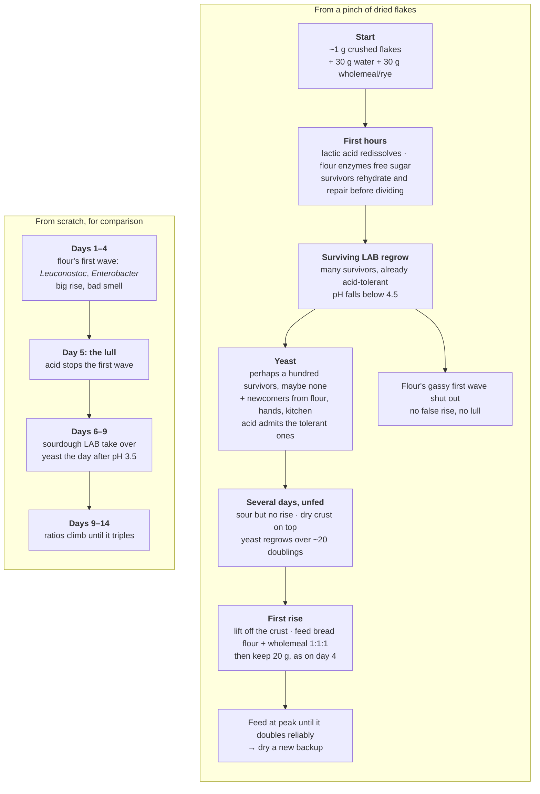

# Starting a Starter From Scratch: The 14-Day Method and What Each Stage Is

> **Context.** Every chapter in this document assumes a working culture already exists. This
> note covers the step before that: making one from flour and water. The method is the one
> actually used here, Kristen of Full Proof Baking's 14-day tutorial, and it is recorded at
> the level of grams and hours so it can be followed at the bench. Alongside it is what the
> literature says is happening in the jar at each stage. Most of the steps that put people
> off, such as the early rise that dies and the smell, turn out to be an ordinary and
> well-documented succession of microbes. A later section covers the other way to get a
> working culture: drying a backup and reviving it.
>
> The method below is taken from the title card she puts up at every feed, which gives the
> day's observations and the feed in grams, and checked against her narration on
> 2026-10-18. Her free companion PDF of day-by-day notes was not read.

---

## The source

- **Video:** [How To Make A Sourdough Starter From Scratch](https://www.youtube.com/watch?v=m6pGkOuZnrk),
  Full Proof Baking, 7 February 2019, 26 minutes.
- **Notes PDF:** free from [her Gumroad page](https://fullproofbaking.gumroad.com/l/hdAXB),
  with timestamps and her answers to common questions.
- **After day 14:** [her maintenance video](https://www.youtube.com/watch?v=beKzcOe6w_o).
- **To print:** the schedule on one A4 page, [starter-cheatsheet.pdf](starter-cheatsheet.pdf)
  ([markdown](starter-cheatsheet.md)).

---

## The method as run in the video

### Setup

- **Flour mix, 30% rye:** 350 g bread flour plus 150 g dark rye, whisked together, 500 g in
  total. Every feed until day 12 uses this mix. In the video these are King Arthur
  unbleached bread flour and Bob's Red Mill whole grain dark rye. She picks rye for its
  nutrients and enzymes, and bread flour for strength. Plain flour also works for the base.
- **Water:** purified or bottled in the video. See *Adjusting it for this kitchen* below.
- **Temperature:** "warm room temperature", 24°C (75°F), for all 14 days. Her target and
  her time-lapse are at 27°C (80°F); see below.
- **Cover:** cheesecloth and a rubber band until day 8, then a loosely fitted lid.
- **Gauge:** a rubber band around the jar at the level of each fresh feed.
- **A fresh jar** on day 2 to keep mould away, and again whenever the jar gets messy.
- **A scale reading to 0.1 g**, tared before each ingredient. The feeds go down to 5 g.

Ratios are **starter : water : flour by weight**, so every feed is at 100% hydration.

### Day by day

"Her notes" is the text of her title card for that feed. Rises are measured against the
rubber band from the previous feed.

| Day | Feed, starter / water / flour | Ratio | Her notes | Video |
|---|---|---|---|---|
| 1 | — / 30 g / 30 g, rest 24 h | — | Prep flour mix, stir together flour and water | 1:50 |
| 2 | Stir and move to a fresh jar, 24 h | — | (Narration: a dried, darker skin on top) | 3:45 |
| 3 | 20 / 20 / 20, the only feed today | 1:1:1 | "Caught some wild yeast" | 4:50 |
| 4 am | 20 / 20 / 20. **Two feeds a day from here** | 1:1:1 | Lots of activity (~3–4×), unpleasant smells | 6:35 |
| 4 pm | 16 / 16 / 16 | 1:1:1 | Again lots of activity, unpleasant smells | 7:45 |
| 5 am | 15 / 15 / 15 | 1:1:1 | **No significant growth!** Very unpleasant smells, very runny | 8:40 |
| 5 pm | 16 / 16 / 16, fresh jar | 1:1:1 | Minimal growth, smelly | 9:45 |
| 6 am | 15 / 15 / 15 | 1:1:1 | 1.2×, less smelly, more mild | 10:35 |
| 6 pm | 15 / 15 / 15 | 1:1:1 | 1.3×, less smelly, more mild | 11:20 |
| 7 am | 15 / 15 / 15 | 1:1:1 | 2×, smells nice, mild, **bit of sour** | 11:50 |
| 7 pm | 15 / 15 / 15 | 1:1:1 | 1.5×, nice mild sour smell | 13:35 |
| 8 am | 15 / 15 / 15. Start collecting (and freezing) discard; loose lid replaces cloth | 1:1:1 | 1.9×, very nice, sweet and sour | 14:05 |
| 8 pm | 15 / 15 / 15 | 1:1:1 | 2× | 14:55 |
| 9 am | 15 / 15 / 15 | 1:1:1 | 2.5× | 15:20 |
| 9 pm | 8 / 16 / 16 | **1:2:2** | Steady 2.5×, increase feed ratio | 15:50 |
| 10 am | 8 / 16 / 16 | 1:2:2 | Steady 2.5×, stick with 1:2:2. (Narration: it had peaked and fallen) | 16:40 |
| 10 pm | 5 / 15 / 15 | **1:3:3** | 2.5×, peaked and fell. "Best to feed at peak!" | 17:20 |
| 11 am | 5 / 20 / 20 | **1:4:4** | 2.5× (narration: at peak, not fallen) | 18:00 |
| 11 pm | 5 / 25 / 25 | **1:5:5** | 2.5× | 18:25 |
| 12 am | 5 / 25 / 25, then **make the 10% rye mix** | 1:5:5 | 2.5×, smells so sweet, with sour notes | 18:55 |
| 12 pm | 5 / 20 / 20, 10% rye mix from here | 1:4:4 | 2.5×, getting more active | 20:25 |
| 13 am | 5 / 25 / 25 | 1:5:5 | 2.5× | 21:00 |
| 13 pm | 5 / 25 / 25 | 1:5:5 | 2.5× | 21:40 |
| 14 am | 8 / 16 / 16. **Three feeds a day from here** | 1:2:2 | 2.5× | 22:15 |
| 14 afternoon | 8 / 16 / 16, about 7 h later | 1:2:2 | 2.5× | 23:10 |
| 14 pm | 10 / 50 / 50, overnight | 1:5:5 | 2.5× | 23:35 |

**The 10% rye mix** (day 12, at 19:20): what is left of the 30% mix weighs 155.5 g and holds
46.5 g rye. Bring the total up to 465 g with bread flour, about 310 g. Her card gives the
reason: more strength, "higher peak, hold peak longer". Her narration expects less rye to cost
some activity, but the first 10% feed still peaked and fell before morning, so she kept the
ratio at 1:5:5.

**Day 14 time-lapse** (24:20), in an oven with the light on at 27°C (80°F), in a jar marked
for 2× and 3×:

| Feed | 2× | Peak |
|---|---|---|
| 1:5:5 | 5 h | 2.9× at 7.5 h |
| 1:2:2 | 4 h | 3× at 7 h |

### Her rules

- **The target:** "more than triple in 4–6 hrs when fed 1:2:2, kept at 80°F", so at
  **27°C, not room temperature**. Her 3.5-year-old starter, Ozzy, is shown against it at 12:40.
  By that measure **the day-14 starter is not there yet**: 3× at 7 h. She calls it "still
  pretty young" and expects it to keep strengthening if it is fed at peak.
- **Week 1** is "catching wild yeast" and "waiting for microbes to balance out". **Week 2**
  is "building starter activity" and "increasing starter strength". A 1-week starter can be
  practised with, but for a proper loaf she wants the second week.
- **Feed at peak.** Feeding a starter that has already peaked and fallen weakens it over time.
  When it peaks well before the next feed is due, raise the ratio. That is the whole of days
  9–13.
- **Fewer than three feeds a day** is fine, but use higher ratios to compensate, up to
  1:10:10 if the starter can take it.
- **Write down** volume increase, consistency and smell at every feed.
- **Storage:** the fridge covers 2–4 weeks with no feed at all. Dehydrated, it keeps for
  years as a backup. See *Drying a backup and reviving it* below.
- Her closing card sums it up: **"Feed at peak! Monitor your starter! Keep it warm!"**

---

## What is happening in the jar

Her schedule follows the laboratory literature closely. Two studies anchor this section.
Van der Meulen et al. (2007) held their doughs at 30°C. Ercolini et al. (2013) fermented
theirs for 5 hours a day at 25°C and held them at 10°C in between. Both refreshed daily.

### Days 1–4: the early rise is bacteria, not yeast

Flour carries a mixed population, mostly *Proteobacteria* such as *Pantoea*, *Pseudomonas*
and *Enterobacter*. Within a day of mixing almost all of it is suppressed except the
*Enterobacteriaceae*, and lactic acid bacteria take over (Ercolini et al. 2013). The first
LAB to dominate are not typical sourdough organisms at all. They are genera such as
*Leuconostoc*, *Lactococcus* and *Enterococcus*, and they fall below detection within the
first day or two at 30°C (Van der Meulen et al. 2007). Rye flour is the exception,
arriving with *Weissella* already dominant (Ercolini et al. 2013).

The gas behind her 3–4× rise on day 4 comes from this first wave. Debra Wink had a day-two
starter analysed by two labs. Both found the gas producer was *Leuconostoc citreum*, with a
little *Enterobacter cloacae*, and neither found any lactobacilli or yeast. She also links
*Enterobacter*, *Aerococcus* and *Leuconostoc* to the bad smell (Wink 2008b).

### Day 5: the lull

As acid builds up, the first wave stops growing. Before the right organisms have built up
numbers, the jar goes quiet. That is her day-5 morning card, "no significant
growth!", with the worst smell of the run.

Wink tracked this with pH paper (Wink 2008a). The gassy bacteria grew at or above pH 5 and
not at or below 4.5. Yeast usually appeared the day after the pH reached 3.5. She also
suggests that *L. citreum* leaves behind bacteriocins that hold back the lactobacilli after
it stops growing, so that a bigger early rise means a longer lull (Wink 2008b). Treat all of
this as careful amateur work. The pH paper read to the nearest 0.5, no replicate counts are
given, and the bacteriocin account is her hypothesis.

The lab data is consistent with it. At 30°C the pH falls below 4.0 after day 2. Yeasts lag
behind the LAB, reaching high numbers (10⁷ CFU/g) after 4–5 days of backslopping, and in
one of four doughs only after 8 days (Van der Meulen et al. 2007).

### Days 6–9: the sourdough consortium takes over

Sourdough-specific LAB such as *Lactobacillus*, *Pediococcus* and *Weissella* replace the
first wave. From about day 5 at 30°C, well-adapted strains dominate and little changes
after that (Van der Meulen et al. 2007). In the 25°C study, maturity arrives in 5–7 days of
propagation, with lactobacilli prominent by day 10 (Ercolini et al. 2013). Her "bit of sour"
on day 7 and her narration's "definite sour notes" on day 9 are this transition, running
about a day behind the 30°C timeline.

### Days 9–14: ratio escalation is about timing, not species

By day 9 the community has largely settled. What remains is matching food to appetite. A
1:2:2 feed that peaks and collapses within 12 hours has run out of food well before the
next feed, and sits in its own acid until then. A higher ratio dilutes the starter further,
so it takes longer to reach peak, and dilutes the acid it carried over. This is the same
dilution lever chapter 11's recovery protocol uses at 1:10:10.

**"Feed at peak" is a practitioner's rule, not a measured result.** The plausible
mechanism is chapter 11's compounding stressors. Past peak, the substrate is spent and acid
and ethanol are at their highest, so a starter that is always fed after collapse is always
fed in its most stressed state.

---

## Where the video and the literature differ

The method works either way. Only the explanations differ.

1. **"Picks up the wild bacteria and yeasts from the air."** The evidence points to the
   **flour**, and then to the baker's hands. Bakers on two continents made starters from
   the same recipe and the same flour. Much of each starter's community traced back to
   the flour, and the differences between starters were associated with the bakers' hands
   (Reese et al. 2020). In established bakery sourdoughs followed over a year, flour was
   the main driver of the LAB population and the bakery's own microbiota played a minor
   role (Minervini et al. 2018). Wink points out that the activity happens even in a
   covered container (Wink 2008a). The cheesecloth does no harm, but it is not
   what inoculates the jar.
2. **Day 3: "We've caught some wild yeast!"** In a two-day-old starter, the rise is
   bacterial (above). Her narration qualifies it straight away as "not the correct
   balance", so the method is unaffected; only the label is wrong.
3. **Day 8: the loose lid because "this is a live culture that requires air".** The yeast
   and LAB ferment without oxygen. The lid needs to be loose so CO₂ can escape, not so air
   can get in.

---

## Adjusting it for this kitchen

### Temperature: warm is fine, hot is not

This kitchen keeps its culture warm and builds it hot (chapters 07–08, and [The Heat-Driven
Levain Bank](heat-driven-levain-bank.md)). **None of that belongs in the first two weeks.**
A new starter is a small, unsettled population, in the same position as the depleted
culture in chapter 11, whose recovery protocol is explicit: feed at 22–25°C and do not add
selection pressure.

Warm is a different matter, and her own method says so: her target is measured at 27°C
and her closing card says "Keep it warm!". Van der Meulen et al. (2007) ran their whole
establishment at 30°C and had a stable culture within a week. Chapter 09 also records why
the starting temperature matters beyond speed. With daily backslopping, 23°C selected for *Leuconostoc
citreum* as the dominant LAB, while 30°C and 37°C selected for *Lactobacillus fermentum*
(Van der Meulen et al. 2011). That is the same species Wink found behind the false start,
so at the video's 24°C the first wave may never fully leave.

So the choice of 24°C or 30°C is a choice of culture, not just of pace. *(Hypothesis:)* a
starter begun around 30°C may suit a warm-maintained regime better from the outset. That is
open tests 1 and 2 below. Either way, wait until it passes her tripling test before any hot build,
and then follow chapter 08's advice: keep the mother at room temperature and build hot from
it.

### Water

The usual reason for bottled water is chlorine. Danish tap water is groundwater and is
normally supplied without chlorination, so tap water should do here.

### Flour

Any bread flour works for the base. The Manitoba used for bread is more than strong enough.
For the rye, use dark wholemeal rye (*fuldkornsrugmel*): the whole-grain fraction is the
point. The same reasoning is why chapter 11 adds wholemeal to a culture in recovery.

### An optional shortcut through the lull

Wink's alternative for days 1–3 replaces the water with **pineapple juice**, or orange juice
or apple cider, to acidify the mix below what the gas producers tolerate. In her trials
yeast appeared on or before day 4, against about day 7 with water (Wink 2008a). She is
clear that it "doesn't change the end result" (Wink 2008b), and wrote later in the same
thread that it is never necessary, "only patience". Applying it
to this method means juice in place of water for the day-1 mix and the day-3 feed. That
combination is this note's suggestion and has not been tried.

---

## Drying a backup and reviving it

Her storage rule says a dried starter keeps for years as a backup. Chapter 11 gives the
reason to keep one: after a heat kill, a backup is the only way back to the original culture,
rather than to whatever the flour supplies. That holds for the bacteria; the yeast may not
come through the drying (*What it skips*). The revival below is the one that worked here in
October 2026, on flakes a year old. A first attempt followed a recipe worked out in a
conversation with Claude in September 2026: a larger amount of flakes, soaked in warm water.
It did not take. *Why a pinch, not a spoonful* gives the likely reason, and the sections
after it correct two other things that conversation got wrong.

### Drying it

- **Spread it thin** on baking paper and leave it at room temperature until it snaps, about
  24–48 h (Country Roads Sourdough). Crumble it and store it airtight, dry, cool and dark.
- **No oven and no warm dehydrator.** Until the film is dry it is a wet culture, and chapter
  11's limits apply: six hours or more at 40–45°C is high risk. The same guide allows a dehydrator only
  below 37°C. Once the film is dry, heat is much less of a threat (below).
- **Which stage to dry is open.** The usual advice is a starter at peak (Country Roads
  Sourdough). *(Hypothesis:)* the literature points later. In *S. cerevisiae*, fewer than
  one growing cell in a million survived air-drying, against 20–40% from cultures that had
  run out of food and stopped growing (Calahan et al. 2011). A starter at peak is running out
  of food, and one that has peaked and begun to fall is further along. The transfer is
  uncertain: the study ties the tolerance to the switch to respiration when sugar runs out,
  a starter jar is short of oxygen, and no sourdough yeast was tested. That is open test 4.

### Reviving it

The method as run here. The amounts are rough estimates rather than weighed, and the method
does not seem sensitive to them.

1. **Start:** crush a good pinch of flakes, around 1 g, into a day-1 mix of wholemeal and
   rye: about 30 g of water and 30 g of flour, half of each. Use water at room temperature or
   a little above, not cold from the tap (*Water: not cold*, below). No separate soak.
2. **Wait, unfed, for several days** at 24–26°C, until it is clearly active. A dry crust
   forms on top. It is the same skin as day 2 of the main method, and does no harm.
3. **Lift off the crust and feed what is underneath**, now with bread flour and wholemeal,
   at about 1:1:1. From the next feed on, keep 20 g and discard the rest, as on day 4.
   Feeding the whole jar every time lets the ratio fall with every feed.
4. **From there, feed at peak** as in the main method. Give it one or two feeds on the usual
   flour before baking with it.
5. **Dry a new backup** from it once it doubles reliably.

**Record** the age of the flakes, roughly how much went in, the water temperature, the day
it first smells sour, and the days of the first rise and the first doubling. Sour without a
rise is the LAB back and the yeast not yet (*What it skips*). Open tests 4–6 need those
numbers.

### What drying does, and what water undoes

A dried starter is not a paused starter. Drying removes some of what was in the jar, keeps
the rest, and kills most of the cells, and rehydration starts from what is left.

| What | Through drying | Why |
|---|---|---|
| Water | Leaves, down to equilibrium with the room | — |
| CO₂ and ethanol | Leave | A gas and a volatile, from a thin film |
| Acetic acid | About half leaves | Volatile: 57% kept through freeze-drying (Kline 1979) |
| Lactic acid | Mostly stays | Not volatile: 85% kept through freeze-drying (Kline 1979) |
| Spent flour: starch, gluten, bran, minerals | Stays | Already part-fermented, so little food is left in it |
| Flour enzymes | Stay, idle until wet | Flour is itself a dry product whose enzymes work once wetted |
| Cells | A minority survive dormant; the rest die | Below |

The acid figures are from freeze-drying, which is fast and cold. Slow air-drying probably
loses at least as much acetic acid. What the flake carries back is therefore mostly lactic
acid, which is why the dose matters (*Why a pinch, not a spoonful*).

**The first hours: still a starter.** A freshly spread film keeps fermenting until it has
lost too much water to grow, so it goes on making acid for a while. As the water goes,
everything dissolved in it concentrates: sugars, salts and acids. The cells face rising
osmotic and acid stress before they are ever dry. This part is reasoning; nothing here
measured it.

**Drying: who survives.** Cells that have stopped growing survive drying far better than
growing ones (Calahan et al. 2011, under *Drying it*). The damage that kills the rest is
mechanical, structural and oxidative (Dupont et al. 2014, for yeast). In LAB, the membrane
is the main site of injury, at the points where it changes phase during drying or
rehydration (Santivarangkna et al. 2008). The two partners do not survive equally. In a
freeze-dried San Francisco starter, 30–45% of the bacterium, *L. sanfrancisco* (now
*Fructilactobacillus sanfranciscensis*), survived with a protective additive, and 0.7%
without. The yeast, then called *Torulopsis holmii*, fell below 0.01%: the
patent calls it "destroyed by freeze-drying" (Kline 1979). Freeze-drying is not air-drying,
and this is a patent rather than a paper. But it is the only sourdough-specific comparison
found, and it points the same way as the revival here: the yeast is the bottleneck.

**The dry flake.** Air-dried flakes end up in equilibrium with the room. Water activity
equals the relative humidity divided by 100 (FDA 1984), so a kitchen at 50% gives about
0.5, far below anything that grows. Metabolism stops. Dried yeast kept at 55% relative
humidity survived 3 months with no loss (Ribert et al. 2021). Losses in storage come mainly
from oxidation of membrane lipids, and temperature and moisture set the rate (Santivarangkna
et al. 2008). That is the reason for airtight, cool and dark.

**Rehydration.** Four things happen at once:

- The lactic acid redissolves. A pinch gives the fresh flour a small dose; a spoonful gives
  close to full-strength starter acid.
- The flour enzymes in the fresh flour, and any left in the flake, start freeing sugar
  again.
- Surviving cells take up water and their membranes pass back through the phase change.
  That is the moment of leakage, worse in cold water (*Water: not cold*).
- Dead cells leak their contents into the mix.

The survivors then need a lag while they repair before they divide. From there the revival
is a race between regrowth and the flour's own microbes, and the next two sections cover
how it goes.

### How the revival unfolds

A map of the sections that follow, set beside the first week from scratch. The timings are
the run here (October 2026). The order of events inside them is the reasoning in *What it
skips*: no pH or counts were taken.

The pinch skips the first two boxes of the from-scratch column, the bacterial half of the
first week: its surviving LAB supply the acid the third box waits for. The yeast still has
to build up.

### What it skips: the first week

From scratch, the first week is a succession (*What is happening in the jar*, above): a
first wave of gassy bacteria rises and collapses, the jar goes quiet and smells, and only
then do the sourdough organisms take over from tiny numbers. The revival here skipped all of
it. It took days, but there was no false start and no lull.

The likely reason is the inoculum. The LAB surviving in the flakes are sourdough organisms
that months of feeding already selected, and they grow well at the acidity they make. They
acidify the fresh flour before its first wave builds up, closing the window Wink measured:
the gas producers grow at pH 5 and above and not at 4.5 and below (Wink 2008a). From scratch,
nothing acid-tolerant is present in numbers, which is why the first wave gets days. This is
reasoning that fits the run here; no pH was measured.

The days it did take were mostly the yeast. Here the revival behaved as if the LAB had come
through and the yeast had to be caught again (October 2026), and the numbers fit that. A
ripe starter holds about 10⁷ yeast cells per gram (Van der Meulen et al. 2007) and far more
LAB. In Kline's starter, drying killed the yeast at least 70 times harder than the bacterium
(below 0.01% surviving, against 0.7%), and a year in storage cost even commercial dried
yeast 94% (Ribert et al. 2021). Applied to a 1 g pinch, about 2 g of starter before drying,
that leaves perhaps a hundred live yeast cells, possibly none. That is one or two per gram of
the fresh mix, over 20 doublings short of a ripe starter (each tenfold is about 3.3, *How
long it keeps*). The LAB start from far more survivors. This is arithmetic on borrowed
figures, not a count: Kline's starter was freeze-dried, and Ribert's yeast was grown to be
dried.

So the yeast in the revived starter may not be the original. Whatever survives in the
flakes competes with yeast arriving the way it does from scratch: with the flour, and from
the baker's hands (Reese et al. 2020; *Where the video and the literature differ*). A kitchen
that kept the starter for years may hold its yeast too. In four bakeries, the sourdough's
dominant yeast also dominated the walls, air, storage boxes and mixers (Minervini et al.
2015). A bakery holds far more flour and dough than a home kitchen, and the study cannot say
which way the yeast moved, so this is a loose analogue. A "new" yeast may be the old one
coming back from the kitchen.

Either way, the yeast does not arrive in a from-scratch jar. The LAB have already acidified
it, and from scratch Wink saw yeast appear the day after the pH reached 3.5 (Wink 2008a). So
the yeast's clock starts at once instead of after a week of bacterial succession, and the
acid favours yeasts that tolerate it. The revival skipped the bacterial half of the first
week, not the yeast half.

For the backup, this means it reliably brings back the bacteria, and perhaps the yeast.
Drying later in the cycle may save more of the yeast (*Drying it*, open test 4). Whether the
yeast now in the jar is the old one is open test 7.

### Why a pinch, not a spoonful

The first attempt here used a larger amount of flakes, soaked in warm water, and did not
take. The pinch did. The likely difference is acid. Flakes are the old starter's flour plus
all of its lactic acid, which does not evaporate in drying. A spoonful in a little water and
flour leaves the survivors in close to full-strength starter acid with little fresh food.
That is chapter 11's dying culture, which its recovery protocol dilutes out at 1:10:10.

A pinch in 60 g of fresh wholemeal and rye is far more dilute than that. It also gives the
survivors plenty of food, and wholegrain flour is what chapter 11 adds for recovery.
Country Roads Sourdough's recipe is the high-dose kind (5 g of flakes into 20 g of water and
20 g of flour) and expects about a week.

Two things changed between the runs, the amount and the soak, so one run cannot separate
them; that is open test 6. The warm soak is the less likely culprit. At 35–38°C for half an
hour it is a brief excursion by chapter 11's standards, unless the water was hotter than
that.

### Water: not cold

The chat advised lukewarm rather than hot water, then put lukewarm at 25–30°C, because the
cells are most fragile in the first minutes as water rushes back in. The fragility is real,
but it runs the other way: the documented hazard is **cold** water.

As a dry cell takes up water, its membrane lipids pass from a gel to a fluid state. If that
happens in cold water, the membrane leaks while it changes state and the cell loses its
contents. This is imbibitional damage. It was measured in pollen, with dry yeast named as a
case of the same mechanism (Crowe et al. 1989). In active dry yeast rehydrated at 0°C
against 40°C, the cold-soaked cells respired and fermented less, their membranes did not
reseal even after hours at 40°C, and few of them grew on plates (Peña et al. 1992).

With a pinch there is no separate soak: the flakes take up water in the mix. So mix with
water at room temperature or a little above, up to about 35°C, then hold the jar at
24–26°C. Cold tap water is the case to avoid. Country Roads Sourdough asks for
room-temperature water and notes only that cold slows things down.

The limits: the mechanism was measured in pollen, and the yeast result is from commercial
*S. cerevisiae* dried pure. Flakes are wild yeast and LAB embedded in flour, which may wet
more slowly and soften the effect. Peña et al. compared 0 with 40°C and say nothing about
20°C. The direction is supported; the size of the penalty at room temperature is not known.
That is open test 5.

### Dry is heat-proof; drying is not

The chat also said dried cells "lose the water that normally buffers them against
temperature", so that their heat tolerance drops. That is backwards, and it contradicts
chapter 11's section on water activity. Dried *S. cerevisiae* kept full viability through
60 min at 75°C, and through 10 min at 100°C at 12% relative humidity (Ribert et al. 2021).
In a wet culture, the D-value is already under a minute at 55°C (chapter 11).

The risk it was reaching for is real, but it belongs to the wet start of drying, not the dry
end. A thin film in a warm oven stays wet for hours, and a wet culture held hot for hours is
chapter 11's territory. The conclusion stands for a different reason: dry it at room
temperature.

### How long it keeps

Her rule says years. The data say it loses ground every month, but slowly enough not to
matter much:

- Air-dried *S. cerevisiae* held about 20% survival over a month (Calahan et al. 2011).
- Dried *S. cerevisiae* at 25°C and 55% relative humidity lost 1.24 log, about 94%, in a
  year (Ribert et al. 2021).
- A spray-dried sourdough powder lost about 2.5 log of both LAB and yeast in 90 days, in the
  best of four packagings (Hajar-Azhari et al. 2024). That sourdough was started from
  kombucha, so it is a loose analogue.
- Here, flakes a year old came back from a pinch in several days (October 2026).

Each tenfold loss costs about 3.3 doublings to make up, so an old backup wakes more slowly
rather than not at all. Chapter 11's point that even a 4–5 log reduction leaves survivors
applies to the LAB. The yeast is less certain. Drying kills it far harder (*What drying does,
and what water undoes*), the revival here behaved as if it had to be caught again (*What it
skips*), and no study found here measured a home-dried starter. So a revival is at least a
small bottleneck of the kind chapter 11 describes under *After Recovery*, and possibly a new
yeast. Replacing the
backup once a year from the live starter, as Country Roads Sourdough suggests, keeps the
storage loss small.

---

## What to record

Her list, plus what [the doubling test](levain-doubling-test.md) learned about making
rubber-band readings comparable:

1. Time, ratio, and the mass of each component
2. Rise at the next feed, read against the rubber band, in a straight-sided jar
3. Smell and consistency
4. **Room temperature, measured** rather than assumed: the stage timings above depend on it
5. *Optional:* pH paper at each feed through days 3–7, which tests Wink's thresholds for
   the price of a strip

---

## Open tests

1. **Start temperature.** Two jars from the same flour and the same day-1 mix, one at room
   temperature and one at 30°C (the chamber can hold it). Compare the day the lull ends,
   the day each first triples at 1:2:2, and the smell. Van der Meulen et al. (2011) predicts
   different dominant LAB.
2. **Does a culture begun at 30°C take to the hot protocol better** than one begun at 24°C?
   Only meaningful once both pass the tripling test, and run on split lineages per chapter 08.
3. **Juice versus water**, Wink's own design: two identical jars, one with juice on days 1–3.
4. **Dry at peak or after it.** Two films from the same jar, one spread at peak and one a few
   hours after it has fallen. Revive equal weights the same way and compare the day each
   first doubles. Calahan et al. (2011) predicts the later film wins.
5. **Water temperature.** Two jars started the same way from the same flakes, one mixed with
   water at 35°C and one with cold tap water, then both held at 24–26°C. Compare the first
   activity and the first doubling. Peña et al. (1992) predicts the cold jar is slower.
6. **Pinch versus spoonful.** Two jars, same flour and same water temperature, one with a
   pinch of flakes and one with 10 g. This separates the two things that changed between
   the failed run and the working one here. The acid account predicts the spoonful is
   slower, and a pH strip at the start of each should show why.
7. **Same yeast or a new one?** No kitchen test separates them. Sequencing the fungal ITS
   region, as Reese et al. (2020) did, from the flakes and from the revived starter would.
   Dead cells keep their DNA, so the flakes still show which yeast the old starter carried.
   A match at species level would not prove the same strain.

---

## Related

- Chapter 03 for what the mature consortium is.
- Chapter 08 for maintaining the mother at room temperature and building hot from it.
- Chapter 09 for temperature as a selection pressure, and the Van der Meulen 2011 result.
- Chapter 11 for the recovery protocol, which is the same problem as a new start at lower
  stakes, for why feeding a collapsed culture costs strength, and for the case for keeping a
  backup.
- [The Levain Doubling Test](levain-doubling-test.md) for making rubber-band readings
  comparable.
- [The Heat-Driven Levain Bank](heat-driven-levain-bank.md) for where a finished starter
  goes next.

---

## References

- Kristen, Full Proof Baking (2019). *How To Make A Sourdough Starter From Scratch*. YouTube,
  7 Feb 2019. https://www.youtube.com/watch?v=m6pGkOuZnrk — The method above, from its
  on-screen title cards and narration.
- Wink D (2008a). The pineapple juice solution, Part 1. *Bread Lines* 16(1), Bread Bakers
  Guild of America; reposted on The Fresh Loaf, 23 Feb 2009.
  https://www.thefreshloaf.com/node/10856/pineapple-juice-solution-part-1 — pH-paper trials
  with water controls. Not peer-reviewed.
- Wink D (2008b). The pineapple juice solution, Part 2. *Bread Lines*, June 2008; reposted
  on The Fresh Loaf, 27 Feb 2009. https://www.thefreshloaf.com/node/10901 — Lab
  identification of a day-two starter; the bacteriocin hypothesis. Not peer-reviewed.
- Van der Meulen R, Scheirlinck I, Van Schoor A, Huys G, Vancanneyt M, Vandamme P, De Vuyst L
  (2007). Population dynamics and metabolite target analysis of lactic acid bacteria during
  laboratory fermentations of wheat and spelt sourdoughs. *Applied and Environmental
  Microbiology* 73(15):4741–4750. — Three-phase succession within a week at 30°C; yeast lag.
- Van der Meulen R et al. (2011). *Applied and Environmental Microbiology* 77(8):2716–2726.
  — Full entry in chapter 25.
- Ercolini D, Pontonio E, De Filippis F, Minervini F, La Storia A, Gobbetti M, Di Cagno R
  (2013). Microbial ecology dynamics during rye and wheat sourdough preparation. *Applied
  and Environmental Microbiology* 79(24):7827–7836. — Flour microbiota, the first-day
  collapse, *Weissella* in rye, maturity in 5–7 days at 25°C.
- Minervini F, Dinardo FR, Celano G, De Angelis M, Gobbetti M (2018). Lactic acid bacterium
  population dynamics in artisan sourdoughs over one year of daily propagations is mainly
  driven by flour microbiota and nutrients. *Frontiers in Microbiology* 9:1984.
- Reese AT, Madden AA, Joossens M, Lacaze G, Dunn RR (2020). Influences of ingredients and
  bakers on the bacteria and fungi in sourdough starters and bread. *mSphere*
  5(1):e00950-19. — 16S and ITS sequencing of starters, flour and bakers' hands; starters
  most resemble the flour and share some species with the hands.
- Minervini F, Lattanzi A, De Angelis M, Celano G, Gobbetti M (2015). House microbiotas as
  sources of lactic acid bacteria and yeasts in traditional Italian sourdoughs. *Food
  Microbiology* 52:66–76. — In four bakeries, the sourdough's dominant yeast also dominated
  walls, air, storage boxes and mixers.
- Country Roads Sourdough. *Dehydrating and Rehydrating Sourdough Starter: A How To Guide*.
  https://countryroadssourdough.com/dehydrating-and-rehydrating-sourdough-starter/ —
  Practitioner recipe for drying and reviving. Not peer-reviewed.
- Calahan D, Dunham M, DeSevo C, Koshland DE (2011). Genetic analysis of desiccation
  tolerance in *Saccharomyces cerevisiae*. *Genetics* 189(2):507–519. — Fewer than one
  growing cell in a million survives air-drying, against 20–40% from saturated cultures;
  respiration before drying is required, trehalose is not.
- Crowe JH, Hoekstra FA, Crowe LM (1989). Membrane phase transitions are responsible for
  imbibitional damage in dry pollen. *PNAS* 86(2):520–523. — The leakage mechanism on
  rehydration; measured in pollen, with dry yeast named as a case of it.
- Peña A, Uribe S, Clemente M, Sánchez N (1992). Rehydration temperature is critical for
  metabolic competence and for membrane integrity in active dry yeast (ADY). *Archives of
  Microbiology* 158(2):75–80. — Rehydration at 0°C against 40°C.
- Ribert P, Dupont S, Roudaut G, Beney L (2021). Effect of devitrification on the survival
  and resistance of dried *Saccharomyces cerevisiae* yeast. *Applied Microbiology and
  Biotechnology* 105(16–17):6409–6418. — Dried yeast survives 75°C for 60 min; 1.24 log
  lost in a year at 25°C.
- Hajar-Azhari S, Mohd Roby BH, Jemain SN, Meor Hussin AS (2024). Sourdough powder:
  physicochemical, microbiological properties and shelf-life stability in different
  package type. *Journal of Food Science and Technology* 61(9):1701–1710. — Storage losses
  in a spray-dried, kombucha-started sourdough.
- Kline L (1979). Freeze-dried natural sour dough starter. US Patent 4,140,800, filed 13 June
  1977, granted 20 February 1979. https://patents.google.com/patent/US4140800A/en —
  Lactic acid 85% and acetic acid 57% retained through freeze-drying; *L. sanfrancisco*
  30–45% recovered with stabiliser, 0.7% without; the yeast below 0.01%. A patent, not
  peer-reviewed.
- Dupont S, Rapoport A, Gervais P, Beney L (2014). Survival kit of *Saccharomyces
  cerevisiae* for anhydrobiosis. *Applied Microbiology and Biotechnology*
  98(21):8821–8834. — Review: mechanical, structural and oxidative damage in drying, and the
  yeast's defences.
- Santivarangkna C, Kulozik U, Foerst P (2008). Inactivation mechanisms of lactic acid
  starter cultures preserved by drying processes. *Journal of Applied Microbiology*
  105(1):1–13. — The membrane as the main site of damage; storage losses from lipid
  oxidation.
- US Food and Drug Administration (1984). *Water Activity (aw) in Foods*. Inspection
  Technical Guide. https://www.fda.gov/inspections-compliance-enforcement-and-criminal-investigations/inspection-technical-guides/water-activity-aw-foods
  — Water activity equals equilibrium relative humidity divided by 100.

---

<!-- nav -->
[Contents](../README.md)
