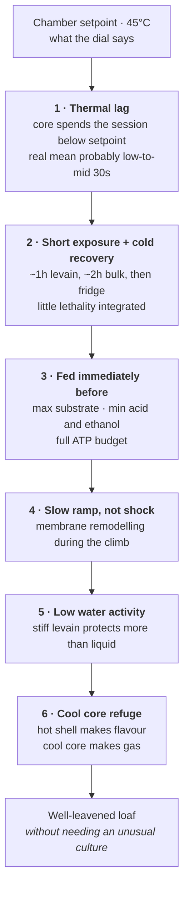

# Why the Hot Protocol Works: Six Ordinary Effects, Not One Exotic Culture

> **Context.** This note answers a question that recurs whenever the hot protocol comes up:
> *why does fermenting well above conventional guidance keep working?* It argues two things.
> First, that the 28°C half of the question dissolves on inspection — nothing is stressed
> there, and the "norm" it violates is a scheduling convention rather than a biological
> limit. Second, that the genuinely surprising half — levain builds and bulk at a 40–50°C
> setpoint — is explained by a **stack of six ordinary effects compounding**, not by the
> culture being unusual. Chapter 08 leaves thermotolerance versus temporal escape open; this
> note takes a position on it, and says what would settle it.

---

## Part 1 — The 28°C question dissolves

At 28°C nothing in the jar is under stress.

*S. cerevisiae* grows optimally around 30–33°C. Most sourdough LAB sit higher still, 30–40°C,
and some are outright thermophilic (ch. 07). A levain at 28°C is not near a limit; it is near
an **optimum**. There is no survival mechanism to explain, because nothing is surviving
anything.

So the question is not "why does 28°C work". It is "why does the usual advice say 24–26°C",
and the answer has nothing to do with microbiology.

### Where the norm comes from

- **Schedule control.** Lower temperature widens the timing window. Advice written for a
  general audience has to forgive a baker who gets home two hours late. This is the largest
  single reason published numbers are conservative — ch. 07 says as much in its opening
  sentence, that the conventional range is "calibrated for schedule predictability and
  consistent leavening, not for optimal flavour".
- **A flavour preference, stated as a rule.** LAB have higher thermal optima than yeast, so
  warmer shifts the ratio: more acid per unit of gas, and more *lactic* relative to acetic.
  The Anglo-American artisan tradition largely chases acetic sharpness, so its conventions
  run cool. That is a taste, not a constraint.
- **It is not even the universal norm.** Italian *lievito madre* is classically maintained
  and refreshed around 28°C, and panettone practice runs 26–30°C as a matter of course. Given
  this document is built around Caputo flour and Italian pizza, the "high" temperature in
  question is the Italian textbook number. It only looks transgressive against a convention
  this document was not following in the first place.

### What is actually traded at 28°C

A narrower timing window, and a rounder, more lactic acid profile. Not viability. Anyone
treating 28°C as risky is importing a constraint from a different tradition's scheduling
advice.

---

## Part 2 — The real question is 40–50°C

This is where ch. 08's paradox lives: a pure sourdough culture, at temperatures the
literature says should inhibit or kill the yeast, producing a well-leavened loaf. Six
effects each contribute, and they multiply rather than add. Ranked by how much explanatory
work each does:

### 1. The culture is not at 40–50°C — thermal lag

The largest deflator, and the cheapest to verify. Ch. 10 establishes that a dough or levain
mass in a plastic container warms by slow conduction, so the core spends much of a short
session well below setpoint. A 75 g jar and a 1 kg tub lag very differently, but both lag.

The honest reading of a "40–50°C" session is probably a **volumetric mean in the low-to-mid
30s** — squarely in the productive stress zone of ch. 07's thermal risk gradient, not the
viability-decline zone. A large part of the paradox is a measurement artifact: the setpoint
was never the exposure.

### 2. Duration, not temperature — and a real recovery window

Ch. 11 is right that thermal death is a rate rather than a threshold. What matters is the
integral of lethality over time, and the protocol integrates very little of it: roughly an
hour for the levain, roughly two for the bulk, each followed by a cold phase.

Structurally this is a **stress/recovery cycle**, and the fridge is a genuine recovery
window — time to resynthesise denatured protein, rebuild trehalose, restore ATP. The single
prolonged session that nearly killed the culture is the control experiment that proves the
point: same temperature, no recovery window, very different outcome.

### 3. Every hot step follows a fresh feed

The levain bank note spots this and calls it accidental. It deserves more weight than that.

Ch. 11's compounding stressors — falling pH, accumulating ethanol, substrate depletion — are
what turn a survivable session into a lethal one, and all three are *time-since-feeding*
variables. A freshly fed culture enters heat with maximum substrate, minimum accumulated
acid and ethanol, and a full ATP budget. The bank build is a fresh feed; the bake-day refeed
is a fresh feed; the dough mix is, from the levain's point of view, the largest feed of all.

Every hot pulse in the protocol lands on a culture in the best condition it will ever be in
to survive one. Nothing in the protocol was designed to achieve this.

### 4. The ramp is protective, not merely imprecise

Guyot, Ferret and Gervais (ch. 11) found *S. cerevisiae* substantially more resistant to a
slow linear temperature increase than to a shock to the same final temperature, with the
resistance acquired principally during the 40–50°C portion of the climb — above the maximum
growth temperature. The mechanism appears to be plasma membrane lipid remodelling rather than
the Hsp104/trehalose route.

A levain placed cold into a hot chamber experiences exactly that ramp. The insulating plastic
container, which ch. 10 frames as a source of imprecision, is doing genuine protective work.
The corollary is a warning: pre-warming the container, or dropping a small levain into an
already-hot water bath, is **harsher than it looks**.

### 5. Water activity — the matrix is a thermal protectant

Microbial heat resistance rises sharply as water activity falls. Dough and levain are
low-water-activity matrices, and a stiff levain is a lower one than a liquid levain. This is
developed in chapter 11; the practical consequence is that the stiff/liquid choice of
chapter 04 has been buying thermal protection alongside its acetic/lactic effect, invisibly.

### 6. The cool core is where the leavening comes from

Ch. 10's dual-zone framing explains the thing that ought to be impossible: the hot shell runs
as an LAB flavour reactor while the cool core runs as a yeast-friendly leavening zone. Gas
production survives because part of the mass was never hot enough to lose it.

---

## Part 3 — The position

**The stack is sufficient. The culture is probably ordinary.**

Six ordinary effects, each worth a few degrees of effective exposure or a few-fold in
survival, compounding, is a complete explanation. Nothing in the observed results requires a
Kveik-grade domestication story.

Chapter 08's Hypothesis 1 (genuine thermotolerance) and Hypothesis 2 (temporal escape) are
posed there as alternatives. On this reading they are not symmetric: **temporal escape,
augmented by the five other effects above, is doing nearly all the work**, and whatever
thermotolerant selection has occurred is a small additional term rather than the explanation.
That is a bet, not a finding, and it is stated here so it can be proved wrong.

The Kveik parallel of ch. 09 remains a sound *mechanism* — serial passage under thermal
selection does reshape a culture. The claim being resisted is only that it is the reason
*this* protocol works.

### Why "it works" is weak evidence

A 90% population kill still leaves enough yeast to leaven a loaf. Failure is only visible at
the point of near-total collapse, which means **years of success are consistent with
routinely taking heavy losses that were never observed**. Ch. 11's diagnostic table is the
tell: sharp acidity with no gas is the characteristic failure, and it arrives abruptly.

That is exactly what the one prolonged session produced. The protocol had not been safe and
then become unsafe; it had been running closer to the edge than the results suggested, and
one change removed the margin.

---

## What would settle it

Three tests, cheapest first. All three are now instrumented rather than argued — see
[`chamber/`](../chamber/).

1. **Log the jar core during a hot build.** The levain bank note already names this as its
   first open test. It measures effect 1 directly, and effect 1 is the largest term in the
   stack. If a 75 g jar genuinely tracks the setpoint while a 1 kg tub does not, the two are
   in different thermal regimes and should stop being discussed as one protocol.
2. **Does the levain double during a hot build?** Ch. 08's own proposed test. Doubling means
   the yeast are *reproducing* at temperature — that is Hypothesis 1, and it would falsify
   the position taken above.
3. **Extend the hot bulk until leavening fails.** If failure is abrupt somewhere between 4
   and 8 hours, temporal escape is confirmed. If the dough tolerates 8 hours, the culture is
   genuinely thermotolerant and this note is wrong.

Test 2 is the decisive one and the least expensive. It has not been run.

---

## Related

- Chapter 07 for the thermal risk gradient and the admission that conventional ranges are
  calibrated for schedule rather than flavour.
- Chapter 08 for the original protocol and the thermotolerance versus temporal escape
  question this note takes a position on.
- Chapter 09 for the Kveik domestication mechanism.
- Chapter 10 for thermal lag, the gradient, and the dual-zone bioreactor.
- Chapter 11 for thermal death kinetics, the ramp effect, water activity, and the compounding
  stressors.
- Chapter 04 for the stiff/liquid hydration choice that turns out to carry a thermal
  consequence as well as a flavour one.
- [The Heat-Driven Levain Bank](heat-driven-levain-bank.md) for the protocol as currently run,
  and the fresh-feed-before-every-hot-step observation.

---

<!-- nav -->
[Contents](../README.md)
